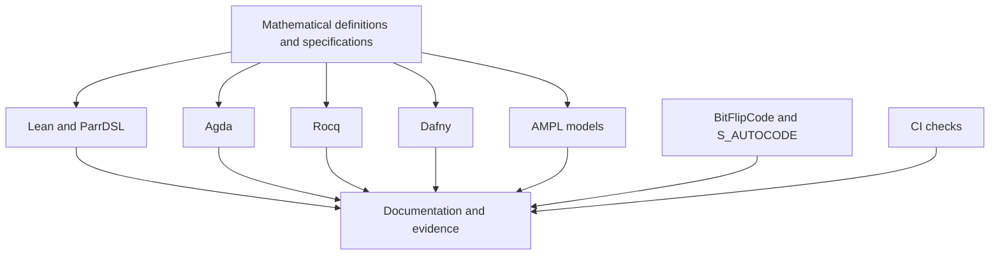
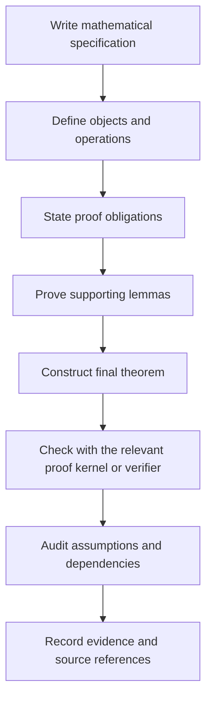
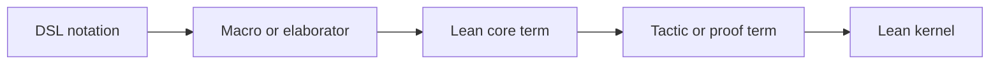
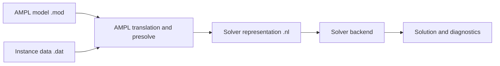
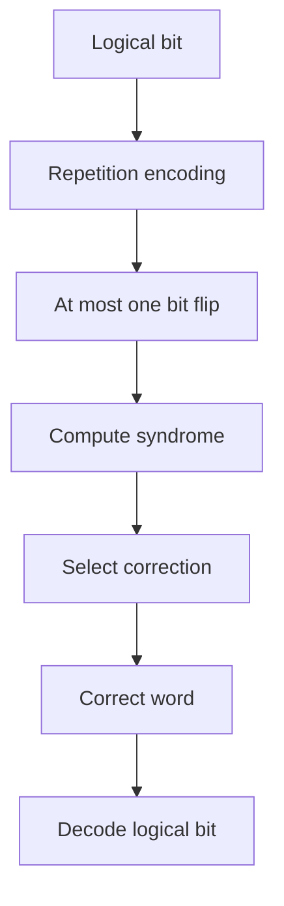
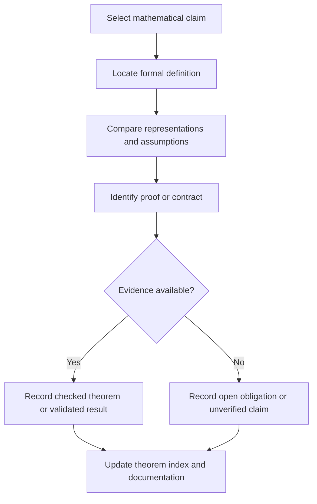

# Repository Architecture, Proof Methodology, and Module Reference

**Repository:** `AHMADALIPARR`  
**Branch described:** `main`  
**Scope:** Formal methods, mathematical modeling, domain-specific languages, and bit-level computation

## Overview

This repository brings together mathematical models, proof-assistant developments, verification contracts, a Lean-based domain-specific language (DSL), and bit-level computation. Its organization follows the mathematical problem and the formal language used to express it, rather than placing every experiment behind one universal compiler or proof engine.

The repository has five broad areas: CI configuration in `.github/workflows/`; mathematical models in `AMPL/`, `Quantum/`, and `RiemannMetatron/`; formal developments in `Agda/`, `Rocq/`, `Dafny/`, `GKN/`, and the Lean-based `ParrDSL/`; bit-level and autocode material in `BitFlipCode/` and `S_AUTOCODE/`; and documentation and licensing in `docs/` and `LICENSE`.

## Repository map

| Path | Category | Responsibility |
| --- | --- | --- |
| `.github/workflows/` | Automation | CI definitions and automated checks |
| `AMPL/` | Optimization | Algebraic models, parameters, objectives, constraints, and data |
| `Agda/` | Formal proof | Constructive definitions and dependent-type proofs |
| `BitFlipCode/` | Bit-level methods | Bit-flip transformations, syndromes, and recovery properties |
| `Dafny/` | Deductive verification | Functions, methods, contracts, invariants, and verification obligations |
| `GKN/` | Mathematical core | Algebraic definitions and theorem developments |
| `ParrDSL/` | Lean DSL | Syntax, elaboration, tactics, automation, and model representation |
| `ParrDSL.lean` | Lean entry point | Top-level module exposing the DSL |
| `Quantum/` | Mathematical modeling | Finite spectra, partition functions, and related quantum models |
| `RiemannMetatron/` | Analytic mathematics | Spectral, zeta-related, and logit-gate constructs |
| `Rocq/` | Formal proof | Rocq/Coq specifications and theorem proofs |
| `S_AUTOCODE/` | Autocode and numerics | Low-level mathematical representations and numerical witnesses |
| `docs/` | Documentation | Specifications, theorem indexes, figures, and reference material |
| `LICENSE` | Governance | Legal terms for reuse and redistribution |

### Architecture diagram

The arrows express a **documentation and conceptual organization**, not verified automatic translations between languages. Cross-language equivalence is a separate theorem or contract to establish.

## Design principles

### Separate mathematical meaning from verification evidence

A formal repository needs distinct categories for the objects it defines, the properties it claims, and the evidence it supplies.

| Category | Meaning | What establishes confidence |
| --- | --- | --- |
| Definition | Introduces a mathematical or computational object | Inspection of the actual definition and its domain |
| Specification | States expected behavior or invariants | Precise preconditions and postconditions |
| Theorem or lemma | States a proposition with a proof | Successful checking of the proof term in its formal system |
| Axiom or assumption | Introduces an unproved premise | Explicit disclosure and dependency tracing |
| Verification obligation | Property a verifier must discharge | A recorded successful verification result |
| Numerical witness | Demonstrates behavior for particular inputs | Reproducible computation and tolerance criteria |
| Generated artifact | Material produced from another representation | Provenance and validation of its output format |

A test result cannot substitute for a universal theorem. Conversely, a formally valid theorem may establish a weaker proposition than its name suggests. The statement and its assumptions are authoritative.

### Conceptual proof flow

### Why use multiple formal languages?

Agda, Rocq, and Lean support dependent types and machine-checkable proof terms, but they have different libraries, automation, and language ergonomics. Dafny focuses on program contracts and automated deductive verification. AMPL expresses optimization problems for numerical solver backends. None of these roles requires every mathematical claim to be duplicated across every language.

Cross-language work becomes meaningful when its definitions, sign conventions, normalization factors, indexing choices, and assumptions are compared explicitly. A theorem proved over one representation is not automatically a theorem over a differently defined representation.

## Module reference

### 1. `.github/workflows/` — continuous integration

Workflow definitions describe which toolchains are configured and what checks run on repository changes. CI should distinguish successful compilation, theorem checking, test completion, and optional external-solver availability.

| Review item | Expected documentation |
| --- | --- |
| Toolchain setup | Exact versions and reproducible installation instructions |
| Build step | The commands actually used by the workflow |
| Proof checking | The theorem modules included in the build |
| Failure handling | Which failures are fatal and which are optional |
| Artifact retention | Logs or generated evidence available for review |

A build workflow for Lean does not automatically validate the Agda, Rocq, Dafny, or AMPL directories. Describe only the checks that the workflow actually performs.

### 2. `Agda/` — constructive proofs and dependent types

Agda supports proofs-as-programs, inductive families, structural recursion, and dependent pattern matching. Its type checker validates the internal consistency of definitions and proof terms relative to their assumptions.

Key review points include termination and positivity checks, module-name alignment, explicit assumptions, equational reasoning, and the distinction between an inhabited record of proof obligations and an unfilled record type. A field specifying a required proof is not itself a supplied proof.

When documenting Agda code, show the exact proposition type and explain any relevant pattern matches, recursion measures, and premises. Keep holes and postulates visible in an assumption inventory when present.

### 3. `Rocq/` — proof developments in the Calculus of Inductive Constructions

Rocq (formerly Coq) provides inductive types, modules, typeclasses, proof terms, and tactics such as `intros`, `induction`, `rewrite`, `ring`, and `lia`. Its checker validates completed theorem proofs relative to their environment.

A theorem reference should include the statement, supporting lemmas, proof method, and assumptions. `Print Assumptions` is useful when auditing reliance on classical principles or explicitly declared axioms. The presence of `Qed` marks a closed proof script in source, but an actual successful check is the evidence that the file is accepted by a particular toolchain.

### 4. `Dafny/` — contract-driven program verification

Dafny uses `requires`, `ensures`, loop `invariant`, framing clauses, and termination measures to express and check program behavior. Verification normally uses an SMT-backed workflow.

| Construct | Engineering purpose |
| --- | --- |
| `requires` | Defines a valid input domain |
| `ensures` | Specifies the required result |
| `invariant` | Preserves a loop property across iterations |
| `decreases` | Supports termination reasoning |
| `lemma` | Packages reusable logical reasoning |
| Ghost code | Supports verification without becoming ordinary runtime logic |

The presence of a method contract, including a lemma with an empty body, is not evidence of a successful verifier run. Record verifier results separately. For complex proofs, intermediate assertions and small lemmas make proof obligations more understandable and reduce solver instability.

### 5. `GKN/` — mathematical core

The `GKN/` workspace contains the repository's specialized algebraic objects, formal definitions, and theorem developments. Its exact exports must be read from the source, not inferred from the folder name.

For each major algebraic operation, document the ground ring or field, input structure, output type, equation, and assumptions. For example, homogeneity claims should specify both the scalar action and the degree of the polynomial:

$$
F(c \cdot x) = c^d F(x).
$$

If parallel formalizations use different signs, scalar pairings, or restricted subalgebras, document the distinction in a comparison table before discussing their proofs together.

### 6. `ParrDSL/` and `ParrDSL.lean` — Lean DSL

Lean 4 combines functional programming, dependent type theory, macros, elaboration, tactics, and kernel-checked propositions. The root `ParrDSL.lean` serves as the entry-point module for the domain-specific language material.

The DSL may provide surface notation, transformations into core Lean terms, specialized tactics, theorem wrappers, or modeling structures. The important semantic boundary is between **notation expansion**, **proof construction**, and **proof checking**. Convenient syntax does not create a new theorem; a tactic may construct a proof term, which Lean's kernel subsequently checks.

Document a notation with its exact expansion, a tactic with the lemmas it may invoke, and a theorem wrapper with the underlying theorem it references. If the DSL also emits AMPL-style text, distinguish text generation from solver validation.

### 7. `AMPL/` — mathematical programming

AMPL represents constrained optimization using sets, parameters, decision variables, objectives, and relations. Its common file types separate the mathematical model from the numerical instance and solver command sequence.

| Extension | Contents | Role |
| --- | --- | --- |
| `.mod` | Sets, parameters, variables, objectives, and constraints | Model specification |
| `.dat` | Numerical parameters and indexed data | Concrete problem instance |
| `.run` | Load, solve, and report commands | Solver workflow |
| `.nl` | Solver-facing optimization representation | Intermediate exchange format |

When auditing a model, verify that summation indices match their declared sets, parameters are defined for the active instance, domains and units are consistent, and the objective has the intended sign. Distinguish the result of solving one numerical instance from a theorem about every admissible instance. A hand-authored `.nl` sketch is not equivalent to translator-generated solver input unless compatibility has been checked.

### 8. `Quantum/` — finite-spectrum and quantum mathematics

Quantum-oriented material should define state conventions, energy spectra, observables, normalization, and the algebraic assumptions behind each equation. Exact symbolic statements and numerical approximations need separate evidence.

For a finite energy spectrum, a common starting point is the partition function

$$
Z(\beta) = \sum_{i=1}^{n} e^{-\beta E_i},
$$

with Gibbs weights

$$
p_i(\beta) = \frac{e^{-\beta E_i}}{Z(\beta)}.
$$

For a nonempty finite spectrum of real energies, the exponential terms are positive, so $Z(\beta) > 0$ and the probabilities sum to one. Actual repository theorems must still be identified by their precise formal statements and dependencies.

### 9. `RiemannMetatron/` — analytic and spectral structures

This directory covers analytic, spectral, and related mathematical constructions. Separate known identities from conjectural relationships and from numerical experiments. For zeta-function or spectral-gap work, clearly state complex domains, normalization conventions, ordering assumptions, and any limiting process.

A name such as `conjecture` does not establish a theorem of the intended conjecture: inspect the formal conclusion. In particular, a proof of `True` is only a proof of `True`, irrespective of the declaration's descriptive name.

### 10. `BitFlipCode/` — bitwise operations and recovery

Bit-level proofs require unambiguous bit positions, syndrome conventions, error models, and recovery procedures.

A single-bit error at position $i$ changes only one coordinate. A recovery claim should specify the index domain and show that applying the correction and decoding returns the original logical bit for each admitted error.

The syndrome can encode equality or inequality of adjacent bits; these conventions give complementary bit patterns. Document the exact convention before comparing results across languages. A three-qubit bit-flip repetition code protects against the specified bit-flip error class; it is not, by itself, a code correcting arbitrary single-qubit Pauli errors.

### 11. `S_AUTOCODE/` — generated or low-level mathematical artifacts

This workspace contains autocode-oriented mathematical representations, transformations, and computational witnesses. Distinguish structural definitions from algorithms, direct numerical evaluation from assertions, and formal proofs from axiomatized properties.

If computations use machine floating point, ordinary ring laws do not automatically hold without regard to rounding and exceptional values. Document precision, evaluation order, admissible ranges, and comparison tolerances. A printed ratio or diagnostic is useful evidence for one input, but it is not an assertion over all inputs.

### 12. `docs/` and `LICENSE` — evidence, references, and governance

Technical appendices belong under `docs/` when they need more space than the root README: theorem registries, mathematical specifications, source maps, diagrams, and audit records. Prefer exact source paths and symbol names, and update references when source declarations move.

`LICENSE` governs copying, modification, and redistribution. Consult its actual text and retain required attribution when combining third-party material.

## Detailed engineering conventions by subsystem

### Continuous integration: what a check actually establishes

A CI badge by itself is insufficient to establish the scope of verification. Every workflow should be read as a sequence of explicitly configured actions. A job that installs Lean and invokes Lake establishes whether the selected Lean targets build under that environment. It does not imply that a Rocq `.v` file, an Agda `.agda` file, a Dafny `.dfy` file, or an AMPL `.mod` file has been checked. Each language needs its own command and an associated recorded result to support such a statement. Where a pipeline includes a command with failures explicitly tolerated, that command should be distinguished from a mandatory gate. Toolchain versions, dependency revisions, enabled build targets, environment variables, and accepted exit statuses all belong in the engineering record.

A useful failure report identifies the exact source revision, the job and step, the relevant diagnostic, and the point where checking stopped. If an import cannot be resolved, that is a build-environment failure until further evidence identifies a source defect. If a proof obligation remains open, that is different from a syntax error. If an optimizer reports infeasibility, that is different again from its inability to read a model file. Keeping these failure classes separate prevents documentation from turning one red CI indicator into an unsupported conclusion about the whole repository.

### Dependent type theory: preserving proof meaning

For Agda, Lean, and Rocq, proof-oriented documentation starts with the proposition's exact type. Informal mathematical notation helps a reader, but it must preserve the formal binding of variables, implicit parameters, typeclass assumptions, and any local hypotheses. A proof of a statement parameterized by a record of algebraic laws depends on that record. It is not automatically a proof that a particular concrete structure satisfies those laws. Likewise, a result restricted to a diagonal subalgebra should not be presented as a universal identity over an entire nonassociative algebra.

Inductive proofs deserve a description of the induction principle and the changing hypothesis. For a list theorem, name the base case and show why the cons case follows from the induction hypothesis. For a finite-index theorem, describe whether the proof uses exhaustive cases, a decidability procedure, or a general invariant. For algebraic normalization, identify the laws required by the tactic: commutativity, associativity, distributivity, or ordered-field properties. The checker validates a proposition in its actual environment, not the broader intuition implied by its theorem name.

### Dafny: contract boundaries and algorithm refinement

A Dafny contract is a formal interface between caller and callee. The precondition identifies the states in which the operation may be invoked; the postcondition identifies the states the operation must produce on normal completion. Frame specifications constrain which locations may change, and loop invariants connect a finite body of code to a general property over all iterations. In a sound review, each invariant should be meaningful before the first iteration, preserved by the body, and strong enough to imply the required postcondition when the loop terminates.

When mathematical definitions are translated into imperative algorithms, document the abstraction relation between the program state and the mathematical object. A program's array of coefficients may represent a polynomial, a matrix, a quantum state, or a set of bounds. The contract should explain the representation and preservation requirements, not just assert a numeric outcome. Termination arguments are equally important: a decreasing integer quantity must be bounded appropriately, while more involved algorithms may use lexicographic measures. A contract with insufficient evidence remains a proof obligation even when its syntax is valid.

### AMPL: model semantics, presolving, and result interpretation

AMPL-style modeling separates abstract structure from particular values. An indexed constraint can expand into many concrete constraints after data is loaded; therefore the number of named declarations in a `.mod` file is not necessarily the number of rows a solver receives. Before interpreting an optimizer's result, confirm the model's effective variables, bounds, objective direction, constraints, and any presolve transformations. Constraints depending only on parameters can act as consistency checks for the selected data instance, rather than restricting decision variables.

For nonlinear optimization, a solver's success status should be reported with its meaning: a local stationary solution, a feasible point, a global optimum under additional guarantees, or another status. Numerical tolerances matter, particularly around equalities, singularities, and functions defined piecewise. If model output is serialized to `.nl`, distinguish an actual translator-produced representation from an illustrative sketch. A readable description of an intermediate format is valuable documentation, but it is not a substitute for a parser-compatible artifact.

### Bit-level reasoning: representation contracts

Bit-level interfaces need precise treatment of ordering and encodings. If three bits are stored as a function on `Fin 3`, the index domain is formal and finite. If they are stored in a machine word, the bit-position convention, shifts, width, and overflow behavior must be stated. The phrase “flip bit one” is not sufficiently precise unless the indexing base and orientation are known. Syndrome conventions must specify what each Boolean signifies: equality of adjacent coordinates and XOR of adjacent coordinates express complementary conditions, even when their correction maps ultimately restore the same codeword.

Exact recovery should be expressed as a composition of encode, corruption, syndrome, correction, and decode operations. The admitted error class must appear in the statement. A proof for at most one bit flip is not a proof for arbitrary corruption or arbitrary quantum errors. The same caution applies to low-level numeric witnesses: observing an expected output for a fixed set of states does not establish a universal equivalence. Those distinctions make bit-oriented work reviewable without overstating its guarantees.

### Autocode: preserving semantics across representations

Autocode can serve as a concrete mathematical implementation, a code generator, or a diagnostic harness; these are different responsibilities. A generator produces artifacts, a checker validates claims, and a witness prints or records observed values. When a mathematical object is moved from exact real or ring reasoning into floating-point arithmetic, associativity and distributivity can fail in ordinary machine computation because of rounding, underflow, overflow, and exceptional values. Any claim of semantic preservation therefore needs an explicit numeric model and stated tolerances, or a representation that retains exact arithmetic.

Generated source should identify its input representation, output format, naming conventions, and deterministic ordering rules. If two backends share a theorem statement, describe the translation of types and operations between them before asserting their equivalence. A successful emission step establishes that a file was produced; it does not establish that the file is accepted by a compiler or that its behavior matches the mathematical source. This is especially important for hardware-oriented or optimizer-facing backends, where interface compatibility and mathematical correctness are separate obligations.

## Documentation traceability model

Every significant claim should be traceable in both directions: from the README to the source declaration, and from the source declaration to the section that describes it. A theorem index should record the theorem identifier, language, defining file, hypotheses, conclusion, proof dependencies, explicit axioms, and the evidence available for its current revision. A file inventory should record every tracked path separately from temporary generated files. Diagram labels should match documented modules rather than imply components that exist only as future plans.

The best architectural diagrams expose boundaries, not merely clusters of boxes. Draw a connection only when a corresponding dependency, data exchange, or mathematical mapping exists. If an arrow represents a conceptual review relationship instead of a functioning compiler transformation, name it accordingly. In the same way, a comparison table should state whether two language implementations use identical equations, equivalent equations under assumptions, or merely related mathematical themes. This approach turns documentation into a practical review aid rather than an attractive but ambiguous map.

A technical README should also preserve provenance over time. Record the source revision associated with a theorem catalog or numeric example, and keep numerical inputs next to the claimed outputs or link directly to the exact instance file. Proof status is revision-specific: a later change to a definition can invalidate the meaning of a previous result even when a theorem retains its name. Clear cross-references, source paths, and revision records let readers identify such differences without guessing.

### Documentation quality gates

| Gate | What to inspect | What passing means |
| --- | --- | --- |
| Markdown structure | Headings, tables, code fences, links | The document remains readable and parsable |
| Mermaid structure | Diagram declarations, labels, edges | The diagram source has a coherent graph definition |
| Source references | Relative paths and cited identifiers | References correspond to the documented revision |
| Theorem inventory | Declaration list versus catalog | No intended theorem is omitted |
| Assumption inventory | Axioms, hypotheses, record fields | Important premises remain visible |
| Mathematical notation | Quantifiers, signs, indices, domains | Informal equations faithfully reflect formal statements |
| Verification record | Tool, version, command, result | Claims of checking have identifiable evidence |

These gates are independent. Balanced Markdown fences do not establish that a Mermaid renderer accepts a diagram. Valid SVG or Mermaid syntax does not establish that a diagram faithfully depicts the architecture. An accepted theorem does not establish that an unrelated solver model implements the same definition. Each gate answers its own narrow question and should be reported without implying that all the others passed.

## Cross-system correspondence

The architecture is best understood as several formal representations of related mathematical ideas, **not** as an automatically certified translation chain.

| Question | Required evidence |
| --- | --- |
| Do two languages define the same operation? | Side-by-side equations, types, and domain conventions |
| Is a theorem proved in a particular prover? | Accepted proof term or verifier result |
| Is a solver model faithful to the mathematics? | Translation contract or validated correspondence |
| Does a numerical residual establish invariance? | Only for the tested instance and specified tolerance |
| Does code generation preserve meaning? | A semantic-preservation theorem or equivalent checked contract |
| Does CI cover a module? | A workflow step that actually checks it |

### Evidence-oriented review flow

## End-to-end proof and verification methodology

### Step 1 — State the exact claim

Write the mathematical proposition before choosing a tactic or backend. Identify the quantifiers, admissible domain, preconditions, normalization conventions, and desired conclusion. Review boundary cases such as zero elements, empty collections, and degenerate indices.

### Step 2 — Separate definitions from helper facts

Introduce minimal definitions and prove reusable algebraic lemmas before the final result. A homogeneity result, for example, should build on explicit scaling laws for the component operations, rather than silently relying on a desired property of the entire expression.

### Step 3 — Construct the proof

Choose induction, rewriting, finite case analysis, algebraic normalization, or contract-based verification according to the proposition. Use the native source language directly. Keep proof scripts readable enough that a reviewer can see the role of each supporting lemma.

### Step 4 — Audit assumptions and termination

List axioms and assumptions on which the final result depends. Check termination or productivity of relevant recursive definitions. Distinguish a theorem derived from an axiom from an unconditional theorem over the intended mathematical structure.

### Step 5 — Compare against concrete examples

Use representative examples to detect mistaken specifications, incorrect sign conventions, indexing errors, or unexpectedly weak conclusions. Examples support review; they do not replace universal proof.

### Step 6 — Check and record evidence

Use the checker or solver appropriate to each changed component, where available. Capture the relevant command, toolchain version, acceptance result, and source revision. Record unavailable checks explicitly instead of implying that every formal language has been validated by a single CI workflow.

## Review criteria for a research repository

A research repository should allow an independent reviewer to answer three questions without relying on the author's interpretation: What is the exact mathematical claim? Which source statement expresses it? What evidence establishes that statement? The README should make those answers easy to find. A formal theorem needs its quantified variables and premises, not only a friendly English title. A computational example needs its inputs, representation, and output interpretation. A claim about a numerical optimizer needs a solution status and tolerances if the claim depends on numerical feasibility. A claim about a compiler needs a definition of what it preserves as it translates between representations.

The separation between these questions matters most when a project combines different foundations. Lean, Agda, Rocq, Dafny, and AMPL do not share a universal proof kernel or a universal mathematical semantics. Their common subject may be a mathematical expression, but shared names do not force shared definitions. To compare two versions rigorously, write both equations, align the dimensions and types, establish matching conventions for signs and normalization, and define the relation that maps one representation onto the other. Only after those steps can a correspondence proof make sense. If those steps uncover a mismatch, document it precisely; do not alter the source simply to make the documentation look uniform.

The same discipline applies to maintenance. A change to an underlying definition may leave an interface name unchanged while shifting the meaning of downstream results. Source review should therefore compare the mathematical statement before and after a modification, inspect imported facts, and recheck any affected theorem or model. The documentation record should say what changed and what was revalidated, without treating a repository-wide summary as a substitute for concrete evidence. A successful engineering review is one in which the reader can reconstruct the reasoning and reproduce the relevant checks from the information supplied.

## Contribution and maintenance guidelines

Keep changes focused on a coherent mathematical or computational unit. Use names that describe the property established rather than the anticipated importance of a result. Preserve build reproducibility through versioned toolchain configuration and clear run instructions. Maintain the theorem catalog and cross-language correspondence tables alongside source changes.

Proof documentation should always distinguish a statement from its evidence. This keeps exploratory research, implementation work, and established results usable together without blurring their respective guarantees.

### New-module checklist

- [ ] Place the module in the appropriate directory.
- [ ] Confirm imports, namespaces, and module naming conventions.
- [ ] Document exact types, domains, indexing, and sign conventions.
- [ ] State all preconditions, invariants, and assumptions explicitly.
- [ ] Identify helper lemmas and theorem dependencies.
- [ ] Inspect for unintended axioms, holes, or vacuous conclusions.
- [ ] Record applicable checker, compiler, or solver results.
- [ ] Update diagrams, inventory tables, and documentation links.
- [ ] Confirm CI coverage only for jobs that actually include the module.

