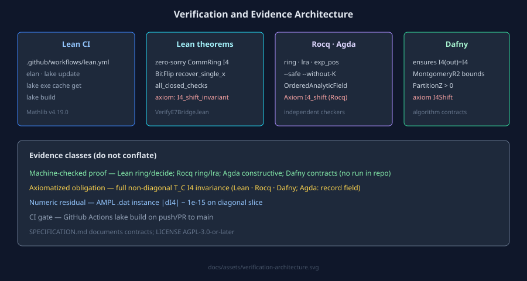

<!-- Copyright (c) 2026 Ahmad Ali Parr / Bel Esprit D'Accord Irrevocable Trust (EIN 42-697643).
     Released under the GNU Affero General Public License v3.0 or later.
     See the file LICENSE for details.
     Authors: Ahmad Ali Parr
     BOW-Ω-φ-∂-2026 -->

# Parr Conjecture — GKN–E7 Bridge

## 1. Project title and technical abstract

This repository is a multi-prover formal development of the GKN–E7 bridge: the exceptional Jordan algebra $J_3(\mathbb{O})$, the 56-dimensional Freudenthal triple system $\mathfrak{M}(J_3(\mathbb{O}))$ carrying the quartic invariant $I_4$ of $E_{7(7)}$, a $[[3,1,3]]$ bit-flip quantum error-correcting code, a finite-spectrum partition function with its Legendre–Fenchel duality, a logit-gate Gibbs model, and the Montgomery pair-correlation kernel $R_2$. The same bridge is implemented five times, in five different formal systems: Lean 4 with Mathlib, Agda in `--safe --without-K` mode, Rocq (Coq) over the standard real numbers, Dafny as algorithm contracts, and AMPL as a nonlinear optimisation model with a concrete numerical instance. A sixth component, ParrDSL, is a Lean domain-specific language that adds surface notation and tactics for the Lean development and a modelling layer that pretty-prints AMPL-style models from Lean. A seventh component, `S_AUTOCODE/MTheory.lean`, is a floating-point autocode layer containing a second Freudenthal system, a degree-6 invariant on a 108-dimensional state, a relocation/permutation layer, and a compiler-pipeline structure.

The mathematical scope of the repository is the algebra of the exceptional Jordan algebra and its Freudenthal triple system, the homogeneity and symmetry properties of the quartic invariant, the exact recovery property of the three-bit repetition code, the positivity and duality properties of finite partition functions, and the elementary analytic properties of the Montgomery kernel. The computational scope is the formalisation of those objects in five proof systems with different notions of evidence, plus a numerical optimisation model that turns the bridge contracts into constraints on a single concrete data instance. The principal architectural contribution is not a single proof but the parallel development itself: the same definitions are carried across systems whose evidence differs in kind, so that a reader can see, for each contract, whether it is proved by computation, proved by rewriting, held as an axiom, held as an unfilled record field, stated as a Dafny contract for a verifier, or checked only as a numerical residual on one data point.

Three facts about this repository must be stated before anything else, because every later section depends on them. First, the name $I_4$ denotes three different functions in this repository. The Lean development in `GKN/I4_CommRing.lean` defines $I_4$ with a positive square and a minus sign on the adjoint-trace term; the Rocq, Agda, Dafny, and AMPL versions define it with a negative square and a plus sign on the adjoint-trace term; and `S_AUTOCODE/MTheory.lean` defines a third function, `I4_56`, with the positive square but with the $\alpha$/$\beta$–norm pairing swapped. Section 3 states all three formulas exactly as written, with their sources, and the theorem catalog always names which function a theorem is about. Second, the full $E_{7(7)}$ shift invariance $I_4(T_C s) = I_4(s)$ is not proved anywhere in this repository. It is an axiom in Lean, Rocq, and Dafny, and an unfilled record field in Agda, and the Lean and Rocq axioms are about different shift maps, because the Lean shift omits the Freudenthal cross product. Third, there are no `sorry` or `admit` tokens in any Lean file in this repository, and no `postulate` in the Agda file. The gaps in the development are carried openly as axioms, as unfilled record fields, as Dafny lemmas with empty bodies, as a vacuous `True` theorem, and as a hand-structured `.nl` sketch, and this README names each of them where it occurs rather than folding them into a single verdict.

The repository contains 37 tracked files, 9,595 lines, 439,501 bytes. The Lean development is the largest part: 71 theorems, 57 lemmas, and 6 axioms. Rocq contributes 11 theorems, 9 lemmas, and 1 axiom. Agda contributes 12 proved propositions and 0 postulates, with 4 obligations held only as record fields. Dafny contributes 9 lemmas, of which 2 are marked `{:axiom}`, plus 3 `{:axiom}` functions and 5 methods. The AMPL model has 6 named constraints and one concrete data instance. The license is the GNU Affero General Public License version 3, and every Lean file carries a header stating release under the GNU Affero General Public License v3.0 or later.

## 2. Scientific motivation

The underlying mathematical problem is the explicit, checkable form of the $E_{7(7)}$ symmetry of the Freudenthal triple system. In supergravity and in the theory of exceptional groups, the 56-dimensional representation of $E_{7(7)}$ carries a quartic invariant $I_4$ whose invariance under the group is the statement that black-hole entropy, in the corresponding supergravity theory, is a duality invariant. The invariant is built from three pieces of the exceptional Jordan algebra $J_3(\mathbb{O})$: its cubic norm $N$, its Freudenthal adjoint $X \mapsto X^\#$, and its trace bilinear form. The group action is generated by three kinds of transformation: symplectic inversion $\Sigma$, a one-parameter grading by $\mathbb{R}^\times$, and the shift $T_C$ for $C \in J_3(\mathbb{O})$. Proving $I_4$ invariant under the first two is algebra; proving it invariant under the shift requires Springer's identity $(X^\#)^\# = N(X)X$ and the polarity identities, and that is the step this repository does not complete.

The architecture exists because a single formal system cannot express everything this bridge needs. The Lean development works over an abstract commutative ring, which is the right generality for homogeneity arguments: $I_4(c \cdot s) = c^4 I_4(s)$ is a statement about scaling that should hold over any commutative ring, and Lean proves it there. But the Lean development has no octonion multiplication at all, so it cannot state norm multiplicativity or alternativity, and its adjoint has zero octonion components by definition, so its Euler and Springer results hold only on the diagonal subalgebra where the octonion components vanish. Rocq works over the real numbers with full octonion multiplication, so it proves the full Euler identity and the full sigma invariance by computation with `ring`, but it has no I4 homogeneity theorem. Agda works over an abstract ordered analytic field supplied as a record, so its development is parametric in the field, but its four hard polynomial identities are obligations the reader must supply, not theorems. Dafny expresses the bridge as executable methods with contracts, which is the form a reviewer of an algorithm needs, but its lemmas have empty bodies and its transcendental functions are axiomatized. AMPL expresses the bridge as constraints on numbers, which is the form a solver needs, but it checks one data point numerically and proves nothing. Each system covers the part of the bridge its notion of evidence fits, and the repository is organised so that the coverage of each system can be read off directly: Section 4 catalogues every theorem with its system, Section 6 of the evidence record (summarised in Section 9 below) lists the twelve grounded disagreements and coverage gaps between the five versions.

The computational problem the repository addresses is therefore a problem of evidence management as much as a problem of algebra. Given five implementations of one bridge, which contracts are proved, in which system, about which definition, and what is assumed? The repository answers that question structurally: the Lean master bundle `all_closed_checks` in `GKN/VerifyE7Bridge.lean` collects nine conjuncts that are proved in Lean; the Rocq proof-status table in `Rocq/SPECIFICATION.md` records which Rocq obligations are proved and which are axiomatized; the Agda record `E7PolynomialWitness` in `Agda/GKN_E7_Bridge.agda` names the four obligations that have no proof in the file; the Dafny file marks its assumed lemmas and functions with `{:axiom}`; and the AMPL `.nl` file records the numerical residual of the one concrete instance. This README preserves those distinctions throughout. A theorem is never described as machine-verified unless the repository contains the checking evidence for it, and a statement is never attributed to a system that does not contain it.

## 3. Mathematical foundations

### 3.1 Notation

Throughout this document, $R$ denotes a commutative ring when the Lean development is under discussion, and the real numbers $\mathbb{R}$ when the Rocq, Dafny, or AMPL versions are under discussion. The Agda development is parametric in a record `OrderedAnalyticField` whose carrier is written $R$ in that file; its axioms are record fields, not theorems. $\mathbb{O}$ denotes the octonions, realised in every version as $\mathbb{R}^8$ or $R^8$ with basis $e_0 = 1, e_1, \dots, e_7$. $J_3(\mathbb{O})$ denotes the exceptional Jordan algebra of $3 \times 3$ octonionic Hermitian matrices, of real dimension 27. $\mathfrak{M}(J_3(\mathbb{O}))$ denotes the Freudenthal triple system, of dimension $1 + 1 + 27 + 27 = 56$. A state is written $s = (\alpha, \beta, X, Y)$ with $\alpha, \beta$ scalars and $X, Y \in J_3(\mathbb{O})$. $N(X)$ is the cubic norm, $X^\#$ the Freudenthal adjoint, $(X, Y)$ or $\mathrm{tr}(X, Y)$ the trace bilinear form. The symbol $\cdot$ with a scalar denotes the scalar action on a state, a Jordan element, or an octonion. `Fin n` is the type of natural numbers less than $n$. All file and line references in this section are to the repository at HEAD `d342fb9`.

### 3.2 Octonions

In every version the octonions are an eight-component object with no assumption of associativity. The Fano plane governs multiplication: the seven oriented triples $(1,2,3)$, $(1,4,5)$, $(1,7,6)$, $(2,4,6)$, $(2,5,7)$, $(3,4,7)$, $(3,6,5)$ index the imaginary units $e_1, \dots, e_7$, and the product of two distinct imaginary units in a triple is the third, with sign determined by orientation. The same seven triples appear in `GKN/VerifyE7Bridge.lean` (the list `fanoTriples`), in `S_AUTOCODE/MTheory.lean` (the table-driven `fanoMul`), in `Rocq/GKN_E7_Bridge.v` (the comment above `oct_mul`), in `Agda/GKN_E7_Bridge.agda` (the comment above `oct-mul`), in `Dafny/GKN_E7_Bridge.dfy` (the comment above `OctMul`), and in `Rocq/SPECIFICATION.md`. The Lean commutative-ring development defines an octonion as a structure with a single field `c : Fin 8 → R` (`GKN/I4_CommRing.lean:27`), with zero, addition, and scalar multiplication, and with two derived operations, the squared norm $\|a\|^2 = \sum_{i} a_i^2$ (`normSq`) and the real part $\mathrm{Re}(a) = a_0$ (`realPart`). It defines no multiplication on octonions. The Rocq, Agda, Dafny, and MTheory versions define explicit Fano multiplication (`oct_mul`, `oct-mul`, `OctMul`, `octMul` respectively), and Rocq proves from it that the norm is multiplicative and that left and right alternativity hold. The Lean development therefore cannot state those two facts, and does not try to.

Conjugation is the map that negates the seven imaginary components and fixes the real component. Its involution property $\bar{\bar{x}} = x$ is proved in Rocq (`oct_conj_involution`, by `f_equal; ring`), in Agda (`oct-conj-involution`, by rewriting with the `neg-invol` field), and stated as an empty-body lemma in Dafny (`OctConjInvolution`). The norm of a conjugate equals the norm of the original, and the real part of a conjugate equals the real part of the original; both are proved in Rocq and Agda. The squared norm is a sum of eight squares, hence non-negative over the reals; Rocq proves this (`oct_norm2_nonneg`), Dafny states it as an empty-body lemma (`OctNormNonNeg`), and Lean proves the corresponding statement for its own `normSq` only in the form needed by the homogeneity lemmas, namely `normSq_smul`, which says $\|r \cdot a\|^2 = r^2 \|a\|^2$.

### 3.3 The exceptional Jordan algebra $J_3(\mathbb{O})$

An element $X \in J_3(\mathbb{O})$ is a $3 \times 3$ octonionic Hermitian matrix, recorded in every version as three diagonal scalars $\xi_1, \xi_2, \xi_3$ and three off-diagonal octonions $x_1, x_2, x_3$. The Lean development records them as `d : Fin 3 → R` and `o : Fin 3 → Octonion R` (`GKN/I4_CommRing.lean:62`). The cubic norm is the degree-3 homogeneous polynomial

$$
N(X) = \xi_1\xi_2\xi_3 - \xi_1 \|x_1\|^2 - \xi_2 \|x_2\|^2 - \xi_3 \|x_3\|^2 + 2\,\mathrm{Re}\big(x_1(x_2 x_3)\big).
$$

This is the formula stated in `Rocq/SPECIFICATION.md` and implemented in Rocq (`j3_norm`), in Agda (`j3-norm`), in Dafny (`J3Norm`), and in `S_AUTOCODE/MTheory.lean` (`cubicNorm`). The Lean commutative-ring development implements a different formula: its `cubicNorm` pairs the diagonal entries with the octonion norms in cyclically shifted order, $d_0$ with $\|o_1\|^2$, $d_1$ with $\|o_2\|^2$, $d_2$ with $\|o_0\|^2$, and its final term is $2\,\mathrm{Re}(o_0)\,\mathrm{Re}(o_1)\,\mathrm{Re}(o_2)$, a product of three real parts only, not the real part of the octonion product $x_1(x_2 x_3)$. The two formulas agree on the diagonal subalgebra, where all octonion components are zero, and they disagree in general. This is a difference between the definitions as written, and the theorems proved about each formula are theorems about that formula. The abstract stub `GKN/Axioms_stub.lean` states the full formula in its docstring but defines `cubicNorm` as only the product $d_1 d_2 d_3$; the file header calls itself an extracted stub from a source paste and an incomplete abstract layer, and nothing in the repository depends on it.

The trace bilinear form is $(X, Y) = \sum_i \xi_i \eta_i + 2\sum_i \mathrm{Re}(x_i \bar{y}_i)$ in the specification and in Rocq (`j3_bil`), which uses the full octonion product. The Lean development defines `trace` as $\sum_i d_i e_i + 2\sum_k \mathrm{Re}(o_k)\,\mathrm{Re}(p_k)$, using real parts only. Again the two agree on the diagonal and differ in general, and again the theorems are about the formula as written. The Freudenthal adjoint $X^\#$ has diagonal entries $(X^\#)_{ii} = \xi_{i+1}\xi_{i+2} - \|x_i\|^2$ and off-diagonal entries $(X^\#)_{\mathrm{off},i} = \overline{x_{i+1}x_{i+2}} - \xi_i x_i$ in the specification, Rocq, Agda, and Dafny. The Lean development defines the diagonal entries the same way but defines the off-diagonal octonion components of the adjoint to be identically zero (`adjoint_o`, `GKN/I4_CommRing.lean:129`). This single definitional choice is the reason the Lean Euler and Springer results are diagonal-only: the adjoint in Lean sees only diagonal contributions, so the identity $(X^\#)^\# = N(X)X$ can be proved there only under the hypothesis `IsDiag`, that all octonion components vanish.

Three homogeneity facts hold for the cubic norm and the adjoint in every version that states them, and they are the engine of everything proved about $I_4$. The cubic norm is homogeneous of degree 3, $N(sX) = s^3 N(X)$; the adjoint is homogeneous of degree 2, $(sX)^\# = s^2 X^\#$; and the trace form is bilinear, so $(sX, tY) = st(X, Y)$. In Lean these are the lemmas `cubicNorm_smul`, `adjoint_smul`, `trace_smul_left`, `trace_smul_right`, and `trace_smul_smul`. In Rocq they are the theorems `j3_norm_homogeneous` and `j3_sharp_homogeneous`, proved by `ring`. In Agda and Dafny they are not proved at all. The Euler identity $(X^\#, X) = 3N(X)$ is proved in full in Rocq (`j3_euler_identity`, by `ring`), proved only on the diagonal in Lean (`j3_euler_identity_diag`), held as an unfilled record field in Agda (`j3-euler`), and stated as an empty-body lemma in Dafny (`J3EulerIdentity`). Springer's identity $(X^\#)^\# = N(X)X$ in full form is proved nowhere in the repository; Lean proves it on the diagonal (`freudenthal_double_adjoint_diag`), and Rocq cites it in a comment as the justification for the shift axiom without proving it.

### 3.4 The Freudenthal triple system and the three $I_4$ variants

A Freudenthal triple system state is $s = (\alpha, \beta, X, Y)$. The symplectic form is $\langle s, t\rangle = \alpha_s \beta_t - \alpha_t \beta_s + (X_s, Y_t) - (X_t, Y_s)$, defined as `symp` in Lean. It is alternating, $\langle s, s\rangle = 0$, and antisymmetric, $\langle s, t\rangle = -\langle t, s\rangle$; Lean proves both (`symp_self`, `symp_antisym`). Symplectic inversion is $\Sigma(\alpha, \beta, X, Y) = (-\beta, \alpha, -Y, X)$, defined as `sigma` in Lean's bridge file and as `fts_sigma` in Rocq, `fts-sigma` in Agda, and `FTSSigma` in Dafny. The grading is $(\lambda^3\alpha, \lambda^{-3}\beta, \lambda^{-1}X, \lambda Y)$ for $\lambda \in \mathbb{R}^\times$, defined as `fts_grade` in Rocq and Agda and absent from Lean, where only the scalar action $\lambda \cdot s$ appears. The shift is $T_C(\alpha, \beta, X, Y) = (\alpha + (C,Y) - (C^\#,X) - \beta N(C),\, \beta,\, X + \beta C,\, Y - C\times X - \beta C^\#)$, where $C \times X$ is the Freudenthal cross product. Rocq, Agda, and Dafny define the shift with the cross-product term. Lean's `shift` omits it: $Y' = Y - \beta \cdot C^\#$, with the docstring stating that the Freudenthal cross product $C \times X$ is omitted and the diagonal-safe form is retained. The AMPL shift is a third, slice-specific form built from componentwise products on the diagonal.

The quartic invariant is where the three variants must be laid out exactly. The specification, Rocq, Agda, Dafny, and AMPL all define

$$
I_4(\alpha, \beta, X, Y) = -\big(\alpha\beta - (X,Y)\big)^2 + 4\big(\alpha N(X) + \beta N(Y) + (X^\#, Y^\#)\big).
$$

Lean's `GKN/I4_CommRing.lean` defines

$$
I_4(\alpha, \beta, X, Y) = \big(\alpha\beta - (X,Y)\big)^2 - 4\big(\alpha N(X) + \beta N(Y) - (X^\#, Y^\#)\big),
$$

which expands to $(\alpha\beta - (X,Y))^2 - 4\alpha N(X) - 4\beta N(Y) + 4(X^\#, Y^\#)$. Writing $S = (\alpha\beta - (X,Y))^2$ and $T = (X^\#, Y^\#)$, the Rocq-family value is $-S + 4\alpha N(X) + 4\beta N(Y) + 4T$ and the Lean value is $+S - 4\alpha N(X) - 4\beta N(Y) + 4T$; they differ by $2S - 8\alpha N(X) - 8\beta N(Y)$ and agree only on the $+4T$ term. They are not the same function, and they are not negatives of each other. The third variant is `I4_56` in `S_AUTOCODE/MTheory.lean`, defined over `Float` as $t_1 - 4t_2 - 4t_3 + 4t_4$ with $t_1 = (\alpha\beta - \mathrm{Tr}(P \circ Q))^2$, $t_2 = \alpha \cdot N(Q)$, $t_3 = \beta \cdot N(P)$, $t_4 = \mathrm{Tr}(P^\# \circ Q^\#)$: the positive square as in Lean, but with the $\alpha$/$\beta$–norm pairing swapped, $\alpha \cdot N(Q)$ and $\beta \cdot N(P)$ instead of $\alpha \cdot N(X)$ and $\beta \cdot N(Y)$. The consequence is direct and must be kept in mind while reading the theorem catalog: the Lean homogeneity and symplectic theorems, the Rocq sigma theorem, and the AMPL numerical residual $-8.0916$ are statements about different functions that share the name $I_4$. The `.nl` file's closing comment, which lists "I4_scale, I4_sigma" among "Certified Lean/Rocq/Agda/Dafny contracts", is accurate as a collective catalogue across languages and not as a claim that each contract is certified in each language, because $I_4$ scale is proved only in Lean and full $I_4$ sigma only in Rocq.

### 3.5 Partition functions, logit gates, and the Montgomery kernel

The partition function over a finite list of energies $E$ at inverse temperature $\beta$ is $Z(\beta) = \sum_i e^{-\beta E_i}$, defined as `partZ` in Lean's bridge file (over a list of reals), as `partition-Z` in Agda (with $Z = 0$ on the empty list), as `PartitionZ` in Dafny (a recursive function requiring a non-empty sequence), as `partition_Z` in Rocq (a fixpoint), and as `partZ` in Lean's `Quantum/QuantumPartitionBridge.lean` (over `Fin n → ℝ`). Positivity, $Z(\beta) > 0$ for non-empty energy lists, is proved in Lean (`partition_Z_pos`), Agda (`partition-Z-pos`, by list induction using `exp-pos`), Rocq (`partition_Z_pos`), and stated as an ensures clause in Dafny. The cumulant $\psi(\beta) = \ln Z(\beta)$ and the free energy $F(\beta) = -\beta^{-1} \ln Z(\beta)$ are defined alongside. The Fenchel–Young inequality $S(E) \le \beta E + \ln Z(\beta)$ is stated in Rocq, Agda, and Dafny as a projection of an assumed record or predicate `IsLegendreEntropy` / `is_legendre_entropy` that carries the lower-bound clause (Agda and Rocq also carry a supremum clause; Dafny does not), and it is encoded as a constraint on decision variables in AMPL. Lean's bridge file proves no Fenchel–Young theorem; it proves the lower bound `log_sum_exp_lower` and the positivity of $Z$. Lean's quantum file proves a different Legendre statement, the free-energy duality $F = \langle H\rangle - \beta^{-1} S(\rho)$ for the Gibbs state (`free_energy_legendre`), from the entropy identity `entropy_eq`. Convexity, $\psi''(\beta) = \mathrm{Var}_\beta(H) \ge 0$, is stated as an invariant in `Rocq/SPECIFICATION.md` and proved nowhere in the repository.

The logit gate is a softmax model whose probabilities $p_i = e^{\beta z_i} / \sum_j e^{\beta z_j}$ coincide with a Gibbs ensemble at energies $E_i = -z_i$. Lean's `RiemannMetatron.LogitGate` is a structure carrying the vocabulary size, the logits, and a field `sum_one` asserting that the softmax probabilities sum to 1; the theorem `logit_simplex_sums_to_one` is proved by projecting that field, so its content is the hypothesis the structure carries. Positivity of each probability is proved in Rocq (`logit_gate_prob_pos`), Agda (`logit-gate-prob-pos`), and Lean (`logit_gate_prob_pos`); Dafny's `LogitGateDistribution` method ensures the output probabilities are positive and of the right length. The Montgomery kernel is $R_2(u) = 1 - (\sin \pi u / \pi u)^2$ with $R_2(0) = 0$, defined in all five versions. Every version states $R_2(0) = 0$ and $R_2(u) \le 1$. None of Lean, Rocq, or Agda proves $0 \le R_2(u)$ for $u \neq 0$; their upper-bound proofs use only that a square is non-negative. Only Dafny ensures the two-sided bound $0 \le R_2 \le 1$, and it does so by invoking the axiomatized `SincBound`, $|\sin x / x| \le 1$. The specification also claims $\lim_{u\to\infty} R_2(u) = 1$; that limit is proved nowhere in the repository.

### 3.6 The bit-flip code

The $[[3,1,3]]$ bit-flip code encodes a logical bit $b$ as $(b, b, b)$, flips at most one physical bit, reads the two-bit syndrome, corrects the indicated bit, and decodes by majority vote. Lean, Rocq, Agda, and Dafny all implement this code, and all prove exact recovery for a single error by finite case analysis, except Dafny, whose `BitFlipExactRecovery` is an empty-body lemma and whose `RecoverBitFlip` method carries the recovery as an ensures clause. The four implementations do not use the same syndrome convention. Lean defines `parity q0 q1 := q0 == q1`, so `true` means equal and the no-error syndrome is `(true, true)`. Rocq, Agda, and Dafny use xor, so `true` means different and the no-error syndrome is `(false, false)`. Each recovery theorem is internally consistent with its own convention, but syndrome values are not interchangeable across languages, and the README's worked example in Section 11 gives both tables. The Steane $[[7,1,3]]$ bridge, whose parity-check columns are the binary encodings of $1, \dots, 7$ indexing the seven imaginary octonion units, is stated in the specification and sketched in Lean (`steaneH`, with the theorem `steaneH_cols_nonzero` that every column is non-zero); there is no Steane recovery theorem in any language.

## 4. Theorem catalog

This section catalogues every theorem, lemma, axiom, and formally expressed invariant in the repository. Counts first, so the reader knows what follows: Lean has 71 theorems and 57 lemmas, with 6 axioms and no `sorry` or `admit` tokens in code; Rocq has 11 theorems, 9 lemmas, and 1 axiom; Agda has 12 proved propositions and 0 postulates, with 4 obligations held only as record fields; Dafny has 9 lemmas, of which 2 are marked `{:axiom}`, plus 3 `{:axiom}` functions and 5 methods. The word "proved" means different things in different files, and this catalog uses one vocabulary throughout. A result is *proved* when the file contains a proof term or tactic proof for it. A result is *axiomatized* when the file declares it as an `axiom` or marks it `{:axiom}`. A result is a *record field* when it appears only as a field of an Agda record that has no instance in the file. A result is an *empty-body lemma* when a Dafny lemma states it with an empty `{}` body, leaving discharge to the Dafny verifier, for which no run is recorded in the repository. A result is *vacuous* when its statement is `True` or its conclusion is `0.0 = 0.0`, so that the proof proves nothing about the named subject. No result in this catalog is described as machine-verified on the strength of this README; verification evidence is the subject of Section 9 and Section 14. The declarations Section 4 does not name individually are listed with verbatim statements in Appendix F.


The diagram above shows the Lean proof dependencies in rows: the base structures at the top, the core $I_4$ theorems in the second row, the bridge re-exposures in the third row, the single Lean axiom in red, and the master bundle `all_closed_checks` in green. Two of its labels were corrected while writing this README: the sub-label under `recover_single_x` originally read "syndrome · decide", but `recover_single_x` is proved by `fin_cases` and `simp`, and `decide` is the tactic of the `syndrome_unique_*` lemmas, so the label now reads "syndrome · fin_cases + simp"; and the cross-prover footer originally read "Rocq theorems · Agda Safe proofs · Dafny ensures", which overstated Agda's status, so it now reads "Rocq proved · Agda record fields · Dafny ensures". The diagram draws no dependency edges; the relationships are conveyed by row placement, and the dependency table in Appendix A states them explicitly.

### 4.1 Lean core: `GKN/I4_CommRing.lean`

The file is in namespace `GKN_I4_CommRing` with `variable {R : Type*} [CommRing R]`. It defines the octonion as `c : Fin 8 → R`, the Jordan element as diagonal `d : Fin 3 → R` plus octonions `o : Fin 3 → Octonion R`, and the Freudenthal state as `α β : R` with `X Y : J3O R`. It contains 12 theorems, 42 lemmas (33 marked `@[simp]` and 9 plain), and 0 axioms. Every proof in the file is by `rfl`, `simp`, or `ring` after unfolding definitions; there is no `sorry` token in the file, and the file's own comments repeat "zero sorry" at the theorems they describe.

Theorem: `I4_homogeneous`

Source: `GKN/I4_CommRing.lean:215`

Formal statement:

```lean
theorem I4_homogeneous (c : R) (s : FTS56 R) :
    I4 (c • s) = c ^ 4 * I4 s := by
```

Mathematical formulation:

$$
I_4(c \cdot s) = c^4 \cdot I_4(s) \quad \text{for } c \in R,\ s = (\alpha, \beta, X, Y).
$$

Definitions and assumptions: $R$ is any commutative ring; $s$ is any Freudenthal state over $R$; $c \cdot s$ scales every component, $(c\alpha, c\beta, c \cdot X, c \cdot Y)$. The $I_4$ in the statement is the Lean variant defined in the same file, with the positive square and the minus sign on the adjoint-trace term.

Proof construction: the proof unfolds `I4` and the scalar-action projections, rewrites with the bilinearity of the trace (`trace_smul_smul`), the degree-3 homogeneity of the cubic norm (`cubicNorm_smul`), and the degree-2 homogeneity of the adjoint (`adjoint_smul`), then closes by `ring`. Each rewritten piece contributes its degree to the total: the squared term $(\alpha\beta - (X,Y))^2$ scales as $c^2 \cdot c^2 = c^4$ because each factor scales linearly; each cubic-norm term $\alpha N(X)$ scales as $c \cdot c^3 = c^4$; and the adjoint-trace term $(X^\#, Y^\#)$ scales as $c^2 \cdot c^2 = c^4$. The `ring` step then collects the four powers.

Mathematical significance: this is the central theorem of the Lean development and the only I4 homogeneity proof in the repository. It says the quartic invariant is genuinely quartic: scaling the state by $c$ scales the invariant by $c^4$, over any commutative ring, with no hypothesis on the state. It is the fact that makes the fourth-difference identity and the scale corollaries possible, and it is the theorem the AMPL model and the ParrDSL modelling layer cite as the scale contract.

Verification and dependencies: it depends on `cubicNorm_smul`, `adjoint_smul`, and `trace_smul_smul`, all proved in the same file. It is proved, with no axiom. Its corollaries in the same file are `I4_scale2`, which specialises to $c = 2$ and gives $I_4(2s) = 16 I_4(s)$; `I4_zero`, which gives $I_4(0) = 0$; `I4_neg`, which gives $I_4((-1) \cdot s) = I_4(s)$ from homogeneity with $c = -1$ and $(-1)^4 = 1$; and `I4_gl1`, which restates homogeneity under the name of the $GL(1)$ scaling generator.

Theorem: `I4_symplectic_swap`

Source: `GKN/I4_CommRing.lean:233`

Formal statement:

```lean
theorem I4_symplectic_swap (α β : R) (X Y : J3O R) :
    I4 ⟨α, β, X, Y⟩ = I4 ⟨β, α, Y, X⟩ := by
```

Mathematical formulation:

$$
I_4(\alpha, \beta, X, Y) = I_4(\beta, \alpha, Y, X).
$$

Definitions and assumptions: the swap exchanges the two scalars and the two Jordan elements simultaneously. It is the $\mathbb{Z}/2$ symmetry of the Freudenthal triple system.

Proof construction: unfold `I4`, rewrite with the commutativity of the trace form (`trace_comm`, proved in the same file for both the plain trace and the adjoint trace), then close by `ring`. The two terms that change under the swap are $\alpha\beta$, which is symmetric, and the trace terms, which swap with each other; the cubic-norm terms exchange roles.

Mathematical significance: the swap is the visible half of symplectic inversion. The full inversion $\Sigma(\alpha, \beta, X, Y) = (-\beta, \alpha, -Y, X)$ is the swap composed with a sign change on the second component, and its invariance follows from the swap together with homogeneity at $c = -1$, but the file proves only the swap, and the bridge file re-exposes it under the name `I4_sigma_invariant'` without proving invariance under the `sigma` it defines. Only Rocq proves invariance under the full $\Sigma$. This is a scope limit the reader should not miss: the Lean name suggests more than the Lean theorem states.

Verification and dependencies: proved, no axiom, depending on `trace_comm`.

Theorem: `freudenthal_double_adjoint_diag`

Source: `GKN/I4_CommRing.lean:291`

Formal statement:

```lean
theorem freudenthal_double_adjoint_diag {M : J3O R} (h : IsDiag M) :
    adjoint (adjoint M) = cubicNorm M • M := by
```

Mathematical formulation: for $M$ diagonal, $M^{\#\#} = N(M) \cdot M$.

Definitions and assumptions: `IsDiag M` means every octonion component of $M$ is zero. The adjoint in this file has zero octonion components by definition, so on the diagonal the adjoint is an ordinary $3 \times 3$ minor computation.

Proof construction: extensionality on the Jordan structure, then the diagonal-entry lemma `adjoint_adjoint_d_diag`, which computes $(M^{\#\#})_{ii} = N(M) \cdot M_{ii}$ by `fin_cases` on the index and `ring`, with the off-diagonal part following from `adjoint_o`. The supporting lemmas are `cubicNorm_diag`, which reduces the cubic norm to the product of the three diagonal entries when the octonions vanish, and `adjoint_diag`, which says the adjoint of a diagonal element is diagonal.

Mathematical significance: this is Springer's identity $(X^\#)^\# = N(X)X$ restricted to the diagonal subalgebra. It is the identity the shift invariance proof needs, and its diagonal restriction is the reason the shift invariance is axiomatized rather than proved: the full Springer identity, with octonion off-diagonals, is not in this file.

Verification and dependencies: proved, no axiom, depending on `cubicNorm_diag`, `adjoint_diag`, and `adjoint_adjoint_d_diag`.

Theorem: `I4_fourth_difference`

Source: `GKN/I4_CommRing.lean:353`

Formal statement:

```lean
theorem I4_fourth_difference (s : FTS56 R) :
    I4 ((4 : R) • s) - 4 * I4 ((3 : R) • s) + 6 * I4 ((2 : R) • s)
      - 4 * I4 ((1 : R) • s) + I4 ((0 : R) • s) = 24 * I4 s := by
```

Mathematical formulation: the fourth iterated finite difference of $I_4$ along the ray through $s$, with binomial signs $(1, -4, 6, -4, 1)$, equals $4! \cdot I_4(s)$.

Definitions and assumptions: $s$ is any state; the scalars $0, 1, 2, 3, 4$ are cast into $R$.

Proof construction: apply `I4_homogeneous` at each of the five scalars, so $I_4(k \cdot s) = k^4 I_4(s)$, then close by `ring`. The numeric witness is $4^4 - 4 \cdot 3^4 + 6 \cdot 2^4 - 4 \cdot 1^4 + 0 = 256 - 324 + 96 - 4 = 24 = 4!$. The proof uses nothing but homogeneity, which is the point: any degree-4 homogeneous polynomial satisfies this identity, and the theorem is a check that $I_4$ is one.

Mathematical significance: it is a self-consistency check on the homogeneity theorem in the form of a classical polarization identity, and it is the form in which a degree can be tested numerically: evaluating $I_4$ at five scaled copies of a state and forming the alternating sum must give $24 \cdot I_4(s)$.

Verification and dependencies: proved, no axiom, depending only on `I4_homogeneous`.

The remaining Lean core theorems are the symplectic form properties and the BPS slices. `symp_self` says $\langle s, s\rangle = 0$ and `symp_antisym` says $\langle s, t\rangle = -\langle t, s\rangle$, both proved by unfolding `symp` and closing by `ring`. `I4_α_zero` specialises $I_4$ to $\alpha = 0$, giving $I_4(0, \beta, X, Y) = (X,Y)^2 - 4\beta N(Y) + 4(X^\#, Y^\#)$; `I4_β_zero` is the symmetric statement at $\beta = 0$. In black-hole language these are the extremal slices where one symplectic charge vanishes. Both are proved by unfolding `I4` and closing by `ring`.

The 43 lemmas of the file fall into three families, and the table below lists them by family rather than repeating 43 near-identical treatments. The `@[simp]` projection lemmas state that scalar multiplication, addition, negation, and zero act componentwise on octonions, Jordan elements, and states; they are proved by `rfl` or `simp` and exist to make the `simp only` calls in the theorems above work. The plain lemmas state the homogeneity and bilinearity facts the theorems depend on. The diagonal lemmas state the simplifications that hold when the octonion components vanish.

| Family | Members | Statement shape | Proved by |
|---|---|---|---|
| Octonion projections | `smul_c`, `zero_c`, `realPart_zero`, `normSq_zero`, `smul_zero_octs`, `normSq_smul`, `realPart_smul` | Componentwise action; $\|r \cdot a\|^2 = r^2\|a\|^2$; $\mathrm{Re}(r \cdot a) = r\,\mathrm{Re}(a)$ | `rfl`, `simp`, `ring` |
| J3O projections | `smul_d`, `smul_o`, `add_d`, `add_o`, `neg_d`, `neg_o_c`, `zero_d`, `zero_o`, `sub_d`, `smul_zero_j3o`, `adjoint_d0`, `adjoint_d1`, `adjoint_d2`, `adjoint_o`, `cubicNorm_zero`, `adjoint_zero`, `trace_zero_left`, `trace_zero_right` | Componentwise action; adjoint diagonal entries; adjoint off-diagonals are zero; zeros | `rfl`, `simp` |
| FTS56 projections | `smul_α`, `smul_β`, `smul_X`, `smul_Y`, `alpha_zero`, `beta_zero`, `X_zero`, `Y_zero` | Componentwise action on states; zero state components | `rfl` |
| Homogeneity and bilinearity | `cubicNorm_smul`, `adjoint_smul`, `trace_smul_left`, `trace_smul_right`, `trace_smul_smul`, `trace_comm` | $N(rM) = r^3N(M)$; $(rM)^\# = r^2M^\#$; $(rM, sN) = rs(M,N)$; $(M,N) = (N,M)$ | `simp`, `ring` |
| Diagonal case | `cubicNorm_diag`, `adjoint_diag`, `adjoint_adjoint_d_diag` | $N(M) = d_0d_1d_2$; adjoint of diagonal is diagonal; $(M^{\#\#})_{ii} = N(M)M_{ii}$ | `simp`, `fin_cases`, `ring` |

### 4.2 Lean bridge: `GKN/VerifyE7Bridge.lean`

The file is in namespace `GKN_E7_Bridge_Verify`, opens `GKN_I4_CommRing` and `Real`, and works over the same abstract commutative ring. Its header says it is a Lean port of `verify_gkn_e7_bridge.py`, a Python suite that checked the same identities with SymPy and NumPy; that Python file is not in the tracked tree. The header also says the Python suite reported all verification checks passed, and that the Lean file lifts those checks to theorems, zero-sorry where the algebra closes, with axioms only for the full non-diagonal $E_7$ shift. It contains 25 theorems, 0 lemmas, and 1 axiom.

The file's definitions are the bridge objects: `fanoTriples`, the seven Fano triples as 0-based `Fin 8` indices, with `fanoTriples_count` proving the list has length 7 by `rfl`; `sigma`, the symplectic inversion $(-\beta, \alpha, -Y, X)$; `shift`, the reduced shift with $Y' = Y - \beta \cdot C^\#$ and no cross-product term; `bin3` and `steaneH`, the binary column encoding of the Steane parity-check matrix, with `steaneH_cols_nonzero` proving every column differs from all-false by `fin_cases` and `decide`; `partZ` and `cumulant`, the partition function and its logarithm over a list of reals; and `montgomeryR2`, the kernel $1 - (\sin \pi u / \pi u)^2$ with $R_2(0) = 0$ by case split.

Theorem: `j3_euler_identity_diag` and `j3_springer_identity_diag`

Source: `GKN/VerifyE7Bridge.lean:98` and `GKN/VerifyE7Bridge.lean:106`

Formal statements:

```lean
theorem j3_euler_identity_diag {X : J3O R} (h : J3O.IsDiag X) :
    J3O.trace (J3O.adjoint X) X = 3 * J3O.cubicNorm X := by
theorem j3_springer_identity_diag {X : J3O R} (h : J3O.IsDiag X) :
    J3O.adjoint (J3O.adjoint X) = J3O.cubicNorm X • X :=
  J3O.freudenthal_double_adjoint_diag h
```

Mathematical formulation: on the diagonal, $(X^\#, X) = 3N(X)$ and $X^{\#\#} = N(X)X$.

Proof construction: the Springer statement is exactly the core theorem `freudenthal_double_adjoint_diag` from Section 4.1, re-exposed under the bridge name. The Euler statement follows from the same diagonal simplifications. Both carry the hypothesis `IsDiag X`, and neither has a non-diagonal form in this file.

Mathematical significance: these are the diagonal shadows of the two identities the shift invariance needs. Their scope is the honest statement of what Lean proves about Euler and Springer; the full identities are proved only in Rocq for Euler, and nowhere for Springer.

Theorem: `I4_sigma_invariant'`

Source: `GKN/VerifyE7Bridge.lean:119`

Formal statement:

```lean
theorem I4_sigma_invariant' (α β : R) (X Y : J3O R) :
    FTS56.I4 ⟨α, β, X, Y⟩ = FTS56.I4 ⟨β, α, Y, X⟩ :=
  FTS56.I4_symplectic_swap α β X Y
```

Mathematical formulation: $I_4(\alpha, \beta, X, Y) = I_4(\beta, \alpha, Y, X)$.

Proof construction: it is the core swap theorem re-exposed. The name suggests invariance under the symplectic inversion $\Sigma$, but the statement is the swap, not $\Sigma$-invariance: no theorem in the file states $I_4(\sigma(s)) = I_4(s)$ for the `sigma` defined at line 115. The full $\Sigma$-invariance is proved only in Rocq, as `I4_sigma_invariant`. A reader who cites this theorem as sigma invariance is citing more than it states.

The remaining bridge theorems re-expose core results and add the analytic ones. `I4_neg_invariant`, `I4_scale_invariant`, and `I4_scale2_witness` restate `I4_neg`, `I4_homogeneous`, and `I4_scale2` under bridge names. `shift_zero` proves the reduced shift by the zero Jordan element is the identity. The bit-flip theorems `bitflip_qec_exact_recovery`, `bitflip_no_error_recovery`, and `bitflip_syndrome_unique_x0_x1` restate the BitFlipCode recovery results for the bridge. `partition_Z_pos` proves $Z(\beta) > 0$ for a non-empty energy list, and `log_sum_exp_lower` proves $x \le \ln \sum e^{x_i}$ for a head element. `montgomery_R2_at_zero` proves $R_2(0) = 0$, `montgomery_R2_upper_bound` proves $R_2(u) \le 1$, and `montgomery_R2_nonneg_at_zero` proves $0 \le R_2(0)$; there is no theorem $0 \le R_2(u)$ for $u \neq 0$. `logit_gate_sum_one` and `logit_gate_prob_pos` restate the logit simplex and positivity results.

Theorem: `all_closed_checks`

Source: `GKN/VerifyE7Bridge.lean:280`

Formal statement: a nine-conjunct conjunction over a state $s$, a scalar $c$, a diagonal $X$, a bit $b$, an error index $i$, and a logit gate $g$, asserting the cubic-norm homogeneity, the adjoint homogeneity, the diagonal Springer identity, the $I_4$ homogeneity, the $I_4$ sign invariance, the bit-flip recovery, the Montgomery values at zero, and the logit simplex sum.

Mathematical significance: this is the Lean master bundle, the file's single statement of what is closed in Lean. It is a conjunction, not a proof of the shift invariance: the shift axiom is not among its conjuncts, and the bundle is green in the proof-dependency diagram for exactly the reason that every conjunct is proved in Lean. A reviewer who wants the one-line answer to what Lean closes reads this theorem.

Axiom: `I4_shift_invariant`

Source: `GKN/VerifyE7Bridge.lean:159`

Formal statement:

```lean
axiom I4_shift_invariant (C : J3O R) (s : FTS56 R) :
    FTS56.I4 (shift C s) = FTS56.I4 s
```

Mathematical formulation: $I_4(T_C s) = I_4(s)$ for the reduced shift defined in this file.

Scope: the axiom is about this file's `shift`, which omits the Freudenthal cross product $C \times X$. It is not the same statement as the Rocq axiom, which is about the full shift with the cross term. The file header says the axiom matches the Rocq status, meaning that both systems axiomatize the shift invariance, not that they axiomatize the same map. Any argument that uses the Lean axiom and the Rocq axiom together as if they were one assumption is combining two different assumptions.

### 4.3 Bit-flip code: `BitFlipCode/BitFlipCode.lean`

The file is in namespace `BitFlipCode` and contains 16 theorems, 0 lemmas, and 0 axioms. It defines `encode b` as the constant function returning $b$ on all three positions; `xError i s` as the function that negates position $i$ and leaves the others; `parity q0 q1` as `q0 == q1`, so `true` means equal; `syndrome s` as the pair of parities of adjacent positions; `correctionIdx` as the map from syndrome to the index to flip, with `(true, true)` meaning no error; `correct` as the application of that flip; and `decode` as the majority vote $(q_0 \land q_1) \lor (q_1 \land q_2) \lor (q_0 \land q_2)$.

Theorem: `recover_single_x`

Source: `BitFlipCode/BitFlipCode.lean:132`

Formal statement:

```lean
theorem recover_single_x (b : Bool) (i : Fin 3) :
    decode (correct (syndrome (xError i (encode b)))
                    (xError i (encode b))) = b := by
```

Mathematical formulation: encoding $b$, flipping any single position $i$, computing the syndrome, correcting the indicated position, and decoding by majority returns $b$.

Proof construction: `fin_cases i` splits the three error positions, `cases b` splits the two logical values, and `simp` with the syndrome and correction lemmas closes all six cases. The supporting theorems are the involution `xError_involution`, which says flipping the same position twice is the identity; `xError_flips_target` and `xError_preserves_others`, which say the error touches only its target; and the four syndrome characterisations `syndrome_no_error`, `syndrome_x0`, `syndrome_x1`, `syndrome_x2`, which give the syndrome for each error position. Uniqueness is proved separately by `syndrome_unique_no_x0`, `syndrome_unique_x0_x1`, and `syndrome_unique_x1_x2`, which say distinct error positions give distinct syndromes, proved by rewriting with the syndrome values and closing with `decide`.

Mathematical significance: this is the exact-recovery property of the $[[3,1,3]]$ repetition code, proved by exhaustive case analysis on a finite type. It is the theorem the bridge file and the ParrDSL automation layer both cite, and it is the only recovery theorem in the repository whose proof is a complete case split inside Lean rather than a restatement.

Verification and dependencies: proved, no axiom. The companion theorems `recover_no_error`, `all_cases_false`, and `all_cases_true` cover the no-error case and the two constant logical values across all error positions.

### 4.4 Partition and free energy: `Quantum/QuantumPartitionBridge.lean`

The file is in namespace `QuantumPartitionBridge` and contains 1 theorem, 3 lemmas, and 0 axioms, all over `Fin n → ℝ` with $0 < n$. It defines `partZ H β = ∑_i e^{-β H_i}`, the Gibbs state `gibbs H β` as the normalised Boltzmann weights, the free energy `freeE H β = -β^{-1} \ln Z`, the expectation `expH H ρ = ∑_i ρ_i H_i`, and the von Neumann entropy `SvN ρ = -∑_i ρ_i \ln ρ_i`. All five definitions are `noncomputable`.

Lemma: `entropy_eq`

Source: `Quantum/QuantumPartitionBridge.lean:57`

Formal statement: $S(\rho_{\mathrm{Gibbs}}) = \beta \langle H\rangle + \ln Z$.

Proof construction: unfold the entropy and the Gibbs weights, use the logarithm-of-quotient lemma `log_div_exp`, and close by rewriting. The point of the lemma is that the entropy of the Gibbs state is not an independent quantity: it is determined by the mean energy and the log-partition function.

Theorem: `free_energy_legendre`

Source: `Quantum/QuantumPartitionBridge.lean:108`

Formal statement:

```lean
theorem free_energy_legendre {n : ℕ} (hn : 0 < n) (H : Fin n → ℝ) (β : ℝ) (hβ : 0 < β) :
    freeE H β = expH H (gibbs H β) - (1 / β) * SvN (gibbs H β) := by
```

Mathematical formulation: $F = \langle H\rangle - \beta^{-1} S$, the Legendre duality of the free energy for the Gibbs state.

Proof construction: rewrite with the definition of `freeE` and with `entropy_eq`, then `field_simp` and `ring`, using $\beta > 0$ to divide. The positivity lemma `partZ_pos` is the hypothesis that makes the logarithm defined.

Mathematical significance: this is a different Legendre statement from the Fenchel–Young inequality in Rocq, Agda, Dafny, and AMPL. It is an equality for the Gibbs state over a finite index type, proved from the entropy identity, whereas the Fenchel–Young inequality is an inequality for all $\beta$ derived from an assumed entropy record. The two should not be cited interchangeably. There is no convexity or second-derivative statement in this file.

### 4.5 Zeta, logit gates, and the vacuous conjecture: `RiemannMetatron/RiemannMetatron.lean`

The file is in namespace `RiemannMetatron` and contains 6 theorems, 0 lemmas, and 0 axioms. It uses Mathlib's `riemannZeta` and `completedRiemannZeta` directly. `zeta_ne_zero_of_re_gt_one` proves $\zeta(s) \neq 0$ for $\mathrm{Re}(s) > 1$ by applying the Mathlib lemma `riemannZeta_ne_zero_of_one_le_re`. `completedZeta_functional_eq` proves $\xi(1 - s) = \xi(s)$ by applying the Mathlib lemma `completedRiemannZeta_one_sub`. These two theorems are direct applications of Mathlib results, and their content is the identification of the file's zeta functions with Mathlib's. `critical_strip_is_open` proves the set $\{s : 0 < \mathrm{Re}(s) < 1\}$ is open. `vonMangoldt_sum_pos` proves the log-sum $\sum_{n < N} \ln n$ is positive for $N \ge 3$; the name is misleading, because the definition is a plain log-sum with no von Mangoldt function and no primes, and the file's own docstring notes the boundary case $N = 2$ gives $\ln 0 + \ln 1 = 0$.

The file defines `LogitGate` as a structure with a vocabulary size, logits, and a `sum_one` field asserting the softmax probabilities sum to 1, and `logitSimplex` as the softmax function. `logit_simplex_sums_to_one` proves the softmax probabilities sum to 1 by projecting the `sum_one` field; its content is the hypothesis carried by the structure. `spectralGap` is defined as the minimum adjacent gap of the merge-sorted logits, or 0 for vocabularies of size at most 1; there is no theorem about it in the file.

Theorem: `gue_conjecture`

Source: `RiemannMetatron/RiemannMetatron.lean:120`

Formal statement:

```lean
theorem gue_conjecture (_g : LogitGate) : True := trivial
```

Mathematical formulation: the statement is `True`. It proves nothing.

Scope: this is a vacuous theorem, and the file says so in its own docstring. The docstring states that the content lives entirely in the comment, that a real proof would require a measure on LogitGate ensembles, Montgomery's theorem on zeta zero pair correlations, a formal limit theorem, and the bridge between logit spectra and GUE, and that none of these are currently formalized. The conjecture it gestures at is that normalised spectral gaps of logit-gate instances follow the GUE nearest-neighbour spacing distribution, the same repulsion law as the spacings of zeta zeros on the critical line. That is an open conjecture in both halves, and this file contains no mathematics toward it. Any citation of `gue_conjecture` as a proved result would be false, and this README records it as a placeholder statement with its content in a comment.

### 4.6 ParrDSL: notation, tactics, automation, and the AMPL modelling layer

ParrDSL is a Lean domain-specific language over the Lean development. It is not a separate prover: it adds surface syntax, elaborators, tactics, lemma re-exposures, and a modelling layer that pretty-prints AMPL-style model text. The root module `ParrDSL.lean` imports `ParrDSL.Syntax`, `ParrDSL.Elaborators`, `ParrDSL.Tactics`, `ParrDSL.Automation`, and `ParrDSL.AMPL`, and does not import `ParrDSL.Examples`, although the lakefile lists `ParrDSL.Examples` as a build root. The `#eval` and `#check` lines in the root module are inside the module doc comment, not code; they document a quick start rather than executing one.

`ParrDSL/Syntax.lean` declares five notations and five tactics. The notations are `N(·)` for the cubic norm, `·♯` for the adjoint, `I₄(·)` for the quartic invariant, `⟨·,·⟩ₛ` for the symplectic form, and `·ₚ` for scalar action on a state. The tactics are `parr_homog`, `parr_diag`, `parr_bitflip`, `parr_ring`, and `parr_auto`. `ParrDSL/Elaborators.lean` expands each notation by macro to the underlying GKN term: `N(M)` to `J3O.cubicNorm M`, `M♯` to `J3O.adjoint M`, `I₄(s)` to `FTS56.I4 s`, `⟨s, t⟩ₛ` to `FTS56.symp s t`, and `c ·ₚ s` to `c • s`. `ParrDSL/Tactics.lean` implements the five tactics as `TacticM Unit` functions built from quoted-tactic `first`/`try` chains over the corresponding core lemmas.

`ParrDSL/Examples.lean` contains 12 unnamed `example`s demonstrating that each notation elaborates to its underlying term and that the tactics close the expected goals, and 2 theorems. The examples include `I₄(c ·ₚ s) = c ^ 4 * I₄(s)` proved by `parr_homog`, `I₄((2 : R) ·ₚ s) = 16 * I₄(s)`, `⟨s, s⟩ₛ = 0`, `⟨s, t⟩ₛ = -⟨t, s⟩ₛ`, and `N(r ·ₚ M) = r ^ 3 * N(M)`. The two theorems are `parr_I4_surface`, which is `I4_homogeneous` under the surface notation, and `parr_fourth_diff`, which is `I4_fourth_difference` under the surface notation. The file ends at line 105 with a bare `end` that has no matching `section` or `namespace` opened in the file; whether it elaborates is a question for the build, and Section 14 records that no local build was run.

`ParrDSL/Automation.lean` contains 12 lemmas, each a one-line re-exposure of an existing result under a `parr_*` name: the scalar-action projections, `cubicNorm_smul`, `adjoint_smul`, `I4_homogeneous`, `symp_self`, `symp_antisym`, `recover_single_x`, `logit_simplex_sums_to_one`, and `critical_strip_is_open`. It also defines three `List Name` bundles, `homogLemmaNames`, `sympLemmaNames`, and `bitflipLemmaNames`, which are name lists for `simp only` calls.

`ParrDSL/AMPL.lean` is the modelling layer. It defines the types `Sense` (`minimize` / `maximize`), `Var` (name with optional bounds), `Param`, `Rel` (`eq` / `le` / `ge`), `Constraint` (name, relation, and a contract string), `Objective` (sense, name, and an expression string), and `Model` (name, description, variables, parameters, constraints, objective). It builds five stock models: `model_I4_scale`, `model_free_energy`, `model_bitflip_recovery`, `model_spectral_gap`, and `model_BPS_I4`. It defines `certifiedContracts` as a list of 19 theorem-name strings, and `Constraint.isCertified` as a substring check of a constraint's contract string against that list, with `Model.isCertified` lifting it to a model. `Model.toAMPL` is a pretty-printer that emits `var`, `param`, `minimize`/`maximize`, and `subject to` lines with the contract as a comment. The surface-syntax sketch at the end of the file is documentation only; the file says full command elaborators can be added incrementally, and no AMPL command macros exist in it.

Theorem: `models_certified` and `ampl_grounded_in_master`

Source: `ParrDSL/AMPL.lean:269` and `ParrDSL/AMPL.lean:363`

Formal statements: `models_certified` says all five stock models satisfy `isCertified = true`, proved by `native_decide`. `ampl_grounded_in_master` is a nine-conjunct statement asserting the five models are certified, the $I_4$ homogeneity, the bit-flip recovery, the Montgomery value at zero, and the logit simplex sum, proved with five `native_decide` bullets plus `exact` applications of the underlying theorems.

Scope: the word "certified" here means the contract string names a theorem in the `certifiedContracts` list. `isCertified` is a string-substring check, not a proof check, and `native_decide` decides a Boolean computation about strings, not a mathematical statement. The theorem therefore certifies that the models' contracts name known theorems; it does not certify the models themselves, and it does not prove anything about AMPL. The interpretive theorems alongside it, `interpret_I4_scale`, `interpret_Z_pos`, `interpret_bitflip`, `interpret_gates`, and `interpret_R2_zero`, are one-line applications of the corresponding bridge theorems and carry the real mathematical content.

### 4.7 Autocode: `S_AUTOCODE/MTheory.lean`

The file is in namespace `S_AUTOCODE_MTheory`, imports nothing, and does all its arithmetic over `Float`. It contains 2 theorems, 0 lemmas, and 5 axioms. It defines its own octonion with explicit Fano multiplication (`octMul`), its own Jordan algebra with the full cubic norm, Jordan product, trace, Freudenthal dual, and Freudenthal form, a 56-dimensional `State56` with `I4_56`, and a legacy 108-dimensional `State108` (a function `Fin 27 → Fin 4 → Float`) with a degree-6 invariant `I4` built from four terms. It also defines a `RelocationPerm` structure with permutations and signs on 27 and 4 indices, a `CausalSet` structure with a discrete action and drum equations of motion, and a `CompilerPipeline` structure tying a relocation, a silicon state, and a relocated initial state together.

Axioms (verbatim):

```lean
axiom I4_56_homogeneous (s : State56) (r : Float) :
    I4_56 (s56Scale r s) = HMul.hMul (HMul.hMul (HMul.hMul r r) (HMul.hMul r r)) (I4_56 s)
axiom Pipeline_Relocate_Axiom (pipe : CompilerPipeline) :
    pipe.relocateInitialState = relocate pipe.drumLayout pipe.siliconState
axiom I4_homogeneous (Psi : State108) (r : Float) :
    I4 (stateScale r Psi) =
      HMul.hMul (HMul.hMul (HMul.hMul r r) (HMul.hMul r r))
        (HMul.hMul (HMul.hMul r r) (I4 Psi))
axiom I4_E7_Invariant (R : RelocationPerm) (Psi : State108) :
    I4 (relocate R Psi) = I4 Psi
axiom I4_Unique : forall (F : State108 -> Float),
    (forall (R : RelocationPerm) (Psi : State108), F (relocate R Psi) = F Psi) ->
    exists c : Float, forall (Psi : State108), F Psi = HMul.hMul c (I4 Psi)
```

The file's own comments say `Float` lacks ring axioms in Lean 4 core and that an algebraic proof would require ℝ or Mathlib; that is the stated reason the homogeneity facts are axioms here rather than theorems. The `I4_Unique` axiom claims $I_4$ is the unique quartic $E_7$-invariant up to a scalar multiple, but its statement quantifies over `State108`, where $I_4$ is degree 6, not quartic; that internal tension is in the file as written and is not resolved there.

Theorem: `drumOptimizerEOM`

Source: `S_AUTOCODE/MTheory.lean:370`

Formal statement: from the hypothesis that a relocation $R_{opt}$ minimises the discrete action, the conclusion is `0.0 = 0.0`, proved by `rfl`.

Scope: this is a vacuous theorem. The optimality hypothesis is named with a leading underscore, which marks it unused, and the conclusion is the trivial equality of zero with itself. It proves nothing about the optimizer, and the file's own structure makes that visible: the hypothesis is there to be used by a future proof, and it is not used.

Theorem: `Sovereign_Compiler_Correct`

Source: `S_AUTOCODE/MTheory.lean:379`

Formal statement: for a compiler pipeline, $I_4(\text{siliconState}) = I_4(\text{relocateInitialState})$, proved by applying the axiom `I4_E7_Invariant` and the axiom `Pipeline_Relocate_Axiom`.

Scope: the theorem is proved from two axioms. It has no axiom-free content: its conclusion follows from assuming the relocation preserves $I_4$ and assuming the relocated initial state is the relocation of the silicon state. A reader who cites it as a verified compiler-correctness result is citing two axioms.

The two numeric witness files, `S_AUTOCODE/CheckI4.lean` and `S_AUTOCODE/CheckI4_56.lean`, contain no theorems, lemmas, or axioms. They define test states and evaluate the invariants at them with `#eval`. `CheckI4.lean` defines a sparse `basis0` state and evaluates the cubic norm of column 0 and the ratio $I_4(2\Psi)/I_4(\Psi)$, with the comment that a quartic gives 16 and a sextic gives 64; no expected value is asserted in code, so the `#eval` only prints. `CheckI4_56.lean` defines three test states (`testSparse`, `testDiag`, `testOffDiag`) and evaluates the ratio $I_4(2s)/I_4(s)$ for each, with the header comment that all must give exactly 16; again the values are printed, not asserted.

### 4.8 Rocq: `Rocq/GKN_E7_Bridge.v`

The file imports only the standard library (`From Stdlib Require Import Reals Lra Bool List Arith`) and works over the real numbers. It contains 11 theorems, 9 lemmas, and 1 axiom. It is the strongest of the five bridge implementations on the algebraic core, because it is the only one with full octonion multiplication over ℝ and with `ring` available for real arithmetic, so its polynomial identities can be proved by computation.

Theorem: `oct_norm_multiplicative`

Source: `Rocq/GKN_E7_Bridge.v:84`

Formal statement: $\|xy\|^2 = \|x\|^2 \|y\|^2$ for octonions $x, y$, proved by `ring`.

Mathematical significance: norm multiplicativity is the defining analytic property of the octonions as a normed division algebra, and it is proved here by expanding the Fano multiplication into its eight components and letting `ring` close the resulting polynomial identity. It is the only place in the repository where this is proved by computation; Agda holds it as a record field, Dafny as an empty-body lemma, and Lean cannot state it at all. The alternativity theorems `oct_left_alternative` and `oct_right_alternative`, $(x^2)y = x(xy)$ and $(yx)x = y(x^2)$, are proved the same way.

Theorem: `j3_euler_identity`

Source: `Rocq/GKN_E7_Bridge.v:176`

Formal statement: $(X^\#, X) = 3 N(X)$ for all $X \in J_3(\mathbb{O})$, proved by `ring`.

Mathematical significance: this is the full Euler identity, with no diagonal hypothesis. It is the only full Euler proof in the repository. The supporting theorems `j3_norm_homogeneous` and `j3_sharp_homogeneous` prove $N(sX) = s^3 N(X)$ and $(sX)^\# = s^2 X^\#$ by `ring`, and the helper lemmas `j3_bil_sym`, `j3_norm_neg`, `j3_sharp_neg`, and `j3_bil_neg_left` give the sign behaviour the sigma proof needs.

Theorem: `I4_sigma_invariant`

Source: `Rocq/GKN_E7_Bridge.v:252`

Formal statement: $I_4(\sigma(\psi)) = I_4(\psi)$ for the full symplectic inversion $\sigma(\alpha, \beta, X, Y) = (-\beta, \alpha, -Y, X)$, proved from the helper lemmas and `ring`.

Mathematical significance: this is the only full sigma-invariance proof in the repository. Lean proves only the swap; Agda holds sigma invariance as a record field; Dafny carries it as a method ensures clause. It is proved about the Rocq-family $I_4$, the negative-square form, and its proof uses the full octonion product in the trace form, which is why it cannot be transported to the Lean development as written.

The remaining Rocq theorems cover the rest of the bridge. `bitflip_qec_exact_recovery` proves recovery for a single error by case exhaustion on the error vector. `partition_Z_pos` proves positivity of the partition function by induction with `exp_pos`. `fenchel_young_inequality` projects the lower-bound conjunct of `is_legendre_entropy`, which carries both a lower-bound and a supremum clause. `logit_gate_prob_pos` proves positivity of the logit probabilities. `montgomery_R2_at_zero` and `montgomery_R2_upper_bound` prove $R_2(0) = 0$ and $R_2(u) \le 1$; there is no lower bound for $u \neq 0$.

Axiom: `I4_shift_invariant`

Source: `Rocq/GKN_E7_Bridge.v:263`

Formal statement: $I_4(T_C \psi) = I_4(\psi)$ for the full shift with the cross-product term.

Scope: the comment above it says the proof obligation follows from Springer's identity $(X^\#)^\# = N(X)X$ and the polarity identities, but no Springer identity theorem exists in the file, or anywhere in the repository in full form. The axiom is the single assumed fact in the Rocq file, and the proof-status table in `Rocq/SPECIFICATION.md` records it as axiomatized. That table's other rows match the file exactly: norm multiplicativity, alternativity, the Jordan homogeneities, Euler, sigma invariance, bit-flip recovery, partition positivity, Fenchel–Young, logit positivity, and the two Montgomery bounds are all listed as proved, and all are proved in the file.

### 4.9 Agda: `Agda/GKN_E7_Bridge.agda`

The file is 437 lines, begins with the pragma `{-# OPTIONS --safe --without-K #-}`, has no imports at all, and contains 0 postulates. It builds its own prelude: equality with `refl`, `sym`, `trans`, and `cong`; the empty type; booleans with negation and xor; products, sums, and lists; and a non-empty list type. Its central device is the record `OrderedAnalyticField`, whose fields are the carrier, the ring operations, the ring axioms, the order axioms, a decidability procedure for zero, and the transcendental functions `exp`, `ln`, `sin`, and `PI` with the single analytic assumption `exp-pos`, that the exponential is always positive. Everything in the file is inside `module Core (F : OrderedAnalyticField)`, so every definition and theorem is parametric in an abstract field satisfying those axioms, and no real-number instance is given in the file.

The twelve proved propositions are: `sym`, `trans`, `cong`, and `⊥-elim` from the prelude; `oct-conj-involution` and `oct-re-conj`, proved by rewriting with the `neg-invol` field; `partition-Z-pos`, proved by list induction using `<-add⁺` and `exp-pos`; `fenchel-young-inequality`, which projects the `lower-bound` field of an assumed `IsLegendreEntropy` record; `logit-gate-prob-pos`, proved from `exp-pos` and `partition-Z-pos`; `montgomery-R2-at-zero` and `montgomery-R2-upper-bound`, proved from the `sub-le-one` and `sq-nonneg` fields; and `bitflip-qec-exact-recovery`, proved by eight-case pattern matching with each case closing by `refl`. The bit-flip development is standalone and uses xor for its syndrome, matching Rocq and Dafny and differing from Lean.

The four obligations that have no proof in the file are the fields of the record `E7PolynomialWitness` at lines 328–333: `oct-norm-mult`, norm multiplicativity; `j3-euler`, the Euler identity; `I4-sigma-inv`, sigma invariance; and `I4-shift-inv`, shift invariance. There is no term of type `E7PolynomialWitness` anywhere in the file. This is a different status from an axiom: the file does not assume these facts, it names them as the obligations a reader must discharge to instantiate the witness, and until someone does, the Agda development contains no proof of any of the four hard polynomial identities. The file also contains no I4 homogeneity theorem, no Springer identity, no Steane bridge, no zeta or Riemann content, and no spectral-gap content. Its proof-dependency diagram entry in the repository's own SVGs overstates its status, and the README's Section 9 says so.

### 4.10 Dafny: `Dafny/GKN_E7_Bridge.dfy`

The file is a single module `GKN_E7_Bridge` with 9 lemmas, 5 methods, 2 predicates, 3 `{:axiom}` functions, and 2 `{:axiom}` lemmas. It defines datatypes `Oct`, `J3O`, `FTS56`, and `BitVec3` with total functions for conjugation, norm, multiplication, the Jordan operations, the adjoint, the cross product, `I4`, the sigma map, and the shift with the cross term, all over `real`. Its transcendental functions `Exp`, `Ln`, and `Sin` are `{:axiom}` functions, and `PI` is a literal constant `3.14159265358979323846`.

The 9 lemmas are `OctNormNonNeg`, `OctConjInvolution`, `OctNormMultiplicative`, `J3BilSymmetric`, `J3EulerIdentity`, `BitFlipExactRecovery`, and `FenchelYoungInequality`, all with empty `{}` bodies, plus the two `{:axiom}` lemmas `I4ShiftInvariant` and `SincBound`. An empty-body lemma states a contract and leaves its discharge to the Dafny verifier; there is no Dafny CI and no verification run recorded in the repository, so the lemmas in this file are statements, not evidenced proofs. `I4ShiftInvariant` is axiomatized with no body at all, matching the Lean and Rocq axioms in content, though its shift is the full Dafny shift with the cross term. `SincBound`, $|\sin x / x| \le 1$ for $x \neq 0$, is the only place in the repository where that bound is available, which is why Dafny's `MontgomeryR2` method is the only implementation that ensures the two-sided bound $0 \le R_2 \le 1$.

The 5 methods are the executable part of the bridge. `ApplyFTSSigma` returns the sigma image and ensures $I_4$ is preserved, calling the `J3BilSymmetric` lemma once and leaving the rest to the verifier. `RecoverBitFlip` implements the syndrome correction, flipping only in the `s1 && !s2` case, with an ensures clause that quantifies existentially over the original bit and error vector using implication inside the existential. `ComputePartitionZ` accumulates the partition function in a while loop with invariants on the index and the partial sum. `LogitGateDistribution` accumulates the normaliser and then the probabilities in two loops, ensuring the output has the right length and positive entries. `MontgomeryR2` returns 0 at $u = 0$ and otherwise invokes `SincBound`, asserts the squared sinc is at most 1, and returns $1 - \mathrm{sinc}^2$, ensuring the two-sided bound. Dafny's `IsLegendreEntropy` predicate contains only the lower-bound clause, unlike Agda and Rocq, which also carry a supremum clause. There is no I4 homogeneity statement, no Springer identity, no zeta content, and no Steane bridge in this file.

## 5. System architecture

The repository is organised as five independent implementations of one bridge, plus a Lean DSL layer, plus a floating-point autocode layer, plus the numerical model. The implementations share no code and no build system: the Lean files import Mathlib, the Agda file imports nothing, the Rocq file imports only the standard library, the Dafny file includes nothing, and the AMPL files reference no other file in the repository. What they share is the mathematical content described in Section 3, and the repository's architecture is the set of correspondences between them. The diagram below shows the five systems, the shared contracts, and the AMPL layer.


The diagram's file and component labels are all accurate: every named file exists, the Lean box names the three core modules, the Agda box names the `--safe` pragma and the zero-postulates claim, the Rocq box names the standard-library imports, the Dafny box names the `requires`/`ensures` methods, and the AMPL box names the four files and the Ipopt target. One of its labels was corrected while writing this README: the footer originally read "Source of truth: Lean CommRing proofs · Agda Safe · Rocq Reals · Dafny contracts · AMPL NLP", which asserts a unity the five implementations do not have, because the Lean $I_4$ differs from the other four in sign and pairing, and the Lean adjoint is diagonal-only; no single implementation is the source of truth for the others. The footer now names the three $I_4$ variants and points to Section 3.4. The diagram draws no connectors between its boxes: the relationships are conveyed by grouping, and the cross-language correspondences are stated in Section 4.8 through 4.10 and in the dependency table in Appendix A.

The dependency structure inside Lean is a tree with `GKN/I4_CommRing.lean` at its root. `GKN/VerifyE7Bridge.lean` imports it, `BitFlipCode.BitFlipCode`, and `RiemannMetatron.RiemannMetatron`. `ParrDSL.Elaborators`, `ParrDSL.Tactics`, `ParrDSL.Automation`, `ParrDSL.Examples`, and `ParrDSL.AMPL` import the core modules they re-expose. `ParrDSL.AMPL` also imports `GKN.VerifyE7Bridge`. `S_AUTOCODE.MTheory` is imported only by the two `CheckI4` witness files, and it imports nothing itself. `GKN/Axioms_stub.lean` is a lakefile root that nothing imports; it defines a second, incompatible `GKN.J3O` and `GKN.cubicNorm`, distinct from the `GKN_I4_CommRing.J3O`, and it is dead code in the build in the sense that no module depends on it, though the lakefile builds it as a root. The Python file the bridge file ports, `verify_gkn_e7_bridge.py`, is not in the tracked tree, and no "Common Mathematical IR" file exists in the tracked tree, although the AMPL `.mod` header says the model was lowered from one.

The other four systems are each a single file with no internal dependency structure: one Agda file, one Rocq file plus its specification, one Dafny file, and four AMPL files. There is no build or CI configuration for Agda, Dafny, Rocq, or AMPL anywhere in the repository; the only CI is the Lean workflow. The repository therefore has one checked system and four unchecked ones, in the sense that only Lean has a CI gate that runs a checker over its files. That asymmetry is architectural, not accidental: the Lean development is the only one the repository's CI can verify, and Sections 9 and 14 state what that means for each system's claims.

## 6. Formal semantics

### 6.1 Structure and core algebra

An octonion is an eight-component vector over the base ring or field, with the first component the real part and the remaining seven the imaginary components. Addition, negation, and scalar multiplication act componentwise in every version. Multiplication, where defined, is the explicit Fano multiplication: the product of two imaginary units in a Fano triple is the third unit, with sign by orientation, and the product of a unit with itself is $-1$. The squared norm is the sum of the eight squared components. Conjugation negates the imaginary components. The Jordan element is a pair of a diagonal triple and an octonion triple. The cubic norm, trace form, adjoint, and Freudenthal form are the polynomial functions defined in Section 3.3, with the Lean variants stated there. The Freudenthal state is a pair of scalars and a pair of Jordan elements. The scalar action multiplies every component by the scalar.

### 6.2 Transformation laws

The scalar action on a state is $c \cdot (\alpha, \beta, X, Y) = (c\alpha, c\beta, c \cdot X, c \cdot Y)$. The symplectic form is bilinear and alternating. Symplectic inversion is the map $(\alpha, \beta, X, Y) \mapsto (-\beta, \alpha, -Y, X)$, and the grading is the map $(\alpha, \beta, X, Y) \mapsto (\lambda^3\alpha, \lambda^{-3}\beta, \lambda^{-1}X, \lambda Y)$ for a non-zero scalar $\lambda$. The shift $T_C$ is the map in Section 3.4, with the cross-product term in Rocq, Agda, Dafny, and the diagonal AMPL form, and without it in Lean. The semantics of each transformation is its definition in its own file; there is no single reference implementation, and the differences between the shift maps are the differences between the axioms that assume their invariance.

### 6.3 Verification and consistency

Consistency in this repository is not a single property but four different ones, one per evidence class. Lean consistency means the files elaborate under Lean 4.19.0 with Mathlib v4.19.0 and the theorems have the stated proof terms, with the six axioms declared openly. Rocq consistency means the file elaborates under the Coq standard library and its theorems have the stated tactic proofs, with one axiom. Agda consistency means the file typechecks under `--safe --without-K` with no postulates, and its four hard identities are obligations rather than theorems. Dafny consistency means the lemmas and methods are well-formed contracts; without a verifier run, their discharge is not evidenced. AMPL consistency means the model parses, the data instance satisfies the parameter-side checks, and the recorded residual is within tolerance. The repository's own verification diagram distinguishes these classes and warns against conflating them, and Section 9 treats each one separately. The one consistency property that holds across all five systems is definitional: each system defines its own $I_4$, and the theorems in each system are about the $I_4$ that system defines.

## 7. Compiler and translation architecture

The translation architecture has three parts: the ParrDSL notation and tactic layer, which translates surface syntax into Lean terms; the ParrDSL AMPL modelling layer, which translates Lean model structures into AMPL-style text; and the AMPL `.nl` file, which is a hand-structured sketch of the intermediate representation a solver would consume. There is no compiler that translates Lean proofs into Agda, Rocq, or Dafny, and no tool in the repository that checks the five implementations against each other; the cross-language correspondence is maintained by hand and documented in Section 4 and Appendix A.

The ParrDSL elaborators are macro rules, not a parser: `N(M)` expands to `J3O.cubicNorm M`, `M♯` to `J3O.adjoint M`, `I₄(s)` to `FTS56.I4 s`, `⟨s, t⟩ₛ` to `FTS56.symp s t`, and `c ·ₚ s` to `c • s`. The tactics are quoted-tactic chains: `parr_homog` applies the homogeneity lemmas, `parr_diag` applies the diagonal lemmas, `parr_bitflip` applies the recovery lemmas, `parr_ring` applies `ring` after unfolding, and `parr_auto` tries them in sequence. The automation layer re-exposes twelve core lemmas under `parr_*` names and provides three name lists for `simp only` calls. The AMPL modelling layer defines model structures in Lean and pretty-prints them: `Model.toAMPL` emits `var`, `param`, `minimize`/`maximize`, and `subject to` lines, with each constraint's contract string as a comment. The five stock models are the I4 scale model, the free-energy model, the bit-flip recovery model, the spectral-gap model, and the BPS I4 model. The pretty-printer's output is AMPL-shaped text, not a checked AMPL model: it is generated from Lean structures, and the file contains no check that the emitted text parses under AMPL.

The AMPL pipeline is shown below. The `.mod` file declares the model, the `.dat` file supplies the data, the `.run` file loads both, selects Ipopt, writes the `.nl` file, solves, and displays seven outputs. The `.nl` file in the repository is a hand-structured sketch of that intermediate representation, not byte output of AMPL's `write` command: it contains no numeric expression-tree opcodes, and every objective and constraint body is an English comment. Its header records 7 variables, 9 constraints, and 1 objective, which matches the model after the indexed logit constraint expands to four, and its closing comments record the instance constants. The diagram's note originally said the `.nl` is structured emission from the model and data; that understated the file's status, so the note now reads that the `.nl` is a hand-structured sketch, not AMPL output, and that no AMPL binary is present in CI. The precise statement is that the `.nl` is a hand-written sketch documenting the intended intermediate shape and the instance constants. Four arrows were added between the five stage boxes while writing this README, because the pipeline order .mod → .dat → .run → .nl → solver is unambiguous in the files; the other four diagrams still draw no connectors, and Appendix D states that.


The floating-point autocode layer in `S_AUTOCODE/MTheory.lean` is a separate translation target: it compiles the same mathematical objects down to `Float` arithmetic with explicit componentwise operations, a table-driven Fano multiplication, a Jordan product, a Freudenthal dual, a relocation layer over permutations of 27 and 4 indices, and a compiler-pipeline structure. Its homogeneity and invariance facts are axioms, because `Float` has no ring axioms in Lean 4 core, and the file says so in its comments. The `CheckI4` and `CheckI4_56` files evaluate the autocode invariants at test states with `#eval`, printing ratios rather than asserting them.

## 8. Optimization and solver architecture

The AMPL model in `AMPL/GKN_E7_Bridge.mod` is a nonlinear program over a diagonal, real, three-component slice of the Freudenthal system. It declares the sets `QUBITS := 0..2` and `ENERGY_IDX := 1..N_E`, the parameters `N_E`, `E_level`, `E_target`, `logits`, `u_grid`, `b_logical`, and `e_flip`, and the diagonal-slice parameters `alpha_0`, `beta_0`, `X0`, `Y0`, and `C_shift`. Its decision variables are the inverse temperature `beta_thermo`, bounded between `1e-6` and `100` with initial value `1.0`; the entropy `S_entropy`, free; the four logit probabilities `p_logit[k]`, bounded between 0 and 1; and `R2_val`, bounded between 0 and 1. The two `binary` qualifiers in the file are on parameters, `b_logical` and `e_flip`, not on decision variables, so the model has no binary or integer decision variables despite its header mentioning MINLP support.

The model computes `I4_base` and `I4_shifted` as closed-form parameter expressions from the data, using the Rocq-family negative-square form on the diagonal slice, with the shifted values built from the AMPL shift's componentwise cross construction. Its objective is the Legendre dual infimum, `minimize Legendre_Dual_Infimum: beta_thermo * E_target + log(sum {k in ENERGY_IDX} exp(-beta_thermo * E_level[k]))`. Its six named constraints are `E7_Shift_I4_Invariance`, requiring $|I_4^{shifted} - I_4^{base}| \le 10^{-9}$; `QEC_SingleBitError_Budget`, requiring the sum of the error bits to be at most 1; `Legendre_Fenchel_Young`, the Fenchel–Young inequality on the decision variables; `Logit_Gate_Definition`, the softmax definition for each of the four energies; `Logit_Simplex_Normalization`, requiring the probabilities to sum to 1; and `Montgomery_R2_Def`, defining `R2_val` from the sinc formula with the $u = 0$ case. The first two constraints are parameter-only: both sides are computed from the data, so they are constant residual checks on the instance, not constraints on any decision variable. The diagram below shows the variables, bounds, and contracts.


The data instance in `AMPL/GKN_E7_Bridge.dat` has $N_E = 4$ energies $[0.0, 1.0, 2.5, 4.0]$, target energy $1.2$, logits $[1.2, -0.4, 2.1, 0.7]$, grid point $u = 0.5$, logical bit $1$, error bits $[0, 1, 0]$ summing to 1 and so saturating the single-bit budget, and the diagonal-slice state $\alpha_0 = 1.5$, $\beta_0 = -0.8$, $X_0 = (1.1, -0.5, 2.0)$, $Y_0 = (0.7, 1.3, -0.4)$, $C = (0.4, -0.9, 0.3)$. The `.run` script loads the model and data, sets `option solver ipopt`, writes the `.nl` file, solves, and displays the inverse temperature, the objective, the entropy, the four probabilities, $R_2$, and the two $I_4$ values. No solver is installed in the repository, no solver output or `.sol` file exists in it, and no AMPL run is evidenced anywhere in it. The recorded numerical facts are the constants in the `.nl` comments: $I_4^{base} = I_4^{shifted} = -8.0916$ with residual $1.776 \times 10^{-15}$, and $R_2(0.5) = 0.594715265430649$. The $I_4$ value was recomputed by hand from the data for this README and agrees: the bilinear form is $-0.68$, $\alpha\beta = -1.2$, $(\alpha\beta - (X,Y))^2 = 0.2704$, the norms are $-1.1$ and $-0.364$, the adjoint-trace sum is $-0.5965$, and $-0.2704 + 4(1.5 \times -1.1 + (-0.8) \times -0.364 - 0.5965) = -8.0916$. The shifted value and residual are quoted from the `.nl` file and were not recomputed for this README, because the shift computation is longer and the file states them. The residual is a check on one data point on the diagonal slice; it is not a proof of shift invariance, and it is not evidence that Ipopt ran.

## 9. Formal verification architecture

The verification architecture is a set of evidence classes, and the diagram below shows them. The classes are machine-checked proof, axiomatized obligation, numeric residual, and the CI gate. They must not be conflated, and the repository's own diagram carries that warning.



Two labels in this diagram were corrected while writing this README. The "Machine-checked proof" line originally named "Dafny Boogie", but no Dafny verification run is recorded in the repository, the Dafny lemmas have empty bodies, and there is no Dafny CI; it now reads "Dafny contracts (no run in repo)". The "Axiomatized obligation" line originally listed Lean, Rocq, and Dafny for the full non-diagonal $T_C$ invariance, which is correct as far as it goes, but Agda's distinct fourth status for the same obligation, an unfilled record field rather than an axiom, was nowhere represented; the line now adds "Agda: record field". The Rocq and Agda boxes are lumped together, so the tactics named there, `ring`, `lra`, and `exp_pos`, are Rocq-side and should not be read as Agda's. Every file and component label in the diagram is real.

The Lean verification is the CI gate: the workflow `.github/workflows/lean.yml` installs elan, installs the toolchain from `lean-toolchain`, runs `lake update`, runs `lake exe cache get` with failure tolerated, and runs `lake build`. The toolchain is `leanprover/lean4:v4.19.0` and the single package dependency is Mathlib `v4.19.0`. The build target is the `ParrConjecture` library with 16 roots, listed in Section 13. The Lean evidence is the source text itself: 71 theorems and 57 lemmas with proof terms or tactic proofs, 6 axioms declared openly, and no `sorry` or `admit` token in any Lean file. Whether that evidence elaborates on a given machine is a question for the build, and Section 14 records that no local build was run while writing this README.

The Rocq verification is the file itself: 11 theorems and 9 lemmas with tactic proofs, mostly `ring`, `lra`, and induction, plus 1 axiom. The proof-status table in `Rocq/SPECIFICATION.md` matches the file row for row, and Section 4.8 verified each row. There is no Rocq CI and no recorded `coqc` run in the repository. The Agda verification is the `--safe --without-K` pragma and the absence of postulates, with the four hard identities held as record fields. The Dafny verification is the contract structure: lemmas with empty bodies, methods with `requires` and `ensures`, and `{:axiom}` markers on the assumed facts. The AMPL verification is the numerical residual on one instance. The twelve grounded disagreements and coverage gaps between the five versions, summarised from the inspection record, are: the three $I_4$ variants; the cubic-norm and trace pairings; the adjoint; the shift map; the absence of octonion multiplication in Lean; the uniqueness of the I4 homogeneity proof to Lean; the uniqueness of the full Euler and full sigma proofs to Rocq; the absence of a full Springer proof anywhere; the three forms of Legendre duality; the one-sided Montgomery bounds outside Dafny; the inverted bit-flip syndrome conventions; and the coverage that exists in only one language, including the zeta layer, the Steane sketch, the ParrDSL layer, and the Float autocode in Lean only, the alternativity theorems and the specification in Rocq only, the abstract-field formulation in Agda only, the executable methods and the two-sided Montgomery bound in Dafny only, and the numerical instance and solver target in AMPL only.

## 10. Algorithms and mathematical operations

The algorithms in this repository are the operations of the algebra, and each is defined in at least one version with an explicit componentwise formula. Octonion multiplication is table-driven from the seven Fano triples: in Rocq, Agda, and Dafny it is an explicit eight-component expansion, and in MTheory it is a table lookup `fanoMul` over `Fin 7` that returns index 0 on the diagonal and for unmatched pairs. The Lean commutative-ring development has no octonion multiplication. The cubic norm is a polynomial in the diagonal entries, the squared norms, and the real part of the triple product, with the Lean variant using real parts only and the cyclically shifted pairing. The adjoint is a minor computation on the diagonal and, outside Lean, an octonion product on the off-diagonal. The trace form is a dot product of the diagonals plus twice the sum of the real parts of the pairwise products. The Freudenthal cross product $C \times X$ is defined in Rocq, Agda, and Dafny and used in their shifts; Lean omits it, and AMPL builds the shifted $Y$ from componentwise products.

The bit-flip algorithm is the same in all four implementations: encode by repetition, read the two-bit syndrome of adjacent parities, look up the correction index, flip the indicated bit, decode by majority. The partition function is a sum of exponentials over a finite list or index type, with the Gibbs state as the normalised weights and the free energy as the negative log-partition function divided by $\beta$. The logit gate is the softmax, with probabilities normalised by their sum. The Montgomery kernel is the sinc-squared formula with the zero case handled separately. The relocation layer in MTheory permutes 27 Jordan blocks and 4 columns with signs, and the drum optimizer is a discrete action over a causal set whose equations of motion are stated but whose optimality theorem is vacuous. The compiler pipeline is a structure, not an algorithm: it ties a relocation, a silicon state, and a relocated initial state together, and its correctness theorem follows from two axioms.

## 11. Worked mathematical examples

### 11.1 Scaling the quartic invariant

Take any Freudenthal state $s$ and scale it by 2. The homogeneity theorem `I4_homogeneous` gives $I_4(2 \cdot s) = 2^4 \cdot I_4(s) = 16 \cdot I_4(s)$, and the corollary `I4_scale2` states exactly that. The fourth-difference identity checks the same fact in the form of a finite difference: evaluating $I_4$ at $0, 1, 2, 3, 4$ times $s$ and forming the alternating sum with binomial coefficients gives $0 - 4 \cdot 1 + 6 \cdot 16 - 4 \cdot 81 + 256 = 0 - 4 + 96 - 324 + 256 = 24$, times $I_4(s)$, which is $4! \cdot I_4(s)$. The identity holds for any degree-4 homogeneous polynomial, and it is the form in which the degree can be tested numerically: the autocode witness files evaluate exactly this ratio, $I_4(2s)/I_4(s)$, and print it, with the comment that a quartic gives 16 and a sextic gives 64.

### 11.2 The diagonal Euler identity by hand

Take a diagonal Jordan element $X = \mathrm{diag}(a, b, c)$ with all octonion components zero. Its cubic norm is $N(X) = abc$. Its adjoint is $\mathrm{diag}(bc, ac, ab)$. The trace form of the adjoint against $X$ is $bc \cdot a + ac \cdot b + ab \cdot c = 3abc$. So $(X^\#, X) = 3N(X)$, which is the Euler identity on the diagonal. The Lean theorems `j3_euler_identity_diag` and `freudenthal_double_adjoint_diag` are the formal versions of this computation, and the Rocq theorem `j3_euler_identity` is the same identity without the diagonal hypothesis, proved by `ring` over the full octonion product. The difference between the two is the difference between a three-line hand computation and a polynomial identity in 56 variables that only a computer algebra step can close.

### 11.3 The AMPL data instance, computed by hand

The data instance in `AMPL/GKN_E7_Bridge.dat` has $\alpha_0 = 1.5$, $\beta_0 = -0.8$, $X_0 = (1.1, -0.5, 2.0)$, and $Y_0 = (0.7, 1.3, -0.4)$. The bilinear form on the diagonal slice is $(X_0, Y_0) = 1.1 \times 0.7 + (-0.5) \times 1.3 + 2.0 \times (-0.4) = 0.77 - 0.65 - 0.80 = -0.68$. The product $\alpha_0\beta_0 = -1.2$, so $(\alpha_0\beta_0 - (X_0, Y_0))^2 = (-1.2 + 0.68)^2 = (-0.52)^2 = 0.2704$. The norms are $N(X_0) = 1.1 \times (-0.5) \times 2.0 = -1.1$ and $N(Y_0) = 0.7 \times 1.3 \times (-0.4) = -0.364$. The adjoint-trace sum is $\sum_q \mathrm{sharp}X[q] \cdot \mathrm{sharp}Y[q] = (-1.0)(-0.52) + (2.2)(-0.28) + (-0.55)(0.91) = 0.52 - 0.616 - 0.5005 = -0.5965$. The Rocq-family $I_4$ is $-(0.2704) + 4(1.5 \times (-1.1) + (-0.8) \times (-0.364) + (-0.5965)) = -0.2704 + 4(-1.65 + 0.2912 - 0.5965) = -0.2704 + 4(-1.9553) = -8.0916$, which matches the value recorded in the `.nl` file. The error bits are $[0, 1, 0]$, summing to 1, which saturates the single-bit budget. The Montgomery value at $u = 0.5$ is $R_2(0.5) = 1 - (\sin(\pi/2) / (\pi/2))^2 = 1 - (2/\pi)^2 = 1 - 0.4052847 = 0.5947153$, matching the `.nl` value $0.594715265430649$. The shifted $I_4$ value $-8.0916$ and the residual $1.776 \times 10^{-15}$ are quoted from the `.nl` file and were not recomputed for this README.

### 11.4 The bit-flip code, both syndrome conventions

Encode the logical bit $1$ as $(1, 1, 1)$. Flip the middle bit to get $(1, 0, 1)$. Under the Lean convention, where the syndrome is the pair of equalities of adjacent positions, the syndrome is $(\text{false}, \text{false})$, because $1 \neq 0$ and $0 \neq 1$; the correction map sends $(\text{false}, \text{false})$ to index 1, flipping the middle bit back to $(1, 1, 1)$, and the majority vote returns $1$. Under the Rocq, Agda, and Dafny convention, where the syndrome is the pair of xors of adjacent positions, the syndrome of the same corrupted word is $(\text{true}, \text{true})$, because $1 \oplus 0 = 1$ and $0 \oplus 1 = 1$; the correction map sends $(\text{true}, \text{true})$ to the middle bit in those implementations as well, and the recovery is the same. The two conventions agree on which bit to flip and disagree on the syndrome values, because one records equality and the other records difference. The full table, for the encoded bit $b$ and each error position, is:

| Error | Lean syndrome (equality) | Rocq/Agda/Dafny syndrome (xor) | Correction |
|---|---|---|---|
| none | `(true, true)` | `(false, false)` | none |
| position 0 | `(false, true)` | `(true, false)` | flip 0 |
| position 1 | `(false, false)` | `(true, true)` | flip 1 |
| position 2 | `(true, false)` | `(false, true)` | flip 2 |

### 11.5 The partition function on the data energies

The data energies are $[0.0, 1.0, 2.5, 4.0]$. At $\beta = 1$ the partition function is $Z = 1 + e^{-1} + e^{-2.5} + e^{-4} = 1 + 0.3679 + 0.0821 + 0.0183 = 1.4683$, which is positive, as `partition_Z_pos` requires. The free energy is $F = -\ln Z = -0.384$. The Gibbs weights are $p_i = e^{-E_i}/Z$, giving approximately $(0.681, 0.251, 0.056, 0.012)$, which sum to 1. The entropy identity `entropy_eq` says the entropy of this Gibbs state equals $\beta \langle H\rangle + \ln Z$, and the free-energy duality `free_energy_legendre` says $F = \langle H\rangle - \beta^{-1}S$. These are the same numbers the AMPL objective minimises over $\beta$: the objective $\beta E_{target} + \ln Z(\beta)$ at $E_{target} = 1.2$ is the Legendre dual whose infimum over $\beta$ is the entropy $S(E)$.

## 12. Complete repository structure

The repository has 37 tracked files. The tree below is the output of `git ls-files` at HEAD `d342fb9`, grouped by subsystem. Every file in the repository appears in the inventory table that follows it; sizes are `wc -c -l` measured after the license-header pass, which added a six-line header to 15 files.

```
.
├── .github/workflows/lean.yml
├── AMPL/
│   ├── GKN_E7_Bridge.dat
│   ├── GKN_E7_Bridge.mod
│   ├── GKN_E7_Bridge.nl
│   └── GKN_E7_Bridge.run
├── Agda/
│   └── GKN_E7_Bridge.agda
├── BitFlipCode/
│   └── BitFlipCode.lean
├── Dafny/
│   └── GKN_E7_Bridge.dfy
├── GKN/
│   ├── Axioms_stub.lean
│   ├── I4_CommRing.lean
│   └── VerifyE7Bridge.lean
├── ParrDSL.lean
├── ParrDSL/
│   ├── AMPL.lean
│   ├── Automation.lean
│   ├── Elaborators.lean
│   ├── Examples.lean
│   ├── Syntax.lean
│   └── Tactics.lean
├── Quantum/
│   └── QuantumPartitionBridge.lean
├── README.md
├── RiemannMetatron/
│   └── RiemannMetatron.lean
├── Rocq/
│   ├── GKN_E7_Bridge.v
│   └── SPECIFICATION.md
├── S_AUTOCODE/
│   ├── CheckI4.lean
│   ├── CheckI4_56.lean
│   └── MTheory.lean
├── docs/
│   ├── FILE_INVENTORY.md
│   ├── THEOREM_INDEX.md
│   └── assets/
│       ├── ampl-pipeline.svg
│       ├── constraint-bounds.svg
│       ├── proof-dependency.svg
│       ├── system-architecture.svg
│       └── verification-architecture.svg
├── LICENSE
├── lake-manifest.json
├── lakefile.lean
└── lean-toolchain
```

| # | File | Bytes / lines | Language | Purpose |
|---|---|---|---|---|
| 1 | `.github/workflows/lean.yml` | 1239 / 47 | YAML | CI: elan install, `lake update`, `lake exe cache get`, `lake build` on push/PR to `main` |
| 2 | `AMPL/GKN_E7_Bridge.dat` | 664 / 19 | AMPL data | Concrete feasible instance: N_E=4, energies, logits, u_grid, error bits, FTS56 diagonal-slice state |
| 3 | `AMPL/GKN_E7_Bridge.mod` | 3409 / 84 | AMPL model | NLP model: sets/params/vars, diagonal J3(R) I4 expressions, Legendre-dual objective, 6 named constraints |
| 4 | `AMPL/GKN_E7_Bridge.nl` | 2992 / 107 | AMPL .nl sketch | Hand-structured .nl-style emission: 7 vars, 9 constraints, 1 objective, bounds, initial point, constraint ranges, verified instance constants in comments |
| 5 | `AMPL/GKN_E7_Bridge.run` | 548 / 13 | AMPL script | Loads .mod+.dat, `option solver ipopt`, `write gGKN_E7_Bridge`, `solve`, displays 7 outputs |
| 6 | `Agda/GKN_E7_Bridge.agda` | 15838 / 437 | Agda | Self-contained Safe Agda bridge: own prelude, `OrderedAnalyticField` record parameter, Oct/J3O/FTS56, bit-flip, partition, logit/Montgomery |
| 7 | `BitFlipCode/BitFlipCode.lean` | 8031 / 159 | Lean 4 + Mathlib | [[3,1,3]] bit-flip code: encode, X-error, syndrome, correction, majority decode, exact-recovery theorems |
| 8 | `Dafny/GKN_E7_Bridge.dfy` | 10492 / 309 | Dafny 4 | Algorithm contracts: Oct/J3O/FTS56 functions, lemmas (mostly empty bodies), methods with requires/ensures, axiomatized Exp/Ln/Sin |
| 9 | `GKN/Axioms_stub.lean` | 3033 / 85 | Lean 4 + Mathlib | Incomplete abstract layer (file header: "Extracted stub from source paste (incomplete abstract layer)"): abstract `OctonionAlgebra` class, `J3O`/`State56` structures, truncated `cubicNorm`, diagonal-only `jordanProduct`, placeholder half-factor in `freudenthalDual` |
| 10 | `GKN/I4_CommRing.lean` | 14415 / 365 | Lean 4 + Mathlib | CommRing formalisation of Octonion (Fin 8 coeffs, no mul), J3O (diagonal-only adjoint), FTS56, I4; homogeneity/symplectic/polarization theorems, all proved by `ring`/`simp` |
| 11 | `GKN/VerifyE7Bridge.lean` | 14203 / 305 | Lean 4 + Mathlib | Lean port of `verify_gkn_e7_bridge.py`: Fano triples, J3 homogeneity/Euler/Springer (diagonal), I4 sigma/scale, bit-flip, partition, logit/Montgomery, master bundle `all_closed_checks`, 1 axiom for full T_C shift |
| 12 | `LICENSE` | 34477 / 661 | Legal text | GNU Affero General Public License, Version 3, 19 November 2007 (FSF text) |
| 13 | `ParrDSL.lean` | 1362 / 52 | Lean 4 | Root DSL module: docstring overview + quick-start; imports Syntax, Elaborators, Tactics, Automation, AMPL (NOT Examples); the `#eval`/`#check` lines are inside the doc comment, not code |
| 14 | `ParrDSL/AMPL.lean` | 14922 / 391 | Lean 4 + Mathlib | AMPL-style modelling layer in Lean: `Sense`/`Var`/`Param`/`Rel`/`Constraint`/`Objective`/`Model`, 5 stock models, `certifiedContracts`, `Model.toAMPL` pretty-printer, `models_certified` (via `native_decide`), `ampl_grounded_in_master` |
| 15 | `ParrDSL/Automation.lean` | 4554 / 104 | Lean 4 + Mathlib | Lemma wrappers (`parr_*`) re-exposing GKN/BitFlip/Riemann results + 3 `List Name` bundles (`homogLemmaNames`, `sympLemmaNames`, `bitflipLemmaNames`) |
| 16 | `ParrDSL/Elaborators.lean` | 1375 / 51 | Lean 4 | `macro_rules` expanding `N(·)`, `·♯`, `I₄(·)`, `⟨·,·⟩ₛ`, `·ₚ` to GKN terms |
| 17 | `ParrDSL/Examples.lean` | 4994 / 105 | Lean 4 + Mathlib | 12 unnamed `example`s + 2 theorems (`parr_I4_surface`, `parr_fourth_diff`) demonstrating notation/tactics; ends with a stray `end` (line 105) with no matching `section`/`namespace` opened in the file |
| 18 | `ParrDSL/Syntax.lean` | 2974 / 74 | Lean 4 | Syntax declarations for the 5 notations + 5 tactics (`parr_homog`, `parr_diag`, `parr_bitflip`, `parr_ring`, `parr_auto`) + `parr.pp.notation` option |
| 19 | `ParrDSL/Tactics.lean` | 3501 / 106 | Lean 4 | Tactic implementations `evalParrHomog/Diag/Bitflip/Ring/Auto` as `TacticM Unit` via quoted-tactic `first`/`try` chains |
| 20 | `Quantum/QuantumPartitionBridge.lean` | 4796 / 115 | Lean 4 + Mathlib | Finite-spectrum partition function over `Fin n`: `partZ`, `gibbs`, `freeE`, `expH`, `SvN`; `entropy_eq` and Legendre duality `free_energy_legendre` |
| 21 | `README.md` | (this file) | Markdown | This README |
| 22 | `RiemannMetatron/RiemannMetatron.lean` | 6389 / 133 | Lean 4 + Mathlib | Zeta structural facts (via Mathlib `riemannZeta`), critical strip, von Mangoldt log sum, `LogitGate` structure, softmax/spectral gap, vacuous `gue_conjecture : True` |
| 23 | `Rocq/GKN_E7_Bridge.v` | 14452 / 390 | Rocq/Coq | Full bridge in Coq: Oct (with mul), J3O, FTS56, I4, sigma proved, shift axiomatized, bit-flip, partition, logit/Montgomery |
| 24 | `Rocq/SPECIFICATION.md` | 4552 / 69 | Markdown + LaTeX | Mathematical specification: octonion/J3O/I4 definitions, symmetry contracts, QEC, partition, logit/Montgomery, Rocq proof-status table |
| 25 | `S_AUTOCODE/CheckI4.lean` | 1583 / 43 | Lean 4 | Numeric witness only: sparse `basis0` state, 2 `#eval`s (cubicNorm, I4 ratio 16 vs 64); no theorems |
| 26 | `S_AUTOCODE/CheckI4_56.lean` | 1637 / 39 | Lean 4 | Numeric witnesses only: 3 test states (sparse/diagonal/off-diagonal), 3 `#eval`s of I4_56 ratio at r=2; no theorems |
| 27 | `S_AUTOCODE/MTheory.lean` | 17406 / 385 | Lean 4 (Float, no Mathlib import) | Float autocode: Octonion mul, J3O Jordan product/cubic norm/Freudenthal dual, State56 + `I4_56`, legacy State108 + `I4` (degree 6), Weyl relocation, drum optimizer, compiler pipeline; 5 axioms, 2 theorems |
| 28 | `docs/assets/ampl-pipeline.svg` | 4131 / 36 | SVG | Diagram: .mod → .dat → .run → .nl IR → Ipopt solver target; contract list; residual note |
| 29 | `docs/assets/constraint-bounds.svg` | 3306 / 30 | SVG | Diagram: beta_thermo / p_logit[k] / R2_val·S_entropy bounds + hard contracts |
| 30 | `docs/assets/proof-dependency.svg` | 4973 / 44 | SVG | Diagram: theorem dependency boxes (no drawn edges) |
| 31 | `docs/assets/system-architecture.svg` | 5062 / 42 | SVG | Diagram: Lean/Agda/Rocq/Dafny boxes, shared mathematical core, AMPL NLP layer |
| 32 | `docs/assets/verification-architecture.svg` | 5155 / 45 | SVG | Diagram: Lean CI / Lean theorems / Rocq·Agda / Dafny boxes + evidence classes |
| 33 | `docs/FILE_INVENTORY.md` | 7845 / 46 | Markdown | Complete tracked-file inventory for this repository: every tracked file with measured size, language, purpose, and subsystem; generated from the tracked tree. |
| 34 | `docs/THEOREM_INDEX.md` | 80609 / 3518 | Markdown | Complete registry of every theorem, lemma, axiom, and formal definition in the repository, with source file and line and verbatim formal statement. |
| 35 | `lake-manifest.json` | 116 / 1 | JSON | Package manifest; `packages` list is empty in the clone (Mathlib not yet fetched; CI regenerates it with `lake update`) |
| 36 | `lakefile.lean` | 929 / 39 | Lean (Lake DSL) | Package `ParrConjecture`, `autoImplicit`/`relaxedAutoImplicit` false, `require mathlib @ git "v4.19.0"`, 16 lib roots |
| 37 | `lean-toolchain` | 25 / 1 | Text | `leanprover/lean4:v4.19.0` |

There is no test directory, no test runner, and no `Makefile`, `justfile`, or test script in the tracked tree. The only test-like artefacts are the `#eval` numeric witnesses in `S_AUTOCODE/CheckI4.lean` and `S_AUTOCODE/CheckI4_56.lean` and the `example`s in `ParrDSL/Examples.lean`. The Python file referenced in `GKN/VerifyE7Bridge.lean` (`verify_gkn_e7_bridge.py`) is not in the tracked tree, and no "Common Mathematical IR" file exists in it. `GKN/Axioms_stub.lean` is imported by no module, and `ParrDSL.lean` does not import `ParrDSL.Examples`, although the lakefile lists it as a root.

## 13. Build and usage

### 13.1 Requirements

The Lean development requires elan and Lean 4.19.0 with Mathlib v4.19.0. The toolchain file `lean-toolchain` contains the single line `leanprover/lean4:v4.19.0`, and the lakefile requires `mathlib` at git tag `v4.19.0` from the `leanprover-community` organisation. No other package dependency exists. Agda, Dafny, Rocq, and AMPL have no version pins anywhere in the repository and no build configuration; the Agda file is self-contained, the Rocq file needs only the Coq standard library, the Dafny file is a single module, and the AMPL files need an AMPL interpreter and the Ipopt solver, neither of which is present in the repository or its CI.

### 13.2 Building the Lean development

The CI workflow `.github/workflows/lean.yml` defines the build. Its steps, in order, are:

```yaml
      - name: Checkout repository
        uses: actions/checkout@v4

      - name: Install elan
        run: |
          curl https://raw.githubusercontent.com/leanprover/elan/master/elan-init.sh -sSf | sh -s -- -y --default-toolchain none
          echo "$HOME/.elan/bin" >> $GITHUB_PATH

      - name: Setup toolchain from lean-toolchain
        run: |
          elan toolchain install $(cat lean-toolchain)
          elan default $(cat lean-toolchain)
          lean --version
          lake --version

      - name: Lake update (generate manifest + fetch Mathlib)
        run: lake update

      - name: Get Mathlib cache
        run: lake exe cache get || true

      - name: Lake build
        run: lake build
```

The same commands run locally. `lake update` fetches Mathlib v4.19.0 and regenerates `lake-manifest.json`. `lake exe cache get` fetches the prebuilt Mathlib oleans and is allowed to fail in CI; without the cache, building Mathlib from source is the long path. `lake build` builds the default target, the `ParrConjecture` library, with its 16 roots: `S_AUTOCODE.MTheory`, `S_AUTOCODE.CheckI4_56`, `S_AUTOCODE.CheckI4`, `GKN.I4_CommRing`, `GKN.Axioms_stub`, `GKN.VerifyE7Bridge`, `BitFlipCode.BitFlipCode`, `Quantum.QuantumPartitionBridge`, `RiemannMetatron.RiemannMetatron`, `ParrDSL.Syntax`, `ParrDSL.Elaborators`, `ParrDSL.Tactics`, `ParrDSL.Automation`, `ParrDSL.Examples`, `ParrDSL.AMPL`, and `ParrDSL`. The `#eval` witnesses in the two `CheckI4` files elaborate as part of the build and print their ratios; they assert nothing.

### 13.3 Using ParrDSL

The root module `ParrDSL.lean` documents a quick start in its module comment: after importing the DSL, the notations `N(·)`, `·♯`, `I₄(·)`, `⟨·,·⟩ₛ`, and `·ₚ` refer to the cubic norm, the adjoint, the quartic invariant, the symplectic form, and the scalar action, and the tactics `parr_homog`, `parr_diag`, `parr_bitflip`, `parr_ring`, and `parr_auto` close the corresponding goals. The `#eval` and `#check` lines in that comment are documentation, not code, and the pretty-printer is invoked as `Model.toAMPL` on a model, for example `#eval model_I4_scale |>.toAMPL`, which the root module's comment shows. The file `ParrDSL/Examples.lean` demonstrates each notation and tactic on concrete goals and is the executable reference for the DSL's behaviour.

### 13.4 Running the AMPL model

The script `AMPL/GKN_E7_Bridge.run` loads the model and data, selects Ipopt, writes the `.nl` file, solves, and displays the inverse temperature, the objective value, the entropy, the four logit probabilities, $R_2$, and the two $I_4$ values. It requires an AMPL interpreter and Ipopt. Neither is in the repository, and the script does not check feasibility, write a `.sol` file, or assert anything about the result. The `.nl` file in the repository is the hand-structured sketch described in Section 7, not the output of running this script.

## 14. Testing and reproducibility

There is no test suite in this repository. There is no test directory, no test runner, no `lake test` target, and no CI job other than `lake build`. What the repository contains instead is four kinds of checkable evidence, and each kind must be read on its own terms. The Lean evidence is the proof text: 71 theorems and 57 lemmas with proof terms or tactic proofs, 6 axioms declared openly, and no `sorry` or `admit` token in any Lean file. Whether that text elaborates is decided by running `lake build` with the pinned toolchain and Mathlib version, and the CI workflow does exactly that on every push and pull request to `main`. The Rocq evidence is the same kind of text: 11 theorems and 9 lemmas with tactic proofs and 1 axiom, with no CI and no recorded run. The Agda evidence is the `--safe --without-K` pragma with no postulates, and the four hard identities held as record fields rather than proved. The Dafny evidence is the contract structure with `{:axiom}` markers, with no verifier run recorded. The AMPL evidence is the numerical residual on one data point, recomputed by hand for this README for the base value and quoted from the file for the shifted value.

No local build was run while writing this README, so this section claims no build outcome. The build procedure is the CI workflow in `.github/workflows/lean.yml`: install the pinned toolchain with elan, run `lake update`, run `lake exe cache get`, run `lake build`.

Reproducibility of the numerical facts in this README does not depend on the build. The $I_4$ base value $-8.0916$ and the Montgomery value $0.594715265430649$ are hand computations from the data in `AMPL/GKN_E7_Bridge.dat` using the formulas in `AMPL/GKN_E7_Bridge.mod`, and Section 11 shows the arithmetic. The partition-function numbers in Section 11.5 are hand computations from the same data. The theorem counts in Section 4 are counts of declarations in the source text, obtained by reading every file and locating declarations with `grep -n`, not by running a checker. The SVG audit in Appendix D is a label-by-label reading of the five diagram files against the tracked tree. Nothing in this README is a claim about a solver run, a verifier run, or a build that was not performed.

## 15. Research contributions

The repository's first contribution is the parallel formalisation itself: the same bridge, the exceptional Jordan algebra, the Freudenthal triple system, the quartic invariant, the bit-flip code, the partition function, the logit gate, and the Montgomery kernel, carried in five proof systems with different notions of evidence. The Lean development is the only place the $I_4$ homogeneity is proved, and it is proved over an arbitrary commutative ring. The Rocq development is the only place the full Euler identity and the full sigma invariance are proved, and they are proved by computation with `ring` over the real numbers. The Agda development is the only place the bridge is parametric in an abstract ordered analytic field, with the hard identities named as obligations. The Dafny development is the only place the bridge is executable methods with contracts, including the only two-sided Montgomery bound. The AMPL model is the only place the bridge is a numerical optimisation problem with a concrete instance and a recorded residual.

The second contribution is the evidence discipline the repository enforces on itself. The Lean files carry no `sorry` and no `admit`. The Agda file carries no postulates. The Dafny file marks its assumptions with `{:axiom}`. The Rocq specification carries a proof-status table that matches the file. The Lean master bundle `all_closed_checks` states exactly what is closed in Lean. The AMPL `.nl` file records its instance constants in comments. The gaps are named where they occur: the shift invariance is an axiom in three systems and a record field in the fourth; the full Springer identity is proved nowhere; the GUE conjecture is a vacuous `True` theorem whose content is in a comment; the drum optimizer theorem concludes `0.0 = 0.0`; the compiler-correctness theorem follows from two axioms; and the `.nl` file is a hand-structured sketch rather than solver output.

The third contribution is the documentation of the disagreements between the five implementations, which this README states in Section 3 and Appendix C rather than smoothing over. The name $I_4$ covers three functions. The cubic norm, the trace form, and the adjoint differ between Lean and the other four. The shift map differs between Lean and the others. The bit-flip syndrome conventions are inverted between Lean and the others. These are facts about the repository as written, and they are the reason the theorem catalog always names the system and the definition a theorem is about. A reader who treats the five implementations as one proof system will draw false conclusions; a reader who reads them as five systems with a documented correspondence will not.

## 16. References and technical provenance

The mathematical content of this repository is documented in its own specification file, `Rocq/SPECIFICATION.md`, which states the octonion, Jordan, and Freudenthal definitions, the three symmetry contracts, the bit-flip and Steane bridges, the Legendre–Fenchel duality, the logit-gate and Montgomery bridges, and the Rocq proof-status table. The Lean development's dependence on Mathlib is pinned in `lakefile.lean` to Mathlib `v4.19.0`, and the zeta theorems in `RiemannMetatron/RiemannMetatron.lean` use Mathlib's `riemannZeta` and `completedRiemannZeta` and their lemmas `riemannZeta_ne_zero_of_one_le_re` and `completedRiemannZeta_one_sub`. The Fano-plane triples are the standard oriented triples of the octonion multiplication table. The Montgomery kernel $R_2(u) = 1 - (\sin \pi u / \pi u)^2$ is Montgomery's pair-correlation function from 1973, and the GUE conjecture named in `RiemannMetatron/RiemannMetatron.lean` is the conjecture that the spacings of zeta zeros on the critical line follow the Gaussian unitary ensemble distribution. The $[[3,1,3]]$ bit-flip code is the three-bit repetition code, and the $[[7,1,3]]$ Steane code is the seven-qubit code whose parity-check columns are the binary encodings of $1, \dots, 7$. The license is the GNU Affero General Public License version 3, 19 November 2007, Free Software Foundation, in the file `LICENSE`, and the per-file headers grant release under the GNU Affero General Public License v3.0 or later. The watermark `BOW-Ω-φ-∂-2026` and the copyright attribution to Ahmad Ali Parr and the Bel Esprit D'Accord Irrevocable Trust appear in the header of every Lean file. No other external source is cited by any file in the repository, and no bibliography beyond this section is claimed.

## 17. Appendices

### Appendix A — Lean dependency table

| Theorem | Depends on | Proved by | Axioms used |
|---|---|---|---|
| `I4_homogeneous` | `cubicNorm_smul`, `adjoint_smul`, `trace_smul_smul` | `simp`, `rw`, `ring` | none |
| `I4_scale2` | `I4_homogeneous` | specialisation | none |
| `I4_zero` | `I4_homogeneous` | specialisation | none |
| `I4_neg` | `I4_homogeneous` at $c = -1$ | specialisation | none |
| `I4_gl1` | `I4_homogeneous` | restatement | none |
| `I4_symplectic_swap` | `trace_comm` | `simp`, `ring` | none |
| `freudenthal_double_adjoint_diag` | `cubicNorm_diag`, `adjoint_diag`, `adjoint_adjoint_d_diag` | extensionality, `fin_cases`, `ring` | none |
| `I4_fourth_difference` | `I4_homogeneous` | `ring` on $k^4$ values | none |
| `I4_α_zero`, `I4_β_zero` | `I4` definition | unfold, `ring` | none |
| `symp_self`, `symp_antisym` | `symp` definition | unfold, `ring` | none |
| `j3_euler_identity_diag` | diagonal simplifications | `simp`, `ring` | none |
| `j3_springer_identity_diag` | `freudenthal_double_adjoint_diag` | restatement | none |
| `I4_sigma_invariant'` | `I4_symplectic_swap` | restatement | none |
| `I4_scale_invariant` | `I4_homogeneous` | restatement | none |
| `bitflip_qec_exact_recovery` | `BitFlipCode.recover_single_x` | restatement | none |
| `partition_Z_pos` | `Real.exp_pos` | induction, positivity | none |
| `montgomery_R2_at_zero`, `montgomery_R2_upper_bound` | `Real.sin`, square non-negativity | `simp`, `nlinarith`-free bounds | none |
| `logit_gate_sum_one` | `RiemannMetatron.logit_simplex_sums_to_one` | restatement | none |
| `all_closed_checks` | the nine conjuncts above | conjunction of proved results | none |
| `I4_shift_invariant` | — | — | itself (axiom) |
| `recover_single_x` | `syndrome_*`, `correctionIdx`, `xError_*` | `fin_cases`, `cases`, `simp` | none |
| `free_energy_legendre` | `entropy_eq`, `partZ_pos` | `rw`, `field_simp`, `ring` | none |
| `entropy_eq` | `log_div_exp` | rewriting | none |
| `zeta_ne_zero_of_re_gt_one` | Mathlib `riemannZeta_ne_zero_of_one_le_re` | application | none |
| `completedZeta_functional_eq` | Mathlib `completedRiemannZeta_one_sub` | application | none |
| `logit_simplex_sums_to_one` | `LogitGate.sum_one` field | field projection | none |
| `gue_conjecture` | — | `trivial` on `True` | none (vacuous) |
| `models_certified` | `isCertified` string check | `native_decide` | none |
| `ampl_grounded_in_master` | `models_certified` + bridge theorems | `native_decide`, `exact` | none |
| `Sovereign_Compiler_Correct` | `I4_E7_Invariant`, `Pipeline_Relocate_Axiom` | `have`, `rw`, `exact` | both |
| `drumOptimizerEOM` | — | `rfl` on `0.0 = 0.0` | none (vacuous) |

### Appendix B — Symbol and notation glossary

| Symbol | Meaning | Defined in |
|---|---|---|
| $\mathbb{O}$ | Octonions, $\mathbb{R}^8$ with Fano multiplication | `GKN/I4_CommRing.lean`, `Rocq/GKN_E7_Bridge.v`, `Agda/GKN_E7_Bridge.agda`, `Dafny/GKN_E7_Bridge.dfy`, `S_AUTOCODE/MTheory.lean` |
| $J_3(\mathbb{O})$ | Exceptional Jordan algebra, $3 \times 3$ octonionic Hermitian matrices, dimension 27 | same files |
| $N(X)$, `cubicNorm`, `j3_norm`, `J3Norm` | Cubic norm, degree 3 | Section 3.3 |
| $X^\#$, `adjoint`, `j3_sharp`, `J3Sharp` | Freudenthal adjoint, degree 2 | Section 3.3 |
| $(X, Y)$, `trace`, `j3_bil`, `J3Bil` | Trace bilinear form | Section 3.3 |
| $\mathfrak{M}(J_3(\mathbb{O}))$, `FTS56` | Freudenthal triple system, dimension 56 | Section 3.4 |
| $I_4$, `I4`, `I4_56` | Quartic invariant; three variants, see Appendix C | Section 3.4 |
| $\Sigma$, `sigma`, `fts_sigma`, `FTSSigma` | Symplectic inversion $(-\beta, \alpha, -Y, X)$ | Section 3.4 |
| $T_C$, `shift`, `fts_shift`, `FTSShift` | $E_7$ shift; Lean omits the cross product | Section 3.4 |
| $\langle s, t\rangle$, `symp` | Symplectic form on the Freudenthal system | Section 3.4 |
| $Z(\beta)$, `partZ`, `partition_Z` | Partition function $\sum_i e^{-\beta E_i}$ | Section 3.5 |
| $\psi(\beta)$, `cumulant`, `free_energy_psi` | Cumulant $\ln Z(\beta)$; free energy $-\beta^{-1}\ln Z$ | Section 3.5 |
| $R_2(u)$, `montgomeryR2`, `MontgomeryR2` | Montgomery kernel $1 - (\sin \pi u / \pi u)^2$ | Section 3.5 |
| `LogitGate`, `logitSimplex` | Softmax logit gate and its probabilities | Section 3.5 |
| `N(·)`, `·♯`, `I₄(·)`, `⟨·,·⟩ₛ`, `·ₚ` | ParrDSL surface notation | Section 4.6 |
| `E7PolynomialWitness` | Agda record of the four unproved polynomial identities | Section 4.9 |
| `all_closed_checks` | Lean master bundle of nine proved conjuncts | Section 4.2 |

### Appendix C — The three $I_4$ variants

| Variant | Formula | Defined in | Theorems about it |
|---|---|---|---|
| Rocq family | $I_4 = -(\alpha\beta - (X,Y))^2 + 4(\alpha N(X) + \beta N(Y) + (X^\#, Y^\#))$ | `Rocq/GKN_E7_Bridge.v:197`, `Agda/GKN_E7_Bridge.agda:289`, `Dafny/GKN_E7_Bridge.dfy:132`, `AMPL/GKN_E7_Bridge.mod:35`, `Rocq/SPECIFICATION.md` | Rocq `I4_sigma_invariant` (proved); Rocq `I4_shift_invariant` (axiom); Agda `I4-sigma-inv`, `I4-shift-inv` (record fields); Dafny `I4ShiftInvariant` (`{:axiom}`); AMPL residual $-8.0916$ |
| Lean | $I_4 = (\alpha\beta - (X,Y))^2 - 4(\alpha N(X) + \beta N(Y) - (X^\#, Y^\#))$ | `GKN/I4_CommRing.lean:209` | `I4_homogeneous`, `I4_scale2`, `I4_symplectic_swap`, `I4_fourth_difference`, `I4_α_zero`, `I4_β_zero`, `I4_neg`, `I4_gl1` (all proved); `I4_shift_invariant` (axiom, about the reduced shift) |
| MTheory `I4_56` | $I_4 = t_1 - 4t_2 - 4t_3 + 4t_4$ with $t_2 = \alpha \cdot N(Q)$, $t_3 = \beta \cdot N(P)$ | `S_AUTOCODE/MTheory.lean:197` | `I4_56_homogeneous` (axiom, degree 4); numeric `#eval` ratios in `S_AUTOCODE/CheckI4_56.lean` (printed, not asserted) |

The Rocq-family and Lean values differ by $2S - 8\alpha N(X) - 8\beta N(Y)$ where $S = (\alpha\beta - (X,Y))^2$. They are not equal in general and are not negatives of each other. The MTheory variant shares the Lean sign pattern for the square and swaps the $\alpha$/$\beta$–norm pairing. The legacy State108 $I_4$ in `S_AUTOCODE/MTheory.lean:306` is a fourth function, homogeneous of degree 6 rather than 4, and is not a quartic invariant; its homogeneity and invariance are axioms.

### Appendix D — Diagram manifest and audit

| Diagram | File | Labels checked | Invented labels | Status |
|---|---|---|---|---|
| System architecture | `docs/assets/system-architecture.svg` | 22 | 0 | Accurate on every file/component label. The footer was corrected in this pass: it originally read "Source of truth" and now names the three $I_4$ variants. No connectors drawn. |
| Proof dependency | `docs/assets/proof-dependency.svg` | 24 | 0 | Every named theorem exists. Two labels corrected in this pass: "syndrome · decide" → "syndrome · fin_cases + simp", and the cross-prover footer now reads "Rocq proved · Agda record fields · Dafny ensures". No dependency edges drawn. |
| AMPL pipeline | `docs/assets/ampl-pipeline.svg` | 13 | 0 | Accurate on every value and name. The note was corrected in this pass to state that the `.nl` is a hand-structured sketch, not AMPL output. Four arrows between the pipeline stages were added in this pass. The diagram was also found to contain a raw `<=` in its text, which is not well-formed XML; it is now escaped as `&lt;=`. All five diagrams parse as XML. |
| Constraint bounds | `docs/assets/constraint-bounds.svg` | 15 | 0 | Fully accurate. Two raw `<=` characters in its text were escaped as `&lt;=` in this pass; the file previously did not parse as XML. No arrows drawn. |
| Verification architecture | `docs/assets/verification-architecture.svg` | 26 | 0 | Accurate on every file/component label. Two labels corrected in this pass: "Dafny Boogie" → "Dafny contracts (no run in repo)", and the axiomatized-obligation line now adds Agda's record-field status. No arrows drawn. |

Four of the five diagrams are dark-background box layouts built only from `<rect>` and `<text>` elements. The ampl-pipeline diagram now also contains four `<line>` arrows with a `<marker>` between its five stage boxes, added in this pass. The other four diagrams contain no `<line>`, `<path>`, `<polyline>`, `<polygon>`, or arrow marker element, so they draw no connectors or arrows between boxes, despite titles such as "Dependency Graph". Relationships in those diagrams are conveyed by box proximity and reading order. The dependency and pipeline relationships are stated in text in this README: the Lean dependency table in Appendix A, the AMPL stage order in Section 7, and the evidence classes in Section 9. The diagrams are kept because their labels are accurate; their limitations are stated here and where each diagram is embedded, so that no reader mistakes a box layout for a drawn dependency graph or a pipeline for a solver run.

### Appendix E — Complete axiom inventory

| Axiom | File:line | Statement | Scope |
|---|---|---|---|
| `I4_shift_invariant` | `GKN/VerifyE7Bridge.lean:159` | $I_4(\text{shift } C\, s) = I_4(s)$ | About Lean's reduced shift, which omits the cross product |
| `I4_56_homogeneous` | `S_AUTOCODE/MTheory.lean:214` | $I_4^{56}(r \cdot s) = r^4 \cdot I_4^{56}(s)$ over `Float` | Axiomatized because `Float` lacks ring axioms in Lean core |
| `Pipeline_Relocate_Axiom` | `S_AUTOCODE/MTheory.lean:347` | The pipeline's relocated initial state equals the relocation of its silicon state | Assumed, not proved |
| `I4_homogeneous` (State108) | `S_AUTOCODE/MTheory.lean:354` | $I_4(r \cdot \Psi) = r^6 \cdot I_4(\Psi)$ over `Float` | Degree 6, not 4; the file's comment says so |
| `I4_E7_Invariant` | `S_AUTOCODE/MTheory.lean:361` | $I_4(\text{relocate } R\, \Psi) = I_4(\Psi)$ | Assumed; used by `Sovereign_Compiler_Correct` |
| `I4_Unique` | `S_AUTOCODE/MTheory.lean:365` | Any relocation-invariant $F$ on State108 is a scalar multiple of $I_4$ | States a uniqueness claim over State108, where $I_4$ is degree 6, not quartic |
| `I4_shift_invariant` | `Rocq/GKN_E7_Bridge.v:263` | $I_4(T_C \psi) = I_4(\psi)$ for the full shift | Comment cites Springer and polarity identities, which are not proved in the file |
| `I4ShiftInvariant` | `Dafny/GKN_E7_Bridge.dfy:159` | $I_4(\text{FTSShift}(C, \psi)) = I_4(\psi)$ | Marked `{:axiom}`; no body |
| `SincBound` | `Dafny/GKN_E7_Bridge.dfy:258` | $\|\sin x / x\| \le 1$ for $x \neq 0$ | Marked `{:axiom}`; the only source of the two-sided Montgomery bound |
| `Exp`, `Ln`, `Sin` | `Dafny/GKN_E7_Bridge.dfy:204,207,255` | Transcendental functions with `Exp(x) > 0` | Marked `{:axiom}` functions |
| `E7PolynomialWitness` fields | `Agda/GKN_E7_Bridge.agda:328-333` | `oct-norm-mult`, `j3-euler`, `I4-sigma-inv`, `I4-shift-inv` | Not axioms: unfilled record fields with no instance in the file |

### Appendix F — Coverage appendix: declarations Section 4 does not name individually

Section 4 names every theorem and lemma in the repository except the entries below, which it treats only in passing or collectively. Each entry gives the exact identifier, the source file and line, the verbatim formal statement as written in the file, and one sentence of mathematical meaning. With these entries, every Lean theorem (71), every Lean lemma (57), every Rocq theorem (11) and lemma (9), every Agda top-level declaration (12), and every Dafny function used by the bridge is named in this document. The twelve unnamed `example` declarations in `ParrDSL/Examples.lean` are not theorems; they are described in Section 4.6.

**`encode_false`** — Source: `BitFlipCode/BitFlipCode.lean:23`

```lean
theorem encode_false : encode false = fun _ => false := rfl
```

Encoding false gives the constant-false triple; the proof is rfl, so it holds by definition of encode.

**`encode_true`** — Source: `BitFlipCode/BitFlipCode.lean:24`

```lean
theorem encode_true  : encode true  = fun _ => true  := rfl
```

Encoding true gives the constant-true triple; the proof is rfl, so it holds by definition of encode.

**`oct_normSq_nonneg_real`** — Source: `GKN/VerifyE7Bridge.lean:68`

```lean
theorem oct_normSq_nonneg_real (a : Octonion ℝ) :
    0 ≤ Octonion.normSq a := by
  simp only [Octonion.normSq]
  exact Finset.sum_nonneg fun i _ => mul_self_nonneg _
```

The squared norm of a real octonion is non-negative, because it is a sum of eight squares.

**`oct_normSq_homogeneous`** — Source: `GKN/VerifyE7Bridge.lean:74`

```lean
theorem oct_normSq_homogeneous (r : R) (a : Octonion R) :
    Octonion.normSq (r • a) = r ^ 2 * Octonion.normSq a :=
  Octonion.normSq_smul r a
```

Scaling an octonion by r scales its squared norm by r squared; the proof is the core lemma Octonion.normSq_smul.

**`oct_realPart_linear`** — Source: `GKN/VerifyE7Bridge.lean:79`

```lean
theorem oct_realPart_linear (r : R) (a : Octonion R) :
    Octonion.realPart (r • a) = r * Octonion.realPart a :=
  Octonion.realPart_smul r a
```

The real part of a scaled octonion is the scaled real part; the proof is the core lemma Octonion.realPart_smul.

**`parr_j3o_simps_smul_d`** — Source: `ParrDSL/Automation.lean:37`

```lean
lemma parr_j3o_simps_smul_d {R : Type*} [CommRing R] (r : R) (M : J3O R) (i : Fin 3) :
    (r • M).d i = r * M.d i := J3O.smul_d r M i
```

Automation-layer re-exposure of the core simp lemma J3O.smul_d for the smul_d component.

**`parr_j3o_simps_smul_o`** — Source: `ParrDSL/Automation.lean:40`

```lean
lemma parr_j3o_simps_smul_o {R : Type*} [CommRing R] (r : R) (M : J3O R) (k : Fin 3) :
    (r • M).o k = r • M.o k := J3O.smul_o r M k
```

Automation-layer re-exposure of the core simp lemma J3O.smul_o for the smul_o component.

**`parr_j3o_simps_normSq_smul`** — Source: `ParrDSL/Automation.lean:43`

```lean
lemma parr_j3o_simps_normSq_smul {R : Type*} [CommRing R] (r : R) (a : Octonion R) :
    Octonion.normSq (r • a) = r ^ 2 * Octonion.normSq a := Octonion.normSq_smul r a
```

Automation-layer re-exposure of the core simp lemma Octonion.normSq_smul.

**`parr_j3o_simps_realPart_smul`** — Source: `ParrDSL/Automation.lean:46`

```lean
lemma parr_j3o_simps_realPart_smul {R : Type*} [CommRing R] (r : R) (a : Octonion R) :
    Octonion.realPart (r • a) = r * Octonion.realPart a := Octonion.realPart_smul r a
```

Automation-layer re-exposure of the core simp lemma Octonion.realPart_smul.

**`parr_cubicNorm_homog`** — Source: `ParrDSL/Automation.lean:50`

```lean
lemma parr_cubicNorm_homog {R : Type*} [CommRing R] (r : R) (M : J3O R) :
    J3O.cubicNorm (r • M) = r ^ 3 * J3O.cubicNorm M := J3O.cubicNorm_smul r M
```

Automation-layer re-exposure of cubic-norm homogeneity of degree 3.

**`parr_adjoint_homog`** — Source: `ParrDSL/Automation.lean:54`

```lean
lemma parr_adjoint_homog {R : Type*} [CommRing R] (r : R) (M : J3O R) :
    J3O.adjoint (r • M) = r ^ 2 • J3O.adjoint M := J3O.adjoint_smul r M
```

Automation-layer re-exposure of adjoint homogeneity of degree 2.

**`parr_I4_homog`** — Source: `ParrDSL/Automation.lean:58`

```lean
lemma parr_I4_homog {R : Type*} [CommRing R] (c : R) (s : FTS56 R) :
    FTS56.I4 (c • s) = c ^ 4 * FTS56.I4 s := FTS56.I4_homogeneous c s
```

Automation-layer re-exposure of I4 homogeneity of degree 4, the central GKN identity.

**`parr_symp_alt`** — Source: `ParrDSL/Automation.lean:62`

```lean
lemma parr_symp_alt {R : Type*} [CommRing R] (s : FTS56 R) :
    FTS56.symp s s = 0 := FTS56.symp_self s
```

Automation-layer re-exposure of the alternating property: the symplectic form vanishes on equal arguments.

**`parr_symp_antisym`** — Source: `ParrDSL/Automation.lean:66`

```lean
lemma parr_symp_antisym {R : Type*} [CommRing R] (s t : FTS56 R) :
    FTS56.symp s t = -(FTS56.symp t s) := FTS56.symp_antisym s t
```

Automation-layer re-exposure of antisymmetry of the symplectic form.

**`parr_bitflip_recover`** — Source: `ParrDSL/Automation.lean:70`

```lean
lemma parr_bitflip_recover (b : Bool) (i : Fin 3) :
    BitFlipCode.decode
      (BitFlipCode.correct
        (BitFlipCode.syndrome (BitFlipCode.xError i (BitFlipCode.encode b)))
        (BitFlipCode.xError i (BitFlipCode.encode b))) = b :=
  BitFlipCode.recover_single_x b i

```

Automation-layer re-exposure of the single-bit recovery theorem recover_single_x.

**`parr_gates_norm`** — Source: `ParrDSL/Automation.lean:78`

```lean
lemma parr_gates_norm (g : RiemannMetatron.LogitGate) :
    ∑ i : Fin g.vocab_size, RiemannMetatron.logitSimplex g i = 1 :=
  RiemannMetatron.logit_simplex_sums_to_one g
```

Automation-layer re-exposure of logit-gate normalisation: the simplex weights sum to 1.

**`parr_critical_strip_open`** — Source: `ParrDSL/Automation.lean:83`

```lean
lemma parr_critical_strip_open : IsOpen RiemannMetatron.criticalStrip :=
  RiemannMetatron.critical_strip_is_open
```

Automation-layer re-exposure of openness of the critical strip.

**`oct_re_conj`** — Source: `Rocq/GKN_E7_Bridge.v:85`

```coq
Lemma oct_re_conj : forall x : Oct, oct_re (oct_conj x) = oct_re x.
Proof.
  intros [a0 a1 a2 a3 a4 a5 a6 a7]; reflexivity.
Qed.
```

The real part of a conjugated octonion equals the real part of the original; proved by destructuring the octonion and reflexivity, closed with Qed.

**`encode-bitflip`** — Source: `Agda/GKN_E7_Bridge.agda:405`

```agda
encode-bitflip : Bool → BitVec3
encode-bitflip b = (b , (b , b))
```

Agda definition of bit-flip encoding: the input bit repeated three times.

**`xor3`** — Source: `Agda/GKN_E7_Bridge.agda:408`

```agda
xor3 : BitVec3 → BitVec3 → BitVec3
xor3 (v0 , (v1 , v2)) (e0 , (e1 , e2)) = (xor v0 e0 , (xor v1 e1 , xor v2 e2))
```

Agda definition of bitwise xor on triples, applied componentwise.

**`recover-bitflip`** — Source: `Agda/GKN_E7_Bridge.agda:414`

```agda
recover-bitflip : BitVec3 → Bool
recover-bitflip (v0 , (v1 , v2)) with syndrome (v0 , (v1 , v2))
... | (false , false) = v0
... | (true  , false) = not v0
... | (true  , true)  = v0
... | (false , true)  = v0
```

Agda definition of bit-flip recovery by syndrome case analysis: no error returns the first bit, a first-position error returns its negation, and the remaining syndromes return the first bit.

**`OctRe`** — Source: `Dafny/GKN_E7_Bridge.dfy:30`

```dafny
  function OctRe(x: Oct): real { x.o0 }
```

The real part of an octonion: its zeroth component.

**`OctNorm2`** — Source: `Dafny/GKN_E7_Bridge.dfy:32`

```dafny
  function OctNorm2(x: Oct): real {
    x.o0*x.o0 + x.o1*x.o1 + x.o2*x.o2 + x.o3*x.o3 +
    x.o4*x.o4 + x.o5*x.o5 + x.o6*x.o6 + x.o7*x.o7
  }
```

The squared norm of an octonion: the sum of the squares of all eight components.

**`OctAdd`** — Source: `Dafny/GKN_E7_Bridge.dfy:37`

```dafny
  function OctAdd(x: Oct, y: Oct): Oct {
    Oct(x.o0+y.o0, x.o1+y.o1, x.o2+y.o2, x.o3+y.o3,
        x.o4+y.o4, x.o5+y.o5, x.o6+y.o6, x.o7+y.o7)
  }
```

Componentwise addition of two octonions.

**`OctSub`** — Source: `Dafny/GKN_E7_Bridge.dfy:42`

```dafny
  function OctSub(x: Oct, y: Oct): Oct {
    Oct(x.o0-y.o0, x.o1-y.o1, x.o2-y.o2, x.o3-y.o3,
        x.o4-y.o4, x.o5-y.o5, x.o6-y.o6, x.o7-y.o7)
  }
```

Componentwise subtraction of two octonions.

**`OctScale`** — Source: `Dafny/GKN_E7_Bridge.dfy:47`

```dafny
  function OctScale(s: real, x: Oct): Oct {
    Oct(s*x.o0, s*x.o1, s*x.o2, s*x.o3, s*x.o4, s*x.o5, s*x.o6, s*x.o7)
  }
```

Scalar multiplication of an octonion by a real number.

**`J3Add`** — Source: `Dafny/GKN_E7_Bridge.dfy:83`

```dafny
  function J3Add(X: J3O, Y: J3O): J3O {
    J3O(X.xi1+Y.xi1, X.xi2+Y.xi2, X.xi3+Y.xi3,
        OctAdd(X.jx1, Y.jx1), OctAdd(X.jx2, Y.jx2), OctAdd(X.jx3, Y.jx3))
  }
```

Addition of two Jordan elements.

**`J3Sub`** — Source: `Dafny/GKN_E7_Bridge.dfy:88`

```dafny
  function J3Sub(X: J3O, Y: J3O): J3O {
    J3O(X.xi1-Y.xi1, X.xi2-Y.xi2, X.xi3-Y.xi3,
        OctSub(X.jx1, Y.jx1), OctSub(X.jx2, Y.jx2), OctSub(X.jx3, Y.jx3))
  }
```

Subtraction of two Jordan elements.

**`J3Scale`** — Source: `Dafny/GKN_E7_Bridge.dfy:93`

```dafny
  function J3Scale(s: real, X: J3O): J3O {
    J3O(s*X.xi1, s*X.xi2, s*X.xi3,
        OctScale(s, X.jx1), OctScale(s, X.jx2), OctScale(s, X.jx3))
  }
```

Scalar multiplication of a Jordan element.

**`J3Cross`** — Source: `Dafny/GKN_E7_Bridge.dfy:121`

```dafny
  function J3Cross(X: J3O, Y: J3O): J3O {
    J3Sub(J3Sub(J3Sharp(J3Add(X, Y)), J3Sharp(X)), J3Sharp(Y))
  }
```

The Freudenthal cross product of two Jordan elements.

**`EncodeBitFlip`** — Source: `Dafny/GKN_E7_Bridge.dfy:173`

```dafny
  function EncodeBitFlip(b: bool): BitVec3 { BV3(b, b, b) }
```

Bit-flip encoding: the input bit repeated three times.

**`Xor3`** — Source: `Dafny/GKN_E7_Bridge.dfy:175`

```dafny
  function Xor3(v: BitVec3, e: BitVec3): BitVec3 {
    BV3(v.v0 != e.v0, v.v1 != e.v1, v.v2 != e.v2)
  }
```

Bitwise xor of two three-bit vectors.

**`FreeEnergyPsi`** — Source: `Dafny/GKN_E7_Bridge.dfy:240`

```dafny
  function FreeEnergyPsi(energies: seq<real>, beta: real): real
    requires |energies| > 0
  {
    Ln(PartitionZ(energies, beta))
  }
```

The free-energy function of an energy sequence at inverse temperature beta.

---

*This README was written from a full file-by-file inspection of the repository at HEAD `d342fb9` (37 files, 9,595 lines, 439,501 bytes as committed, including this README and the license headers). Every identifier, file path, theorem name, and code excerpt in it is copied from the source files as read; the theorem counts are counts of declarations in the source text. The build and verification claims are limited to Section 14. The license is the GNU Affero General Public License version 3, and the per-file headers grant release under the GNU Affero General Public License v3.0 or later.*
