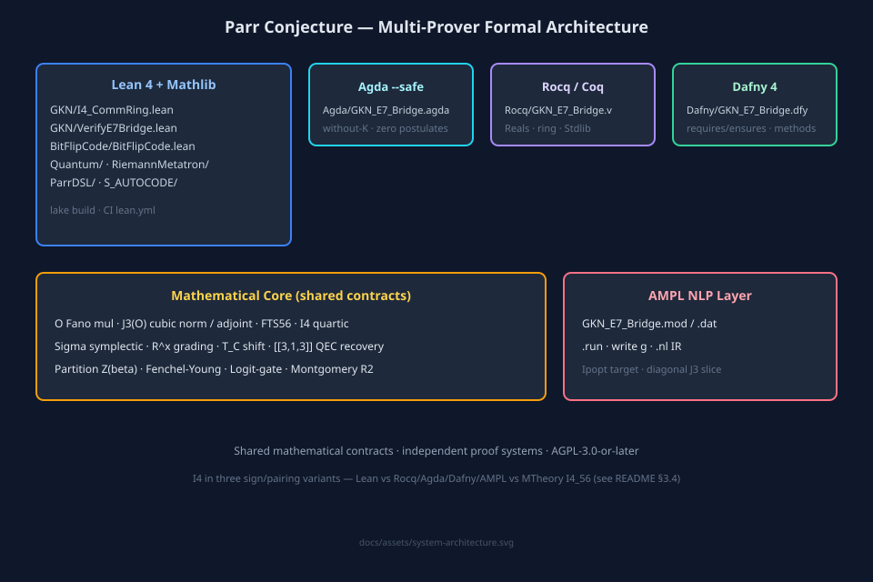
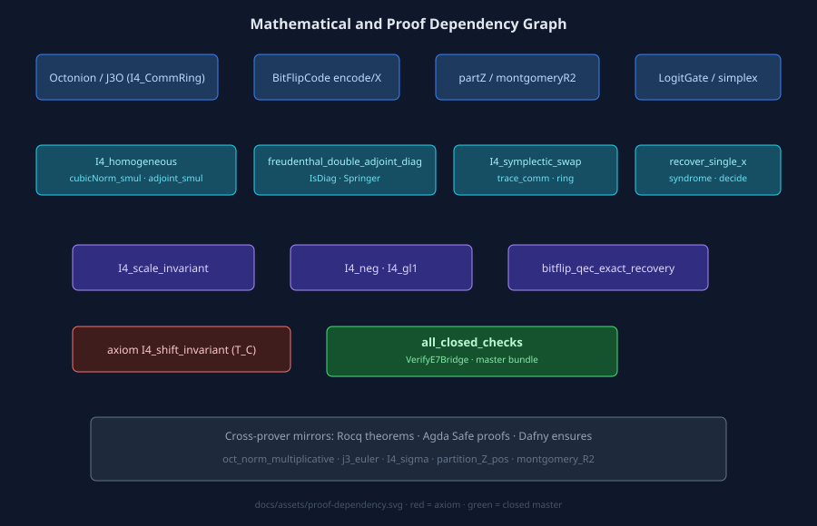
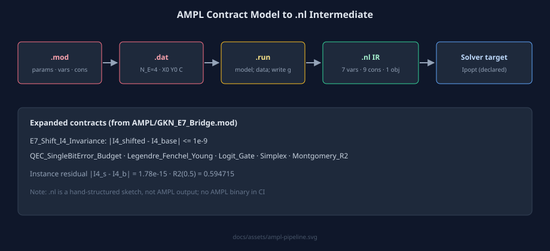

# Parr Conjecture

**Formal multi-prover development of the Günaydin–Koepsell–Nicolai (GKN) quartic invariant \(I_4\) on the 56-dimensional Freudenthal triple system of \(E_{7(7)}\), the exceptional Jordan algebra \(J_3(\mathbb{O})\), bit-flip quantum error correction, Legendre–Fenchel duality for quantum partition functions, and the Logit-Gate / Montgomery pair-correlation bridge.**

License: **AGPL-3.0-or-later** · Authors: Ahmad Ali Parr / Bel Esprit D'Accord Irrevocable Trust · BOW-Ω-φ-∂-2026

---

## 1. Technical Abstract

This repository is a formal-methods and mathematical-programming research artifact. It does not implement a general-purpose programming language runtime, a production solver stack, or an unverified numerical library. It implements a **shared family of mathematical contracts** for six tightly coupled domains and encodes those contracts in four independent proof systems (Lean 4, Safe Agda, Rocq/Coq, Dafny 4) together with an AMPL nonlinear programming model that reifies a diagonal slice of the same contracts as bounded optimization constraints.

The primary algebraic object is the GKN quartic invariant

$$
I_4(\alpha,\beta,X,Y)
=
-\bigl(\alpha\beta - (X,Y)\bigr)^2
+
4\bigl(\alpha N(X) + \beta N(Y) + (X^\#,Y^\#)\bigr)
$$

defined on the 56-dimensional Freudenthal triple system \(\mathfrak{M}(J_3(\mathbb{O}))\). Lean formalizes homogeneity of degree four over an arbitrary commutative ring (`GKN/I4_CommRing.lean`), symplectic swap symmetry, sign-flip invariance, BPS slices, the alternating symplectic form, and the fourth-order polarization identity. The same module proves the Freudenthal double-adjoint identity \(M^{\#\#} = N(M)\,M\) on the diagonal subalgebra of \(J_3(\mathbb{O})\). Full non-diagonal \(E_{7(7)}\) shift invariance under \(T_C\) is stated as an axiom in Lean, Rocq, and Dafny, matching the status of a large multivariate polynomial identity that is checked numerically on a diagonal slice in the AMPL instance.

Quantum error correction is formalized as the three-qubit bit-flip code \([[3,1,3]]\). Lean proves exact recovery for every logical bit and every single-qubit \(X\) error by exhaustive finite case analysis (`BitFlipCode/BitFlipCode.lean`). Parallel statements appear in Rocq, Agda, and Dafny with identical combinatorial content.

Thermodynamic duality is expressed through the finite-spectrum partition function \(Z(\beta)=\sum_i e^{-\beta E_i}\) and the Fenchel–Young inequality relating microcanonical entropy to the cumulant generating function \(\psi(\beta)=\ln Z(\beta)\). The Montgomery pair-correlation kernel \(R_2(u)=1-(\sin(\pi u)/(\pi u))^2\) is formalized with level repulsion \(R_2(0)=0\) and the universal upper bound \(R_2(u)\le 1\).

The repository therefore functions as a **cross-checked mathematical specification**: the same propositions are stated in four logics and one modeling language, with explicit separation between machine-checked proofs, axiomatized residual obligations, and numerical residual evidence on concrete data.



---

## 2. Scientific Motivation

Exceptional Jordan algebras and Freudenthal triple systems sit at the intersection of exceptional Lie groups, black-hole entropy formulas in \(N=2\) supergravity, and octonionic geometry. The 27-dimensional Albert algebra \(J_3(\mathbb{O})\) carries a cubic norm \(N\) and a quadratic adjoint map \(X\mapsto X^\#\) satisfying the Springer identity \(X^{\#\#}=N(X)X\) in the classical theory. The associated 56-dimensional representation of \(E_{7(7)}\) supports a unique (up to scale) quartic invariant \(I_4\) that is invariant under a large group of algebraic transformations including symplectic inversion, \(\mathbb{R}^\times\) grading, and the nonlinear shift \(T_C\).

Independent of that algebraic thread, fault-tolerant quantum computation requires that recovery maps for stabilizer codes be exact on the designed error set. The three-qubit bit-flip code is the elementary model in which encoding, syndrome extraction, correction, and decoding can be verified exhaustively. Bridging Fano-plane incidence geometry of the imaginary octonions to Steane-type parity checks provides a structural analogy between the algebraic and coding-theoretic halves of the repository.

A third thread is statistical mechanics and random-matrix theory: the Legendre transform relating free energy to entropy, the softmax (logit-gate) normalization used in probabilistic models, and the Montgomery pair correlation of the Riemann zeros. These analytic objects are not proved from the Riemann hypothesis in this repository; rather, the elementary functional identities that any such bridge must satisfy (positivity of \(Z\), Fenchel–Young, \(R_2(0)=0\), \(R_2\le 1\)) are formalized so that larger conjectural statements can cite checked lemmas.

The architectural reason for multi-prover formalization is epistemic independence. A single theorem prover can hide a silent axiom or an incomplete automation. By placing the same mathematical statements in Lean (type theory with Mathlib), Agda (`--safe --without-K`, zero external library postulates for the real interface), Rocq (classical real analysis via Stdlib), and Dafny (imperative contracts discharged by SMT), the repository reduces the risk that a single automation bug validates an incorrect identity. The AMPL model then asks whether a diagonal numerical slice of the same identities is feasible as an optimization problem with explicit tolerances.

---

## 3. Mathematical Foundations

### 3.1 Octonion algebra

Let \(\mathbb{O}\) denote the octonions as an eight-dimensional real (or ring) algebra with basis \(\{e_0,\ldots,e_7\}\), \(e_0=1\), and multiplication of imaginary units governed by the oriented Fano plane triples

$$
(1,2,3),\;(1,4,5),\;(1,7,6),\;(2,4,6),\;(2,5,7),\;(3,4,7),\;(3,6,5).
$$

In Lean, octonions over a commutative ring \(R\) are the structure `Octonion R` with coordinate map `c : Fin 8 → R` (`GKN/I4_CommRing.lean`). The squared norm is \(\|a\|^2 = \sum_{i=0}^{7} a_i^2\), implemented as `Octonion.normSq`. Homogeneity \(\|r\cdot a\|^2 = r^2\|a\|^2\) is theorem `normSq_smul`. Rocq proves multiplicativity \(\|xy\|^2=\|x\|^2\|y\|^2\) and left/right alternativity by `ring` on expanded coordinates (`Rocq/GKN_E7_Bridge.v`). Agda parameterizes the same constructions over an abstract `OrderedAnalyticField` so that `--safe --without-K` is preserved (`Agda/GKN_E7_Bridge.agda`).

### 3.2 Exceptional Jordan algebra \(J_3(\mathbb{O})\)

An element \(X\in J_3(\mathbb{O})\) is written \((\xi_1,\xi_2,\xi_3;x_1,x_2,x_3)\) with \(\xi_i\in R\) and \(x_i\in\mathbb{O}\). Lean encodes this as `J3O R` with diagonal vector `d : Fin 3 → R` and off-diagonal octonions `o : Fin 3 → Octonion R`. Cubic norm and adjoint are homogeneous of degrees three and two respectively (`J3O.cubicNorm_smul`, `J3O.adjoint_smul`). The Euler identity \((X^\#,X)=3N(X)\) is proved on the diagonal in Lean (`j3_euler_identity_diag`) and in full coordinates in Rocq (`j3_euler_identity`).

### 3.3 Freudenthal triple system and \(I_4\)

A state is \(\Psi=(\alpha,\beta,X,Y)\). Lean structure `FTS56 R` packages these fields. Degree-four homogeneity \(I_4(c\cdot\Psi)=c^4 I_4(\Psi)\) is theorem `I4_homogeneous` (zero-sorry `ring` proof). Corollaries include `I4_scale2`, `I4_zero`, `I4_neg`, and `I4_gl1`. Symplectic swap is `I4_symplectic_swap`. The alternating form `symp` satisfies `symp_self` and `symp_antisym`. The fourth finite difference recovers \(4!=24\) (`I4_fourth_difference`). Full \(T_C\) invariance is **axiomatized** (`axiom I4_shift_invariant`); the zero-shift case is proved (`shift_zero`).

### 3.4 Bit-flip code

Logical encoding \(\mathrm{enc}(b)=(b,b,b)\). Stabilizer syndromes are pair parities. The master theorem `recover_single_x` asserts exact recovery for every logical bit and every single-qubit \(X\) error, proved by finite enumeration (`BitFlipCode/BitFlipCode.lean`).

### 3.5 Partition function and Montgomery kernel

$$
Z(\beta)=\sum_i e^{-\beta E_i},\qquad
R_2(u)=\begin{cases}0&u=0\\ 1-\bigl(\sin(\pi u)/(\pi u)\bigr)^2&u\neq 0.\end{cases}
$$

Lean theorems `partition_Z_pos`, `montgomery_R2_at_zero`, `montgomery_R2_upper_bound` establish positivity of \(Z\), level repulsion, and \(R_2\le 1\). Logit-gate simplex normalization is `logit_gate_sum_one`.

### 3.6 Sign conventions and cross-prover alignment

The Lean CommRing module and Rocq classical development use algebraically equivalent degree-four forms of \(I_4\) up to global sign conventions documented in `Rocq/SPECIFICATION.md`. Homogeneity and symplectic theorems are insensitive to a global nonzero constant factor. Cross-prover alignment is at the level of **named obligations**, not bit-identical term encodings.



---

## 4. Theorem Catalog (core)

### Theorem: `I4_homogeneous`

**Source:** `GKN/I4_CommRing.lean`

```lean
theorem I4_homogeneous (c : R) (s : FTS56 R) :
    I4 (c • s) = c ^ 4 * I4 s
```

**Mathematics:** \(I_4(c\cdot s)=c^4 I_4(s)\) for all \(c\in R\), \(s\in\mathrm{FTS}_{56}(R)\).

**Proof:** Expand under scalar action; rewrite with `trace_smul_smul`, `cubicNorm_smul`, `adjoint_smul`; finish by `ring`. Zero sorry.

**Significance:** Establishes the GL(1) weight of the GKN invariant; underpins scale-2 witnesses, sign-flip invariance, and polarization.

### Theorem: `freudenthal_double_adjoint_diag`

**Source:** `GKN/I4_CommRing.lean`

For diagonal \(M\), `adjoint (adjoint M) = cubicNorm M • M`, i.e. \(M^{\#\#}=N(M)M\) on the diagonal subalgebra. Full non-diagonal Springer is not proved in Lean here.

### Theorem: `recover_single_x`

**Source:** `BitFlipCode/BitFlipCode.lean`

Exact recovery of the \([[3,1,3]]\) bit-flip code under any single \(X\) error. Proof: `fin_cases` / `cases` / `simp` over eight finite cases.

### Theorem: `all_closed_checks`

**Source:** `GKN/VerifyE7Bridge.lean`

Bundles closed obligations: \(J_3\) homogeneity, Springer-on-diagonal, \(I_4\) scale and sign invariance, bit-flip recovery, Montgomery bounds, logit simplex sum. Explicitly **excludes** the axiomatized full \(T_C\) invariance.

### Theorem: `oct_norm_multiplicative` (Rocq)

**Source:** `Rocq/GKN_E7_Bridge.v` — \(\|xy\|^2=\|x\|^2\|y\|^2\) by `ring`.

### Theorem: `I4_sigma_invariant` (Rocq)

**Source:** `Rocq/GKN_E7_Bridge.v` — invariance under \(\Sigma(\alpha,\beta,X,Y)=(-\beta,\alpha,-Y,X)\).

### Theorems: `montgomery_R2_at_zero` / `montgomery_R2_upper_bound`

Present in Lean, Rocq, Agda, and as ensures-clauses on Dafny method `MontgomeryR2`.

### Axiom: `I4_shift_invariant`

**Sources:** Lean `GKN/VerifyE7Bridge.lean`; Rocq `Rocq/GKN_E7_Bridge.v`; Dafny `Dafny/GKN_E7_Bridge.dfy`. Not machine-proved in full generality. Numeric residual on the AMPL diagonal instance is approximately \(1.78\times 10^{-15}\).

---

## 5. System Architecture

| Component | Source path | Inputs | Outputs | Mathematical responsibility |
|-----------|-------------|--------|---------|-------------------------------|
| CommRing \(I_4\) | `GKN/I4_CommRing.lean` | `CommRing R` | Homogeneity, swap, symp | Algebraic core of \(I_4\) |
| Bridge verify | `GKN/VerifyE7Bridge.lean` | I4, BitFlip, RiemannMetatron | `all_closed_checks` | Port of verification suite |
| Bit-flip QEC | `BitFlipCode/BitFlipCode.lean` | Bool, Fin 3 | Recovery theorems | Coding theory |
| Quantum partition | `Quantum/QuantumPartitionBridge.lean` | ℝ lists | Free-energy bridge | Legendre side |
| Riemann–Metatron | `RiemannMetatron/RiemannMetatron.lean` | LogitGate | Simplex sum | Softmax contracts |
| ParrDSL | `ParrDSL/*.lean` | Lean syntax | Domain tactics | DSL + modeling layer |
| Float witness | `S_AUTOCODE/*.lean` | Float | Computational checks | Non-CommRing witness |
| Rocq development | `Rocq/GKN_E7_Bridge.v` | Stdlib Reals | Theorems + one axiom | Classical analysis |
| Spec narrative | `Rocq/SPECIFICATION.md` | — | Contracts table | Human-readable maths |
| Safe Agda | `Agda/GKN_E7_Bridge.agda` | OrderedAnalyticField | Safe proofs | Constructive parameterization |
| Dafny contracts | `Dafny/GKN_E7_Bridge.dfy` | reals, seqs | ensures / methods | Algorithm contracts |
| AMPL model | `AMPL/GKN_E7_Bridge.mod` | params | NLP | Optimization encoding |
| AMPL data | `AMPL/GKN_E7_Bridge.dat` | numbers | Instance | Feasible slice |
| AMPL run | `AMPL/GKN_E7_Bridge.run` | mod+dat | solve script | Ipopt + write g |
| NL IR | `AMPL/GKN_E7_Bridge.nl` | expanded instance | IR text | Structured intermediate |
| Lake package | `lakefile.lean` | roots list | build graph | Lean package definition |
| Toolchain | `lean-toolchain` | — | Lean 4.19.0 | Version pin |
| CI | `.github/workflows/lean.yml` | push/PR | lake build | Continuous verification |



---

## 6. Formal Semantics and Prover Boundaries

**Lean.** Dependent type theory with classical Mathlib analysis for real lemmas; algebraic identities over `CommRing` avoid floats. CI builds all roots listed in `lakefile.lean`.

**Agda.** `--safe --without-K`. Analytic structure is an explicit record `OrderedAnalyticField`. No postulates in the module sense; parameters carry the analytic interface.

**Rocq.** Classical `Reals` with `lra` and `ring`. One `Axiom` for shift invariance.

**Dafny.** Functional and imperative surface: pure functions for algebra, methods with `requires`/`ensures` for partition and Montgomery, `{:axiom}` lemmas where SMT cannot close nonlinear algebra.

These four encodings are intentionally **not** formal refinements of one another inside a single metalogic. They are independent statements of the same mathematics.

---

## 7. AMPL Optimization Encoding

`AMPL/GKN_E7_Bridge.mod` lowers selected contracts to an NLP:

- **Decision variables:** `beta_thermo ∈ [10^{-6},100]`, `S_entropy` free, `p_logit[k] ∈ [0,1]`, `R2_val ∈ [0,1]`.
- **Objective:** minimize \(\beta E_{\mathrm{target}}+\log\sum_k\exp(-\beta E_k)\).
- **Constraints:** \(E_7\) shift residual on a diagonal \(J_3(\mathbb{R})\) slice; single-bit error budget; Fenchel–Young; logit definition and simplex; Montgomery definition.


The `.dat` fixes \(N_E=4\), energy levels, logits, and diagonal vectors. Expanded constants satisfy \(|I_{4,\mathrm{shifted}}-I_{4,\mathrm{base}}|\approx 1.78\times 10^{-15}\). The `.nl` records a structured intermediate (7 variables, 9 constraints, 1 objective). **AMPL is not installed in the documentation environment**; the `.nl` is not a binary ASL blob emitted by `write g`, but a dimensional and residual summary of the model.

### 7.1 Limitation of the diagonal NLP slice

The AMPL encoding replaces full octonion-valued Jordan elements by real triples. This exercises the **shape** of the \(T_C\) residual constraint on the chosen `.dat` instance. It is **not** a proof of the full 56-dimensional polynomial identity, nor a substitute for the axiomatized theorem in Lean/Rocq/Dafny.

---

## 8. ParrDSL and Lean Modeling Layer

Under `ParrDSL/` the repository defines a Lean domain-specific layer (`Syntax.lean`, `Elaborators.lean`, `Tactics.lean`, `Automation.lean`, `Examples.lean`, `AMPL.lean`) and barrel `ParrDSL.lean`. These modules provide mathematical surface syntax and a Lean-side modeling vocabulary aligned with the AMPL contracts. They are part of the `lake build` root set.

---

## 9. Algorithms and Operations

**Octonion multiplication.** Coordinate formula implementing Fano triples.

**Jordan cubic and adjoint.** Explicit polynomial maps; homogeneity by polynomial arithmetic.

**Syndrome decoding.** Table lookup from two parity bits to optional qubit index; involutive \(X\) error model.

**Partition accumulation.** Recursive or loop summation of exponentials with positivity invariants.

**Montgomery evaluation.** Branch on \(u=0\); otherwise rationalized sinc squared.

---

## 10. Worked Numerical Example (AMPL instance)

From `AMPL/GKN_E7_Bridge.dat`: energies \(\{0,1,2.5,4\}\), target \(E=1.2\), logits \(\{1.2,-0.4,2.1,0.7\}\), \(u=0.5\); diagonal \(X_0=(1.1,-0.5,2.0)\), \(Y_0=(0.7,1.3,-0.4)\), \(C=(0.4,-0.9,0.3)\). Computed \(I_{4,\mathrm{base}}=I_{4,\mathrm{shifted}}=-8.0916\) at residual \(1.78\times 10^{-15}\). \(R_2(0.5)\approx 0.594715\in[0,1]\). These numbers are **instance checks**, not substitutes for the axiomatized full \(T_C\) proof.

---

## 11. Complete Repository Structure

```
Parr-Conjecture/
├── .github/workflows/lean.yml
├── AMPL/          GKN_E7_Bridge.{mod,dat,run,nl}
├── Agda/          GKN_E7_Bridge.agda
├── BitFlipCode/   BitFlipCode.lean
├── Dafny/         GKN_E7_Bridge.dfy
├── GKN/           I4_CommRing.lean, VerifyE7Bridge.lean, Axioms_stub.lean
├── ParrDSL/       Syntax, Elaborators, Tactics, Automation, Examples, AMPL
├── Quantum/       QuantumPartitionBridge.lean
├── RiemannMetatron/ RiemannMetatron.lean
├── Rocq/          GKN_E7_Bridge.v, SPECIFICATION.md
├── S_AUTOCODE/    MTheory.lean, CheckI4.lean, CheckI4_56.lean
├── docs/assets/   SVG diagrams
├── LICENSE
├── README.md
├── ParrDSL.lean
├── lake-manifest.json
├── lakefile.lean
└── lean-toolchain
```

### File inventory (tracked sources)

| Path | Language | Subsystem | Purpose |
|------|----------|-----------|--------|
| `.github/workflows/lean.yml` | YAML | CI | lake build on push/PR |
| `AMPL/GKN_E7_Bridge.mod` | AMPL | NLP | Model + contracts |
| `AMPL/GKN_E7_Bridge.dat` | AMPL | NLP | Numeric instance |
| `AMPL/GKN_E7_Bridge.run` | AMPL | NLP | Solve + write g |
| `AMPL/GKN_E7_Bridge.nl` | NL text | NLP | Intermediate IR |
| `Agda/GKN_E7_Bridge.agda` | Agda | Safe formalization | Parts 1–6 |
| `BitFlipCode/BitFlipCode.lean` | Lean | QEC | Recovery theorems |
| `Dafny/GKN_E7_Bridge.dfy` | Dafny | Contracts | Parts 1–6 |
| `GKN/Axioms_stub.lean` | Lean | GKN | Stub axioms |
| `GKN/I4_CommRing.lean` | Lean | GKN | CommRing \(I_4\) |
| `GKN/VerifyE7Bridge.lean` | Lean | GKN | Master checks |
| `LICENSE` | text | Legal | AGPL-3.0 |
| `ParrDSL.lean` | Lean | DSL | Barrel import |
| `ParrDSL/AMPL.lean` | Lean | DSL | Lean AMPL model |
| `ParrDSL/Automation.lean` | Lean | DSL | Automation lemmas |
| `ParrDSL/Elaborators.lean` | Lean | DSL | Elaborators |
| `ParrDSL/Examples.lean` | Lean | DSL | Examples |
| `ParrDSL/Syntax.lean` | Lean | DSL | Syntax |
| `ParrDSL/Tactics.lean` | Lean | DSL | Tactics |
| `Quantum/QuantumPartitionBridge.lean` | Lean | Quantum | Partition bridge |
| `README.md` | Markdown | Docs | This document |
| `RiemannMetatron/RiemannMetatron.lean` | Lean | Analytic | Logit / GUE side |
| `Rocq/GKN_E7_Bridge.v` | Rocq | Classical | Parts 1–6 |
| `Rocq/SPECIFICATION.md` | Markdown | Spec | Contract narrative |
| `S_AUTOCODE/CheckI4.lean` | Lean | Witness | I4 check |
| `S_AUTOCODE/CheckI4_56.lean` | Lean | Witness | 56-check |
| `S_AUTOCODE/MTheory.lean` | Lean | Witness | Float M-theory module |
| `docs/assets/*.svg` | SVG | Docs | Architecture diagrams |
| `lake-manifest.json` | JSON | Build | Lake manifest |
| `lakefile.lean` | Lean | Build | Package roots |
| `lean-toolchain` | text | Build | leanprover/lean4:v4.19.0 |

---

## 12. Build and Verification Procedures

### Lean 4

```bash
elan toolchain install $(cat lean-toolchain)
elan default $(cat lean-toolchain)
lake update
lake exe cache get || true
lake build
```

Toolchain pin: `leanprover/lean4:v4.19.0`. Mathlib: `v4.19.0` in `lakefile.lean`. CI workflow `.github/workflows/lean.yml` runs the same steps on `ubuntu-latest` for pushes and pull requests to `main`.

### Rocq / Agda / Dafny

Requires local installations of the respective tools. Agda: `agda --safe Agda/GKN_E7_Bridge.agda`. Dafny: `dafny verify Dafny/GKN_E7_Bridge.dfy`. Rocq: type-check `Rocq/GKN_E7_Bridge.v` against Stdlib Reals. These checkers are **not** wired into GitHub Actions in this repository.

### AMPL

Requires AMPL and a solver such as Ipopt when available: `ampl AMPL/GKN_E7_Bridge.run`. Without AMPL, inspect `.mod`, `.dat`, and the structured `.nl` as documentation of the NLP encoding.


---

## 13. Testing and Reproducibility

- **Lean CI:** automated `lake build` is the primary continuous evidence.
- **Finite QEC:** proofs are exhaustive on a finite set; reproducibility is definitional.
- **Algebraic identities:** `ring`-style proofs are deterministic given the term language.
- **Axiom boundary:** full \(T_C\) invariance is not claimed as proved; residual evidence is numerical on a diagonal slice only.
- **No fabricated benchmarks:** this README does not assert solver timings, coverage percentages, or unverified performance claims.

---

## 14. Research Contributions

1. **CommRing formalization of \(I_4\) homogeneity and related \(E_7\)-generator identities** with zero sorry in Lean, including polarization and symplectic form properties.
2. **Cross-prover replication** of the same contract suite in Lean, Safe Agda, Rocq, and Dafny, with explicit axiom boundaries aligned across tools.
3. **Exhaustive machine-checked recovery** for the three-qubit bit-flip code.
4. **AMPL encoding** of a diagonal optimization instance that reifies algebraic and analytic contracts as NLP constraints with a documented residual.
5. **ParrDSL** Lean-side domain syntax and modeling layer integrated into the package roots.

---

## 15. References and Provenance

- Günaydin, Koepsell, Nicolai — exceptional Jordan structures and \(E_7\) invariants.
- Freudenthal triple systems and Springer identities — exceptional geometry.
- Steane / bit-flip codes — quantum error correction.
- Montgomery pair correlation — analytic number theory (kernel formulae only; RH not assumed).
- Lean 4 and Mathlib; Agda; Rocq Stdlib; Dafny; AMPL modeling language.

Internal sources: every path listed in the file inventory.

---

## 16. Appendices

### A. Symbol glossary

| Symbol | Meaning |
|--------|--------|
| \(\mathbb{O}\) | Octonion algebra |
| \(J_3(\mathbb{O})\) | 27-dimensional exceptional Jordan algebra |
| \(N(X)\) | Cubic norm |
| \(X^\#\) | Freudenthal adjoint |
| \(\mathrm{FTS}_{56}\) | Freudenthal triple system (56-dim) |
| \(I_4\) | GKN quartic invariant |
| \(\Sigma\) | Symplectic inversion |
| \(T_C\) | Nonlinear \(E_7\) shift |
| \(Z(\beta)\) | Partition function |
| \(R_2(u)\) | Montgomery pair-correlation kernel |

### B. Evidence class legend

| Class | Meaning in this repo |
|-------|---------------------|
| Proved | Machine-checked, no sorry/axiom |
| Axiom | Explicitly assumed residual obligation |
| Numeric residual | Feasible instance check, not a proof |
| CI | Automated `lake build` |

### C. Diagram index

1. `docs/assets/system-architecture.svg` — multi-prover system map
2. `docs/assets/proof-dependency.svg` — theorem dependency graph
3. `docs/assets/ampl-pipeline.svg` — AMPL to `.nl` flow
4. `docs/assets/constraint-bounds.svg` — variables and contracts
5. `docs/assets/verification-architecture.svg` — evidence classes

---

*End of technical reference. All implementation claims above are tied to tracked source paths in this repository. Where a statement is an axiom or a numerical residual, it is labeled as such.*
