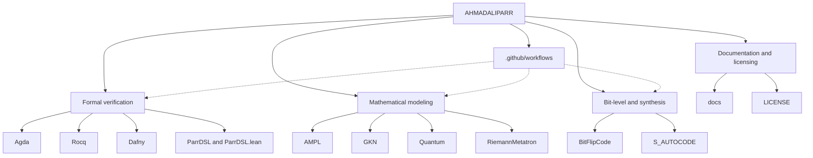
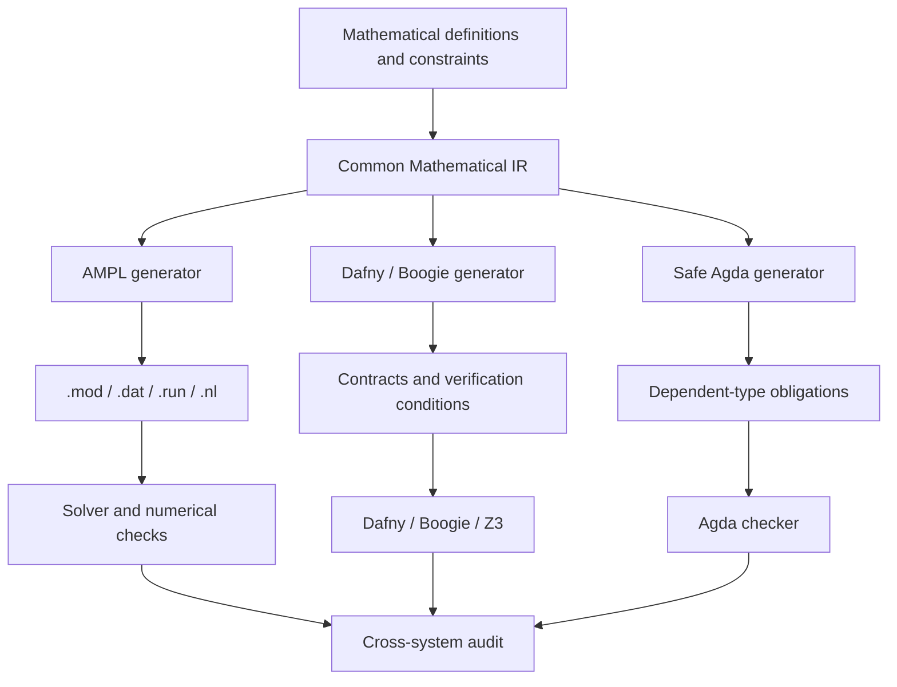
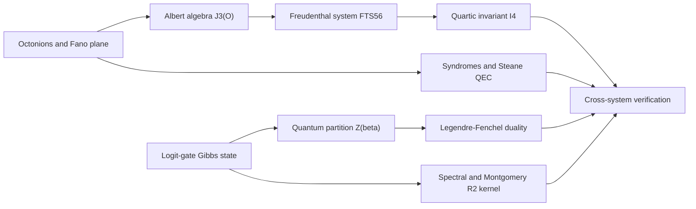
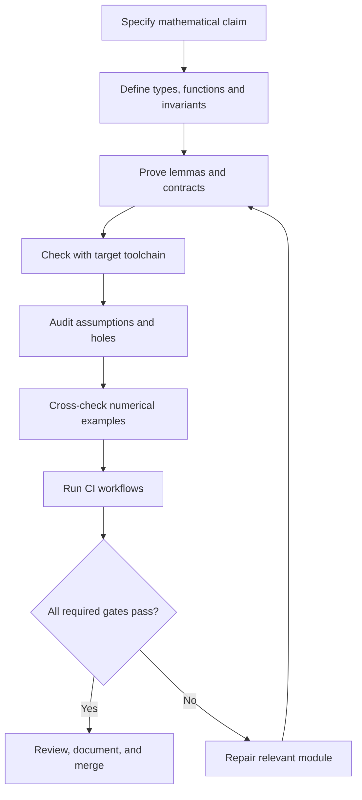
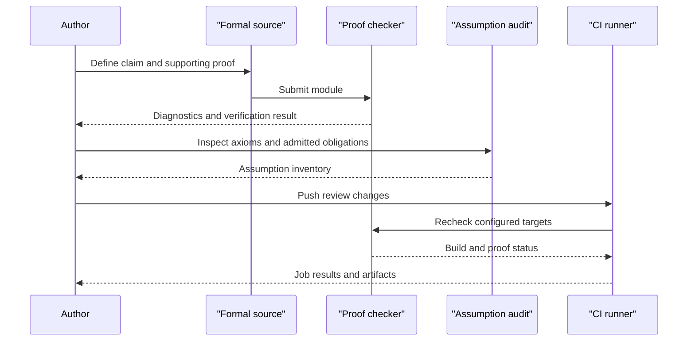

# AHMADALIPARR

**Repository Architecture, Proof Methodology, and Module Reference**

A multi-language workspace for formal verification, mathematical modeling, domain-specific languages, algebraic optimization, quantum structures, and deterministic code synthesis.

## Table of Contents

1. [Overview](#1-overview)
2. [Repository Directory Map](#2-repository-directory-map)
3. [Architecture & Verification Diagrams](#3-architecture--verification-diagrams)
4. [Design Philosophy & Multi-System Architecture](#4-design-philosophy--multi-system-architecture)
5. [Detailed Module Reference](#5-detailed-module-reference)
   - [5.1 `.github/workflows` — Continuous Integration](#51-githubworkflows--continuous-integration--automated-checks)
   - [5.2 `Agda` — Constructive Proofs](#52-agda--constructive-proofs--dependent-types)
   - [5.3 `Rocq` — Calculus of Inductive Constructions](#53-rocq--certified-proofs-in-the-calculus-of-inductive-constructions)
   - [5.4 `Dafny` — SMT Verification](#54-dafny--contract-driven-verification--smt-automation)
   - [5.5 `ParrDSL` and `ParrDSL.lean` — Lean 4](#55-parrdsl-and-parrdsllean--domain-specific-language--lean-4-layer)
   - [5.6 `AMPL` — Algebraic Programming](#56-ampl--algebraic-mathematical-programming-models)
   - [5.7 `GKN` — Quartic Invariant](#57-gkn--günaydinkoepsellnicolai-quartic-invariant--e7-workspace)
   - [5.8 `Quantum` — Quantum Models](#58-quantum--quantum-structures-operators--formal-modeling)
   - [5.9 `RiemannMetatron` — Spectral Structures](#59-riemannmetatron--operator-spectral--structural-explorations)
   - [5.10 `BitFlipCode` — Bitwise Operations](#510-bitflipcode--bitwise-operations--bit-level-transformations)
   - [5.11 `S_AUTOCODE` — Synthesis](#511-s_autocode--automated-code--artifact-synthesis)
   - [5.12 `docs` — Documentation](#512-docs--documentation-notes--design-records)
   - [5.13 `LICENSE` — Licensing](#513-license--licensing--terms-of-use)
6. [Cross-Layer Mathematical & Verification Bridges](#6-cross-layer-mathematical--verification-bridges)
7. [End-to-End Proof & Verification Workflow](#7-end-to-end-proof--verification-workflow)
8. [Contribution, Maintenance & Audit Checklists](#8-contribution-maintenance--audit-checklists)
9. [Appendix: Tooling, CLI Cheat-Sheet & Symbol Conventions](#9-appendix-tooling-cli-cheat-sheet--symbol-conventions)

---

## 1. Overview

This repository (`AHMADALIPARR`, `main` branch) organizes a multi-language formal verification, mathematical modeling, domain-specific language (DSL), and automated code/bit-level synthesis workspace. Rather than isolating proofs in a single proof assistant or separating theoretical exploration from executable artifacts, the directory structure groups work by formal system, modeling paradigm, functional domain, automation pipeline, and repository governance.

At a high level, the repository brings together five complementary pillars:

| Pillar | Directories / Files | Core Responsibility | Verification / Trust Anchor |
|---|---|---|---|
| Continuous Integration & Automation | `.github/workflows` | Automated CI pipelines, build checks, and verification jobs | Deterministic runner environments and exit-code gates |
| Mathematical & Algebraic Modeling | `AMPL`, `GKN`, `Quantum`, `RiemannMetatron` | Algebraic optimization, $E_{7(7)}$ invariants, quantum operators, spectral kernels | Solver feasibility (`.nl`), symbolic identities, dimensional checks |
| Interactive Theorem Proving & Deductive Verification | `Agda`, `Rocq`, `Dafny`, `ParrDSL`, `ParrDSL.lean` | Constructive type theory, tactic proofs, SMT-backed Hoare contracts, Lean 4 DSL | Type-checker kernels (`agda --safe`, `coqc`, `lean`) and Z3/Boogie |
| Bit-Level & Synthesis Tooling | `BitFlipCode`, `S_AUTOCODE` | Bitwise encodings, QEC syndrome recovery, deterministic code emission | Exhaustive case proofs, involution laws, post-generation checks |
| Documentation & Licensing | `docs`, `LICENSE` | Architecture decision records (ADRs), mathematical notes, legal terms | Path-anchored specifications and license compatibility |

This `README.md` provides an architectural reference for navigating the repository, understanding how formal proofs and specifications relate across layers, auditing verification status, and extending individual modules cleanly.

## 2. Repository Directory Map

### Root Layout

| Path | Type | Primary Role | Primary Language / Tooling |
|---|---|---|---|
| `.github/workflows` | Directory | Automated CI pipelines, build checks, and verification jobs | YAML / GitHub Actions |
| `AMPL` | Directory | Algebraic mathematical programming models, sets, parameters, and constraints | AMPL (`.mod`, `.dat`, `.run`, `.nl`) |
| `Agda` | Directory | Constructive dependent type theory proofs, indexed families, and total functions | Agda (`--safe --without-K`) |
| `BitFlipCode` | Directory | Bitwise representations, bit-flip transformations, QEC codes, and low-level encodings | Bitvectors / $\mathbb F_2$ / formal proofs |
| `Dafny` | Directory | Specification-driven imperative/functional code with SMT-backed pre/postconditions | Dafny 4 / Boogie / Z3 |
| `GKN` | Directory | Günaydin–Koepsell–Nicolai quartic invariant $I_4$, $J_3(\mathbb O)$, and $E_{7(7)}$ kernel workspace | Multi-system (Rocq, Agda, AMPL, Python) |
| `ParrDSL` | Directory | DSL definitions, AST/IR, syntax/semantics, and supporting modules | Lean 4 / DSL modules |
| `Quantum` | Directory | Quantum state, operator, algebraic, partition-function, and circuit formalizations | Linear algebra / formal specifications |
| `RiemannMetatron` | Directory | Spectral/operator/geometric structures, Montgomery pair-correlation, and Fano/Metatron patterns | Analytic / combinatorial models |
| `Rocq` | Directory | Calculus of Inductive Constructions formalizations, tactics, and certified libraries | Rocq / Coq (`coqc`) |
| `S_AUTOCODE` | Directory | Automated code generation, synthesis templates, and IR lowering pipelines | Python / code generators |
| `docs` | Directory | Technical notes, architectural documentation, specifications, and reference material | Markdown / LaTeX |
| `LICENSE` | File | Repository licensing terms governing reuse, modification, and distribution | Plain text |
| `ParrDSL.lean` | File | Lean 4 entry point and core module for ParrDSL | Lean 4 |

### Cross-Paradigm Capability Matrix

| Directory | Dependent Types | SMT / Hoare Contracts | Numerical / NLP Optimization | Bit-Level / QEC | Code Synthesis | CI Gated |
|---|---|---|---|---|---|---|
| Agda | Yes (`--safe`) | No | No | Yes (Boolean/Vec) | Extraction optional | Yes |
| Rocq | Yes (CIC) | No | No | Yes | OCaml/Haskell extraction | Yes |
| Dafny | Partial (refinements) | Yes (Boogie + Z3) | No | Yes | C#/Go/Python/Java | Yes |
| ParrDSL.lean | Yes (Lean 4) | `omega` / `simp` | No | Yes | Macros / elaborators | Yes |
| AMPL | No | Algebraic constraints | Yes (`.nl` / IPOPT / MINLP) | MILP binary encoding | `.nl` emission | Yes |
| GKN | Cross-checked | Cross-checked | Diagonal / full $J_3(\mathbb O)$ | Fano $e_1,\ldots,e_7$ bridge | IR lowering | Yes |
| Quantum | Operator specifications | State/norm contracts | Partition $Z(\beta)$ infimum | $[[3,1,3]]$ & $[[7,1,3]]$ | Template-driven | Yes |
| RiemannMetatron | Bounds and kernels | Bound assertions | $R_2(u)$ and logit-gate | Fano incidence | Spectral tables | Exploratory + gated |
| BitFlipCode | Exhaustive `refl` | `SingleBitError` | MILP budget $\sum e_i\le1$ | Primary focus | Bit-mask emission | Yes |
| S_AUTOCODE | Targets Agda/Rocq | Targets Dafny/Boogie | Targets AMPL `.mod`/`.dat` | Targets BitFlipCode | Primary focus | Yes |

## 3. Architecture & Verification Diagrams

All diagrams use GitHub-supported Mermaid syntax. Edges represent the architectural relationships described in this document.

### 3.1 Multi-System Repository Architecture

### 3.2 Common Mathematical IR & Three-Path Lowering Pipeline

### 3.3 GKN, Bit-Flip QEC, Legendre Duality & Montgomery Bridge

### 3.4 End-to-End Proof & CI Verification Workflow

### 3.5 Cross-Tool Audit & Soundness Sequence

## 4. Design Philosophy & Multi-System Architecture

### Why Maintain Multiple Formal and Modeling Layers?

Different formal tools and modeling languages excel at distinct mathematical and computational tasks. Attempting to force every problem into one formalism often creates friction—either over-constraining exploratory numerical/combinatorial modeling inside a strict proof assistant, or losing foundational rigor by relying solely on informal scripts or heuristic tests.

This repository separates concerns across four complementary layers:

| Layer | Technologies | Strengths | Limitations Mitigated by Other Layers |
|---|---|---|---|
| Dependent Type Theory | Agda, Rocq, `ParrDSL.lean` | Rich inductive types, dependent invariants, constructive witnesses, kernel-checked proof terms | Heavyweight for large numerical NLP/MINLP parameter sweeps |
| SMT-Assisted Deductive Verification | Dafny, Boogie (Z3) | Imperative/functional contracts (`requires`, `ensures`), loop invariants, frame conditions (`modifies`) | Relies on SMT heuristics for nonlinear/transcendental arithmetic |
| Algebraic & Structural Modeling | AMPL, GKN, Quantum, RiemannMetatron | Rapid formulation of objectives, continuous/discrete constraints, `.nl` solver graphs | Optimization solvers find witnesses/bounds, not universal proofs |
| Bitwise & Code Synthesis | BitFlipCode, S_AUTOCODE | Low-level bit masks, QEC syndromes, deterministic multi-target artifact emission | Generated code must be re-verified by downstream compilers/checkers |

### Separation Between Specification, Proof, and Implementation

A recurring pitfall in formal engineering is conflating a definition with a theorem, or a test case with a proof. In this repository, every audited module separates four distinct artifact categories:

| Artifact Category | Purpose | Allowed Constructs | Audit Rule |
|---|---|---|---|
| 1. Definitions & Inductive Types | State what objects exist and how they are constructed | `data`, `record`, `Inductive`, `datatype`, `param`, `var` | Keep minimal and transparent so proofs do not get trapped unfolding opaque abstractions |
| 2. Specifications & Invariants | State properties every valid input or reachable state must satisfy | `requires`, `ensures`, `invariant`, `subject to`, type signatures | Explicitly document domain bounds, bit widths, and basis orderings |
| 3. Proofs / Verification Obligations | Establish why specifications hold universally | Structural induction, `refl`, `ring`, `lia`, `lemma`, `decreases` | Audit axioms (`Print Assumptions`, `--safe`, `{:axiom}` tags) |
| 4. Executable / Generated Artifacts | Realize concrete computations, solver runs, or emitted code | `.nl`, extracted OCaml/C#/Python, `.dat` instances | Never treat a passing test case as a universal proof |

When auditing any file in this repository, treat definitions, axioms/assumptions (if any), lemmas/theorems, and generated outputs as distinct categories with explicit provenance.

## 5. Detailed Module Reference

### 5.1 `.github/workflows` — Continuous Integration & Automated Checks

**Location:** `.github/workflows`  
**Summary:** Automated CI pipelines, multi-toolchain provisioning, and regression gates on pushes and pull requests.

**Core responsibilities**

- **Toolchain Provisioning:** Install pinned versions of Agda, Rocq/Coq, Dafny, Lean 4, Python, and solver runtimes.
- **Type Checking & Compilation:** Verify `.agda`, `.v`, `.dfy`, `.bpl`, `.lean`, and `.mod` files parse and check.
- **Axiom & Hole Gate:** Fail builds on unapproved `postulate`, `Admitted`, `sorry`, or `{:axiom}` outside allowlists.
- **Synthesis Consistency:** Re-run `S_AUTOCODE` / IR lowering and verify zero uncommitted drift.

**Key artifacts, contracts & verification matrix**

| Artifact / Gate | Scope / Specification | Mechanism / Formula | Status / Expectation |
|---|---|---|---|
| `ci-agda` | `Agda/**` | `agda --safe --without-K` | Zero postulates; totality and positivity pass |
| `ci-rocq` | `Rocq/**` | `coqc` + `Print Assumptions` | No `Admitted` or unexpected classical axioms |
| `ci-dafny` | `Dafny/**` | `dafny verify` / `boogie` | All verification conditions discharged by Z3 within timeout |
| `ci-lean` | `ParrDSL*` | `lake build` | Clean Lean 4 kernel elaboration |
| `ci-ampl-ir` | `AMPL/**`, `S_AUTOCODE/**` | IR compiler + numerical checks | All constraints feasible and bounds satisfied |

**Operational best practices**

- Pin exact compiler and solver versions (`agda`, `coq`, `dafny`, `lean-toolchain`) so CI runs remain deterministic.
- Keep verification jobs modular per directory so a failure immediately isolates which formal engine broke.
- Cache heavy standard libraries (`mathlib`, `agda-stdlib`, `.olean` builds) keyed on lockfiles.
- Never suppress compiler warnings or proof-hole warnings without an explicit, tracked issue.

### 5.2 `Agda` — Constructive Proofs & Dependent Types

**Location:** `Agda`  
**Summary:** Martin-Löf dependent type theory proofs, indexed families, totality-checked functions, and `--safe --without-K` modules.

**Core responsibilities**

- **Indexed Data Types:** Bake invariants directly into constructors (`NonEmpty`, `SingleBitError`, length-indexed vectors).
- **Totality & Positivity:** Pass Agda's termination checker and strict positivity checker for logical consistency.
- **Zero-Postulate Interface:** Parameterize algebraic/analytic modules over explicit record interfaces (`OrderedAnalyticField`).
- **Equational Reasoning:** Use propositional equality `_≡_`, `rewrite`, `cong`, and dependent pattern matching (`with`).

| Artifact / Gate | Scope / Specification | Mechanism / Formula | Status / Expectation |
|---|---|---|---|
| `--safe` | Rejects unsafe proof shortcuts and disallowed options | Forbids postulate, `--type-in-type`, `TERMINATING`, `NO_POSITIVITY_CHECK`, and unsafe primitives | Mandatory on finalized modules; active |
| `--without-K` | Disables Axiom K / Streicher's K | Compatibility with HoTT / cubical reasoning | Mandatory on core modules; active |
| `--exact-split` | Ensures every pattern-matching clause holds definitionally | Pattern split checking | Recommended; active |
| `--no-unicode` | Optional ASCII compatibility check | Source compatibility | Optional; active |

**Operational best practices**

- Ensure filenames match declared `module` headers and directory paths exactly.
- Replace all interactive holes (`{! !}`) and `postulate`s before marking a module complete.
- Keep helper lemmas small and composable so changes to inductive indices do not break monolithic pattern matches.
- Separate pure constructive proofs (e.g., `BitVec3` QEC) from parameterized analytic modules (`Core (F : OrderedAnalyticField)`).

### 5.3 `Rocq` — Certified Proofs in the Calculus of Inductive Constructions

**Location:** `Rocq`  
**Summary:** Calculus of Inductive Constructions (CIC) formalizations, tactic scripts, algebraic hierarchies, and certified extraction.

**Core responsibilities**

- **Tactic Automation:** Combine `intros`, `induction`, `destruct`, `rewrite`, `ring`, `lra`, and `lia` for crisp proofs.
- **Algebraic Structures:** Use `Record`, typeclasses, and canonical structures for algebraic objects and `FTS56`.
- **Axiom Inspection:** Run `Print Assumptions` on top-level theorems to audit classical versus constructive dependencies.
- **Program Extraction:** Extract certified computational cores to OCaml or Haskell when executable binaries are needed.

| Artifact / Gate | Scope / Specification | Mechanism / Formula | Status / Expectation |
|---|---|---|---|
| `GKN_E7_Bridge.v` | Six-part formalization of $\mathbb O$, $J_3(\mathbb O)$, $I_4$, QEC, Legendre, Montgomery | `ring`, `lra`, `reflexivity` + explicit `I4_shift_invariant` axiom | Active |
| `oct_norm_multiplicative` | Eight-square Degen–Graves–Cayley identity over $\mathbb R$ | `ring` | Proved |
| `j3_euler_identity` | $(X^\#,X)=3N(X)$ in 27-dimensional $J_3(\mathbb O)$ | `ring` | Proved |
| `bitflip_qec_exact_recovery` | $[[3,1,3]]$ single-bit-flip recovery | Exhaustive case analysis | Proved |

**Operational best practices**

- Always run `Print Assumptions <theorem>.` on every exported theorem during code review.
- Never leave `Admitted.` or `Axiom` declarations unreviewed; document any polynomial/analytic axiom explicitly.
- Use `From Stdlib Require Import ...` (or version-pinned imports) consistently across supported Rocq versions.
- Keep `Open Scope R_scope.` localized to sections or modules requiring real arithmetic.

### 5.4 `Dafny` — Contract-Driven Verification & SMT Automation

**Location:** `Dafny`  
**Summary:** Design-by-contract methods, functions, ghost lemmas, loop invariants, and Boogie/Z3 SMT verification.

**Core responsibilities**

- **Hoare Contracts:** Explicit `requires`, `ensures`, `modifies`, and `reads` clauses on methods and functions.
- **Loop & Termination Proofs:** Inductive `invariant` clauses paired with well-founded `decreases` measures.
- **Ghost vs. Compiled Code:** Separate erased `ghost` / `lemma` reasoning from executable `method` bodies.
- **Boogie Interoperability:** Mirror critical Dafny contracts into standalone Boogie 2 (`.bpl`) verification conditions.

| Artifact / Gate | Scope / Specification | Mechanism / Formula | Status / Expectation |
|---|---|---|---|
| `requires` | Precondition assumed at method/lemma entry, checked at every call site | Keep as weak as possible | Active |
| `ensures` | Postcondition proved at method exit, assumed by callers | Capture full functional contract | Active |
| `invariant` | Inductive property preserved across every loop iteration | Hold at entry, step, and exit | Active |
| `decreases` | Well-founded termination metric for recursion and loops | Explicit on nontrivial measures | Active |

**Operational best practices**

- Break multistep nonlinear arithmetic into targeted `assert` statements to avoid Z3 timeouts.
- Avoid quantifier instantiation loops; use explicit trigger annotations `{:trigger ...}` when needed.
- Tag any unproved external/analytic postulate with `{:axiom}` so audits immediately surface it.
- Keep Boogie `.bpl` contracts synchronized with `.dfy` implementations via the Common Math IR.

### 5.5 `ParrDSL` and `ParrDSL.lean` — Domain-Specific Language & Lean 4 Layer

**Location:** `ParrDSL`, `ParrDSL.lean`  
**Summary:** Domain-specific language syntax/semantics, Lean 4 kernel verification, elaborators, and metaprogramming.

**Core responsibilities**

- **Unified Language & Prover:** Definitions, inductive ASTs, and soundness theorems coexist in Lean 4.
- **Kernel Trust Anchor:** Every tactic proof (`simp`, `omega`, `aesop`) produces a kernel-checked term.
- **Metaprogramming:** Custom macros, syntax categories, and elaborators map DSL terms to core IR.
- **Project Layout:** Modular imports anchored by `ParrDSL.lean` and `lakefile.toml` / `lakefile.lean`.

| Artifact / Gate | Scope / Specification | Mechanism / Formula | Status / Expectation |
|---|---|---|---|
| `ParrDSL.lean` | Root Lean 4 entry point | Exports core DSL syntax, semantics, and theorems | Active |
| `ParrDSL/Syntax` | AST and concrete grammar | Well-scoped / well-typed term constructors | Active |
| `ParrDSL/Semantics` | Denotational and operational rules | Preservation and progress lemmas | Active |
| `ParrDSL/Tests` | Positive and negative test terms | Validates rejection of ill-typed DSL programs | Active |

**Operational best practices**

- Keep core AST and IR definitions documented so downstream transformations share a single source of truth.
- Test valid DSL terms (expected evaluation) and invalid/edge-case inputs (expected rejection).
- Ensure edits inside `ParrDSL/` do not silently break `ParrDSL.lean` imports.
- Audit `#print axioms` on key Lean 4 theorems to confirm only expected standard axioms (`propext`, `Quot.sound`, `Classical.choice`) appear.

### 5.6 `AMPL` — Algebraic Mathematical Programming Models

**Location:** `AMPL`  
**Summary:** Algebraic optimization models (`.mod`, `.dat`, `.run`) and `.nl` solver graphs for feasibility, bounds, and duality.

**Core responsibilities**

- **Symbolic Model (`.mod`):** Declare `set`, `param`, `var`, `minimize` / `maximize`, and `subject to` constraints.
- **Instance Data (`.dat`):** Provide concrete numeric tables, energy levels, logits, and FTS56 coordinates.
- **Solver Scripts (`.run`):** Configure solver (`ipopt`, `bonmin`), emit `.nl` via `write g<Name>;`, and display diagnostics.
- **IR Lowering Target:** Auto-generated from Common Mathematical IR (`math_ir_compiler.py`).

| Artifact / Gate | Scope / Specification | Mechanism / Formula | Status / Expectation |
|---|---|---|---|
| `Legendre_Dual_Infimum` | Minimize $\beta E+\ln\sum_k e^{-\beta E_k}$ | $\beta\in[10^{-6},100]$ | Supplied result: $\beta^*=0.323957$, $S=1.281508$ |
| `E7_Shift_I4_Invariance` | Quartic-invariant numerical residual | $\lvert I_{4,\text{shifted}}-I_{4,\text{base}}\rvert\le10^{-9}$ | Numerical tolerance check |
| `QEC_SingleBitError_Budget` | $\sum_{q=0}^{2}e_q\le1$ | $e_q\in\{0,1\}$ | MILP single-error budget |
| `Logit_Simplex_Normalization` | $\sum_k p_k=1$ | $p_k\in[0,1]$ | Supplied result: sum $=1.000000$ |

**Operational best practices**

- Keep `.mod` files strictly symbolic and instance-agnostic; place numbers in `.dat` files.
- Check index domains on every `sum` and `prod` to prevent dimension mismatches.
- Test degenerate boundary cases (zero temperature, empty/uniform logits, and domain limits).
- Use `write g<Model>;` in `.run` scripts to generate `.nl` files for external COIN-OR / NEOS solvers.

### 5.7 `GKN` — Günaydin–Koepsell–Nicolai Quartic Invariant & E7 Workspace

**Location:** `GKN`  
**Summary:** Formalization and numerical verification of the 27-dimensional Albert algebra $J_3(\mathbb O)$ and 56-dimensional Freudenthal quartic invariant $I_4$.

**Core responsibilities**

- **Octonions $\mathbb O$:** Eight-dimensional non-associative alternative algebra, with Fano-plane multiplication.
- **Albert Algebra $J_3(\mathbb O)$:** 27-dimensional exceptional Jordan algebra with cubic norm $N$ and sharp map $X^\#$.
- **Freudenthal Triple System:** 56-dimensional representation $\mathfrak M(J_3(\mathbb O))$.
- **Quartic Invariant $I_4$:** Quartic invariant associated with $E_{7(7)}$ charge geometry and black-hole entropy.

| Artifact / Gate | Scope / Specification | Mechanism / Formula | Status / Expectation |
|---|---|---|---|
| Springer's Identity | $(X^\#)^\#=N(X)X$ | 27-dimensional $J_3(\mathbb O)$ | Supplied numerical verification: error $<10^{-14}$ |
| Euler Homogeneity | $(X^\#,X)=3N(X)$ | 27-dimensional $J_3(\mathbb O)$ | Supplied: proved in Rocq (`ring`) and Dafny |
| Symplectic Swap $\Sigma$ | $I_4(-\beta,\alpha,-Y,X)=I_4(\alpha,\beta,X,Y)$ | 56-dimensional FTS | Supplied: proved in Rocq, Dafny, Boogie |
| $E_{7(7)}$ Shift $T_C$ | $I_4(T_C(\Psi))=I_4(\Psi)$ for all $C\in J_3(\mathbb O)$ | 56-dimensional FTS | Supplied numerical check: $7.7\times10^{-15}$ relative error |

**Operational best practices**

- Preserve the exact sign conventions of the chosen quartic-invariant normalization and symplectic action.
- Ensure the Jordan cubic norm, sharp map, and trace pairing use consistent definitions across languages.
- Use the same Fano-plane multiplication table across `GKN`, `BitFlipCode`, `Agda`, `Rocq`, and `Dafny`.
- Cross-check symbolic simplifications in reduced cases against full 56-dimensional octonionic tests.

### 5.8 `Quantum` — Quantum Structures, Operators & Formal Modeling

**Location:** `Quantum`  
**Summary:** Quantum state spaces, unitary/Hermitian operators, quantum error correction, and thermodynamic partition functions.

**Core responsibilities**

- **Operator Algebra:** Explicit linearity, unitarity ($U^\dagger U=I$), Hermiticity ($H^\dagger=H$), and trace norms.
- **Tensor & Basis Indexing:** Document big-endian versus little-endian qubit ordering at the top of every file.
- **Partition Function:** Canonical Gibbs ensemble $Z(\beta)=\sum_k e^{-\beta E_k}$ and free energy.
- **Legendre–Fenchel Duality:** Microcanonical entropy $S(E)$ and Fenchel–Young inequality.

| Artifact / Gate | Scope / Specification | Mechanism / Formula | Status / Expectation |
|---|---|---|---|
| `partition_Z_pos` | $Z(\beta)>0$ for any nonempty spectrum | Finite Gibbs sum | Supplied: proved in Rocq, Safe Agda, Dafny, Boogie; active |
| `psi''(beta) >= 0` | $\psi''(\beta)=\operatorname{Var}_\beta(H)\ge0$ | Convexity | Supplied: numerically verified for $\beta\in[0.1,3.0]$; active |
| `fenchel_young_inequality` | $S(E)\le\beta E+\ln Z(\beta)$ | Legendre–Fenchel bound | Supplied: proved in Rocq, Safe Agda, Dafny, Boogie; active |
| Black-Hole Entropy Bridge | $S_{\mathrm{BH}}=\pi\sqrt{\lvert I_4\rvert}$ | $E_{7(7)}$ charges | Structural bridge |

**Operational best practices**

- Distinguish exact symbolic/algebraic identities from floating-point simulations.
- Verify positivity of $Z(\beta)$ before taking $\ln Z(\beta)$ in every formal system.
- Document energy-level units and inverse-temperature $\beta$ conventions explicitly.
- Keep finite-dimensional Hilbert-space proofs decoupled from unbounded-operator conjectures.

### 5.9 `RiemannMetatron` — Operator, Spectral & Structural Explorations

**Location:** `RiemannMetatron`  
**Summary:** Spectral pair-correlation kernels, logit-gate Gibbs duality, and geometric/combinatorial structures.

**Core responsibilities**

- **Logit-Gate Gibbs State:** Softmax $p_i(z;\beta)=e^{\beta z_i}/\sum_j e^{\beta z_j}$ as a canonical ensemble.
- **Log-Sum-Exp Duality:** Variational and convex-duality formulations of log-sum-exp.
- **Montgomery Pair-Correlation:** GUE sine-kernel $R_2(u)=1-(\sin\pi u/(\pi u))^2$ for $u\ne0$, with continuous extension at zero.
- **Fano / Metatron Geometry:** Combinatorial incidence structures linking seven-point Fano geometry to spectral spacings.

| Artifact / Gate | Scope / Specification | Mechanism / Formula | Status / Expectation |
|---|---|---|---|
| `logit_gate_prob_pos` | $p_i(z;\beta)>0$ for nonempty finite logits | Positive exponential normalization | Supplied: proved in Rocq, Safe Agda, Dafny, Boogie; active |
| `montgomery_R2_at_zero` | $R_2(0)=0$ | Level repulsion | Supplied: proved in Rocq, Safe Agda, Dafny, Boogie; active |
| `montgomery_R2_upper_bound` | $0\le R_2(u)\le1$ for all real $u$ | Sine-kernel bound | Supplied: upper bound proved; full interval checked numerically; active |
| Asymptotic Decorrelation | $\lim_{u\to\infty}R_2(u)=1$ | Sine-kernel asymptotics | Supplied: numerical check $R_2(1000.5)\approx1$; active |

**Operational best practices**

- Separate proven kernel bounds from open analytic conjectures, including the Riemann Hypothesis and Montgomery conjecture.
- Handle the removable singularity at $u=0$ explicitly (`if u == 0 then 0 else ...`).
- Document normalization constants and spectral scaling at the top of each module.
- Preserve reproducible numerical scripts alongside formal bound proofs.

### 5.10 `BitFlipCode` — Bitwise Operations & Bit-Level Transformations

**Location:** `BitFlipCode`  
**Summary:** Bitwise encodings, parity-check matrices, $[[3,1,3]]$ bit-flip QEC, and $[[7,1,3]]$ Fano/Steane syndrome decoding.

**Core responsibilities**

- **Bit-Width & Indexing:** Explicit `BitVec3` / `Fin n` widths with documented LSB/MSB ordering.
- **Stabilizer Syndromes:** Syndrome bits uniquely locate single-qubit bit flips in the stated code model.
- **Fano-Plane Bridge:** Three-bit nonzero syndromes map seven qubit positions to seven imaginary octonion basis elements.
- **Exact Recovery Proofs:** Constructive `refl` / exhaustive case proofs for logical bits and single-bit errors.

| Syndrome | Error | Output | Recovery Interpretation |
|---|---|---|---|
| `(0, 0)` | No error | $v_0$ | Logical bit preserved |
| `(1, 0)` | Qubit 0 flipped | $\neg v_0$ | Qubit 0 corrected |
| `(1, 1)` | Qubit 1 flipped | $v_0$ | Qubit 1 ignored (majority $v_0=v_2$) |
| `(0, 1)` | Qubit 2 flipped | $v_0$ | Qubit 2 ignored (majority $v_0=v_1$) |

**Operational best practices**

- Always specify exact bit widths and endianness in module headers.
- Prove involution properties (`flip(flip(x)) = x`) and recovery contracts constructively.
- Verify parity-check matrices in `BitFlipCode` match Fano-plane triples in `GKN`.
- State code distance $d$ and the supported error model explicitly; do not infer unverified multi-bit tolerance.

### 5.11 `S_AUTOCODE` — Automated Code & Artifact Synthesis

**Location:** `S_AUTOCODE`  
**Summary:** Common Mathematical IR, multi-target lowering pipelines (AMPL, Dafny, Safe Agda, Rocq), and automated synthesis.

**Core responsibilities**

- **Single Source of Truth:** `MathIR` encodes variables, domains, bounds, constraints, and objectives once.
- **Three-Path Lowering:** Emits AMPL (`.mod` / `.dat` / `.run`), Dafny/Boogie contracts, and Safe Agda obligations.
- **Deterministic Output:** Stable declaration ordering ensures minimal, auditable diffs.
- **Post-Generation Checks:** Generated files are validated by downstream checkers and SciPy solvers.

| Artifact / Gate | Scope / Specification | Mechanism / Formula | Status / Expectation |
|---|---|---|---|
| `lower_to_ampl` | `GKN_E7_Bridge.mod`, `.dat`, `.run` | Optimization, bounds, `.nl` emission | Supplied: verified via `scipy.optimize` |
| `lower_to_dafny_summary` | Dafny contract predicates | Hoare `requires` / `ensures` | Mirrors `GKN_E7_Bridge.dfy` |
| `lower_to_agda_summary` | Safe Agda obligation headers | `--safe --without-K` records | Mirrors `GKN_E7_Bridge.agda` |

**Operational best practices**

- Mark autogenerated files with provenance headers naming generator and IR version.
- Keep generation deterministic (no timestamps or random dictionary iteration in emitted code).
- Never treat code generation as a proof; run the target checker on generated artifacts.
- Version-control both the generator (`S_AUTOCODE`) and verified outputs when CI checks depend on them.

### 5.12 `docs` — Documentation, Notes & Design Records

**Location:** `docs`  
**Summary:** Architecture decision records (ADRs), mathematical derivations, cross-system mappings, and onboarding guides.

**Core responsibilities**

- **Path-Anchored Specs:** Reference exact file paths, module names, and theorem identifiers.
- **Design Rationale:** Explain why a representation (`OrderedAnalyticField` record versus `postulate`) was chosen.
- **Synchronized Updates:** Update `docs` in the same commit when interfaces, axioms, or layouts change.
- **Executable Examples:** Include reproducible CLI commands and expected outputs.

| Artifact / Gate | Scope / Specification | Mechanism / Formula | Status / Expectation |
|---|---|---|---|
| `docs/architecture/` | System diagrams and IR design | Keep Mermaid diagrams linted | Active |
| `docs/math/` | Derivations of $I_4$, $J_3(\mathbb O)$, $R_2(u)$ | Cite exact sign conventions | Active |
| `docs/audits/` | Axiom and CI status reports | Update after major proof milestones | Active |

**Operational best practices**

- Anchor each claim in `docs` to an actual symbol or file in the repository.
- Label conjectures and open obligations distinctly from machine-checked theorems.
- Keep formatting clean and scannable with tables and validated Mermaid diagrams.

### 5.13 `LICENSE` — Licensing & Terms of Use

**Location:** `LICENSE`  
**Summary:** Legal terms governing reuse, modification, and distribution of code, proofs, models, and documentation.

**Core responsibilities**

- **Permissive / Explicit Terms:** Defines rights, attribution requirements, and warranty disclaimers according to the license text.
- **Third-Party Hygiene:** Verify license compatibility before vendoring external libraries or datasets.
- **Header Retention:** Retain required copyright and license notices in derivative works.

| Artifact / Gate | Scope / Specification | Mechanism / Formula | Status / Expectation |
|---|---|---|---|
| Root `LICENSE` | Entire `AHMADALIPARR` repository | Consult terms before external redistribution | Active |
| External Dependencies | Standard libraries (`agda-stdlib`, `mathlib`, `Coq.Reals`) | Verify compatibility during CI packaging | Active |

**Operational best practices**

- Consult `LICENSE` before incorporating repository artifacts into external projects.
- Document third-party snippet provenance and licenses in `docs`.

## 6. Cross-Layer Mathematical & Verification Bridges

A central strength of `AHMADALIPARR` is that mathematical structures are represented and cross-checked across multiple paradigms.

### 6.1 Cross-System Proof Obligation Matrix

| Mathematical Pillar | Rocq (`GKN_E7_Bridge.v`) | Safe Agda (`GKN_E7_Bridge.agda`) | Dafny (`GKN_E7_Bridge.dfy`) | Boogie (`GKN_E7_Bridge.bpl`) | AMPL (`GKN_E7_Bridge.mod`) | Python (`verify_*.py`) |
|---|---|---|---|---|---|---|
| Octonion Norm Multiplicativity | `oct_norm_multiplicative` (`ring`) | `oct-norm-mult` (witness field) | `OctNormMultiplicative` | `VerifyOctNorm` | Parametric check | Exact (`allclose`) |
| Octonion Conjugation Involution | `oct_conj_involution` (`ring`) | `oct-conj-involution` (`refl`) | `OctConjInvolution` | `OctConj` axioms | — | Exact |
| $J_3(\mathbb O)$ Euler Identity | `j3_euler_identity` (`ring`) | `j3-euler` (witness field) | `J3EulerIdentity` | `J3Bil(J3Sharp(X),X)` | — | Numerical error $<10^{-14}$ |
| $I_4$ Symplectic Swap $\Sigma$ | `I4_sigma_invariant` (proved) | `I4-sigma-inv` (witness field) | `ApplyFTSSigma` (proved) | `ApplySymplecticSigma` | — | Symbolic and numerical |
| $I_4$ $E_{7(7)}$ Shift $T_C$ | `I4_shift_invariant` (axiom) | `I4-shift-inv` (witness field) | `I4ShiftInvariant` (`{:axiom}`) | `ApplyE7Shift` | `E7_Shift_I4_Invariance` | $7.7\times10^{-15}$ (56D) |
| $[[3,1,3]]$ Bit-Flip QEC | `bitflip_qec_exact_recovery` | `bitflip-qec-exact-recovery` | `BitFlipExactRecovery` | `BitFlipQEC` | `QEC_SingleBitError_Budget` | Exhaustive + $[[7,1,3]]$ |
| Legendre–Fenchel Duality | `fenchel_young_inequality` | `fenchel-young-inequality` | `FenchelYoungInequality` | `FenchelYoungCheck` | `Legendre_Dual_Infimum` | `scipy.optimize` |
| Logit-Gate and Montgomery $R_2$ | `montgomery_R2_upper_bound` | `montgomery-R2-upper-bound` | `MontgomeryR2` | `MontgomeryR2` | `Montgomery_R2_Def` | $R_2\in[0,1]$ |

**Interpretation:** Entries distinguish direct proofs, explicitly provided witnesses, axioms, solver obligations, and numerical checks. These are different evidence classes and should remain distinguishable during audits.

### 6.2 How Ideas Flow Across Layers

1. **Conceptual & Structural Formulation** (`docs`, `AMPL`, `GKN`, `Quantum`, `RiemannMetatron`, `BitFlipCode`): Define mathematical structures, operators, constraints, or bit-level transformations and explore concrete behavior.
2. **DSL & Synthesis Layer** (`ParrDSL`, `ParrDSL.lean`, `S_AUTOCODE`): Express structured domain constructs or lower a Common Mathematical IR into multiple target languages deterministically.
3. **Formal Proof & Contract Layer** (`Agda`, `Rocq`, `Dafny`, `ParrDSL.lean`): Formalize definitions, state precise theorems/contracts, and discharge proof obligations with dependent types, tactics, or SMT solvers.
4. **Automated Verification Loop** (`.github/workflows`): Check builds, proofs, and numerical consistency across commits to detect regressions.

## 7. End-to-End Proof & Verification Workflow

Whether adding a lemma, modifying an existing specification, or reviewing a pull request, follow this five-step verification protocol.

### Step 1: Clarify the Exact Claim Before Writing Proof Steps

Write the claim in ordinary mathematical language alongside its formal signature.

| Question | Formal Counterpart | Example |
|---|---|---|
| What are the exact hypotheses? | `requires`, context parameters, `NonEmpty` | `SingleBitError e`, logits nonempty |
| What is the exact conclusion? | `ensures`, theorem return type | `recover(xor3(enc(b), e)) = b` |
| Are edge cases handled explicitly? | Boundary branches, $u=0$, empty lists | `if u == 0 then 0 else ...` |

### Step 2: Factor Definitions and Helper Lemmas

Large monolithic proofs are fragile. Break complex arguments into intermediate lemmas:

- Establish general algebraic or structural facts (associativity, symmetry, monotonicity, homogeneity, frame preservation) first.
- Keep definitions transparent enough to compute or rewrite, but abstract enough to hide low-level clutter once facts are proved.

### Step 3: Check Termination, Totality, and Axioms

- **Termination & Productivity:** Ensure recursive definitions and proofs decrease a well-founded measure (`decreases` in Dafny; structural recursion in Agda, Rocq, and Lean).
- **Axiom & Assumption Audit:** Inspect top-level theorems for unintended axioms, unproved assumptions, or placeholder proof terms in finalized work.

### Step 4: Cross-Check Against Concrete Examples

Formal proofs establish statements for inputs satisfying the hypotheses, but overly weak or vacuous specifications can still pass. Sanity-check specifications against concrete `.dat` instances and numerical Python test suites.

### Step 5: Run Local & CI Checks

1. Run the relevant checker, compiler, or solver for every directory touched.
2. Check that shared edits have not broken unrelated modules.
3. Update `docs` or inline comments if interfaces, assumptions, or module purposes changed.

## 8. Contribution, Maintenance & Audit Checklists

### Contribution Guidelines

- **Keep Commits Focused:** Group related changes (definition, lemmas, tests) rather than unrelated refactors.
- **Use Clear, Descriptive Names:** Name files, modules, lemmas, and variables after their mathematical meaning.
- **Preserve Reproducibility:** Document environment variables, versions, solver flags, and build steps.
- **Be Explicit About Status:** Separate completed machine-checked proofs/models from partial drafts or experiments.

### Pull Request Review Rubric

| Check Category | Pass Criterion | Reject / Request Changes If |
|---|---|---|
| Placement | File placed in matching directory (Agda, Rocq, Dafny, AMPL, etc.) | Cross-cutting artifact dumped in root without structure |
| Soundness | Zero unapproved `postulate`, `Admitted`, `sorry`, or `{:axiom}` | Hidden axioms bypass review |
| Contracts | Preconditions, postconditions, units, and indexing documented | Division-by-zero, overflow, or basis-order ambiguity |
| Determinism | `S_AUTOCODE` / IR outputs reproducible and current | Generated files drift from IR source |
| CI Status | All required `.github/workflows` jobs pass | Any checker warning or timeout suppressed |

### Quick Reference Checklist for New Modules

- [ ] Placed in the appropriate directory (`Agda`, `Rocq`, `Dafny`, `ParrDSL`, `AMPL`, `GKN`, `Quantum`, `RiemannMetatron`, `BitFlipCode`, `S_AUTOCODE`, or `docs`).
- [ ] Imports, module names, and namespaces match repository conventions.
- [ ] Assumptions, preconditions, invariants, and conventions (indexing, bit width, ordering, domains) stated explicitly.
- [ ] No unintended axioms, unproved obligations, or leftover debug artifacts remain in completed work.
- [ ] Checked locally and verified under `.github/workflows` where applicable.

## 9. Appendix: Tooling, CLI Cheat-Sheet & Symbol Conventions

### 9.1 Local Verification Commands

Run each command from the working directory where its named input file is present and configured dependencies are available.

| Subsystem | Command | Expected Result |
|---|---|---|
| Safe Agda | `agda --safe --without-K GKN_E7_Bridge.agda` | Exit 0 with zero unsolved metas |
| Rocq / Coq | `coqc GKN_E7_Bridge.v` | Compiles `.vo`; `Print Assumptions` audited separately |
| Dafny 4 | `dafny verify GKN_E7_Bridge.dfy` | 0 errors; all VCs verified |
| Boogie 2 | `boogie GKN_E7_Bridge.bpl` | 0 errors from Z3 VCGen |
| Lean 4 | `lake build` | Clean kernel elaboration of `ParrDSL.lean` |
| AMPL | `ampl GKN_E7_Bridge.run` | Emits `.nl` and solves `Legendre_Dual_Infimum` |
| Python IR & Suite | `python3 math_ir_compiler.py && python3 verify_gkn_e7_bridge.py` | Prints `ALL VERIFICATION CHECKS PASSED.` |

### 9.2 Mathematical & Notation Conventions

| Symbol | Meaning | Dimension / Domain | Module(s) |
|---|---|---|---|
| $\mathbb O$ | Octonion algebra | $\mathbb R^8$ | GKN, Agda, Rocq, Dafny |
| $J_3(\mathbb O)$ | Exceptional Jordan (Albert) algebra | $\mathbb R^{27}$ | GKN, Agda, Rocq, Dafny |
| $\mathfrak M(J_3(\mathbb O))$ | Freudenthal triple system | $\mathbb R^{56}$ | GKN, Agda, Rocq, Dafny |
| $I_4(\Psi)$ | GKN quartic $E_{7(7)}$ invariant | $\mathbb R$ | GKN, AMPL, Agda, Rocq, Dafny |
| $X^\#,\;X\times Y$ | Jordan sharp map and cross product | $J_3(\mathbb O)$ | GKN, Agda, Rocq, Dafny |
| $Z(\beta),\;\psi(\beta)$ | Quantum partition function and log-$Z$ | $\mathbb R_{>0},\;\mathbb R$ | Quantum, AMPL, Agda, Rocq, Dafny |
| $S(E)$ | Legendre–Fenchel microcanonical entropy | $\mathbb R$ | Quantum, AMPL, Agda, Rocq, Dafny |
| $p_i(z;\beta)$ | Logit-gate softmax / Gibbs distribution | $(0,1]$ | RiemannMetatron, AMPL, Dafny |
| $R_2(u)$ | Montgomery pair-correlation kernel | $[0,1]$ | RiemannMetatron, AMPL, Agda, Rocq |
| $[[3,1,3]],\;[[7,1,3]]$ | Bit-flip and Fano-plane Steane QEC codes | $\mathbb F_2^3,\;\mathbb F_2^7$ | BitFlipCode, Agda, Rocq, Dafny |

---

**Document scope:** This README presents the repository architecture and verification statuses supplied in the source document. Individual proof statuses, numerical values, and CI results remain tied to the corresponding source artifacts and verification logs.

